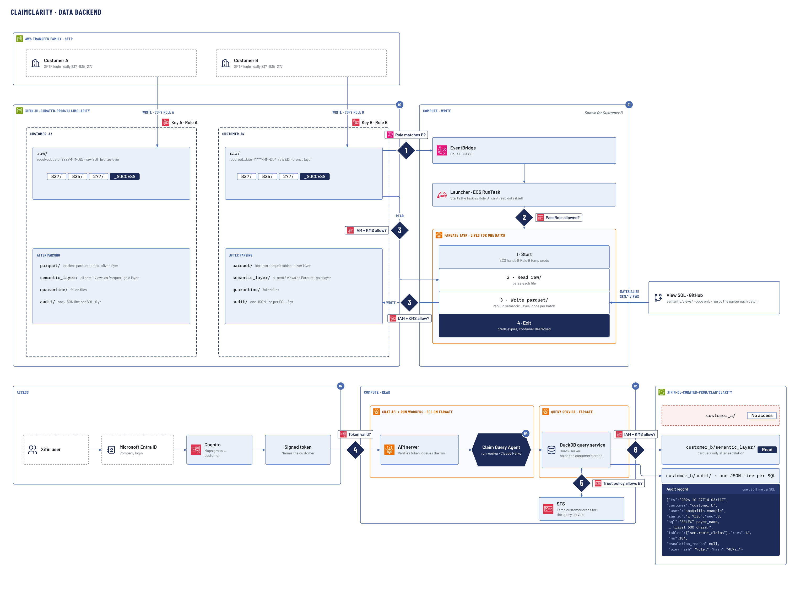
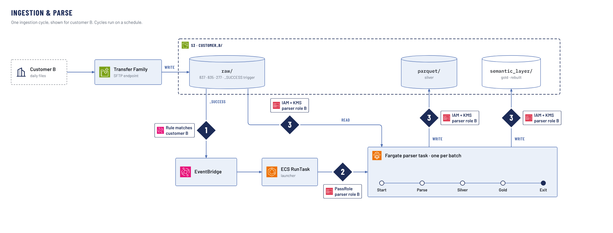
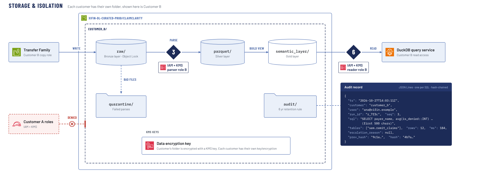
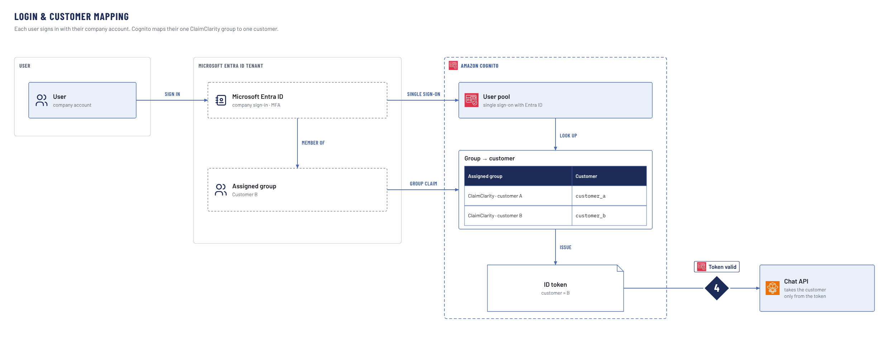
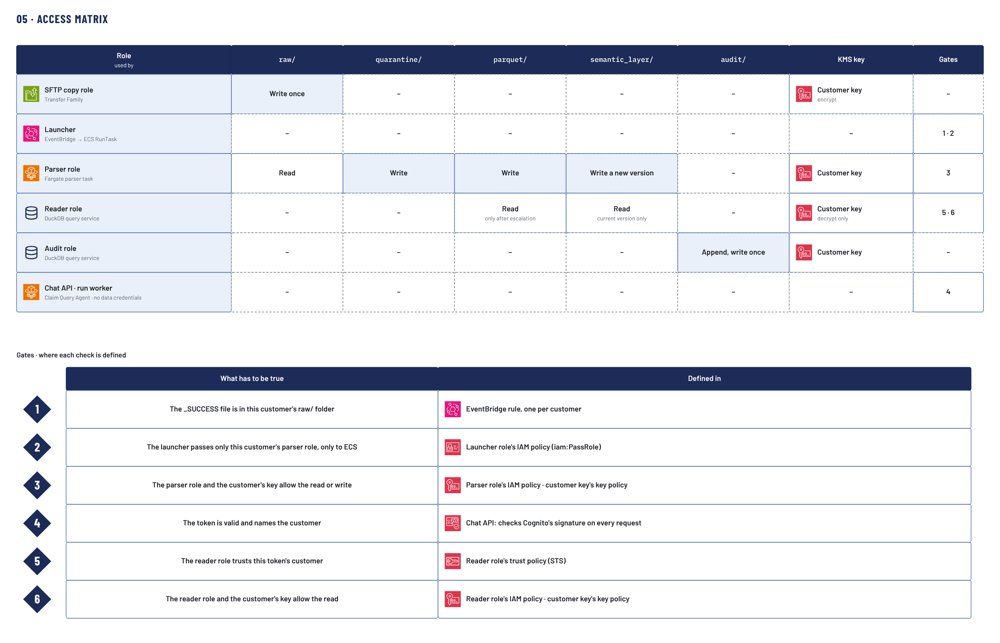

# ClaimClarity · Data backend architecture

| Field | Value |
|---|---|
| Owner | _TODO: name / team_ |
| Status | _TODO: Draft / In review / Approved_ |
| Last reviewed | _TODO: YYYY-MM-DD_ |
| Reviewers | _TODO: security, data platform, app team_ |
| Diagram source | _TODO: link to canvas / draw.io source_ |
| Related pages | _TODO: link to "ClaimClarity · Frontend & UI states" page_ · _TODO: ADRs_ · _TODO: runbooks_ |

> **Note:** Diagram images in this page are exports of the architecture canvas. Filenames are stable (`images/<slug>.png`); replace the files in place when the diagrams change.

## Contents

_TODO: insert Confluence Table of Contents macro here (levels 2–3)._

---

## 1. Purpose and audience

This page explains how customer claim data moves through the ClaimClarity backend and how each customer's data is kept isolated.

- **Purpose:** _TODO: what decisions / reviews this page supports (security review, onboarding, audit evidence)._
- **Audience:** _TODO: engineers, security reviewers, data platform, support._
- **In scope:** _TODO: SFTP intake, S3 storage layout, parser, sign-in and customer mapping, query path, analyzer, IAM / KMS gates, audit._
- **Out of scope:** _TODO: frontend / UI states (see the frontend page), cost, ops runbooks._

## 2. Overview

The whole data backend on one board, shown for Customer B, with the six AWS gates and links to drill-downs 00–04.



_TODO: caption — "Overview board, shown for Customer B."_

### 2.1 How to read the diagrams

_TODO: explain the legend — lanes (Compute · Write, Access, Compute · Read), numbered gate badges 1–6, write vs read arrows, "shown for Customer B" convention, drill-down numbers 00–05._

### 2.2 Main components at a glance

| Component | Runs on | Role in the system |
|---|---|---|
| AWS Transfer Family (SFTP) | _TODO_ | _TODO_ |
| Data bucket `xifin-dl-curated-prod/claimclarity` | S3 | _TODO_ |
| EventBridge rule + launcher (ECS RunTask) | _TODO_ | _TODO_ |
| Fargate parser task | ECS on Fargate | _TODO_ |
| View SQL (`semantic/views/`, GitHub) | _TODO_ | _TODO_ |
| Microsoft Entra ID | _TODO_ | _TODO_ |
| Amazon Cognito | _TODO_ | _TODO_ |
| Chat API + run workers | ECS on Fargate | _TODO_ |
| Claim Query Agent (Claude Haiku) | Run worker | _TODO_ |
| DuckDB query service (Quack server) | Fargate | _TODO_ |
| AWS STS | _TODO_ | _TODO_ |
| KMS keys (one per customer) | KMS | _TODO_ |

### 2.3 End-to-end story

1. _TODO: customer drops daily 837 / 835 / 277 files over SFTP into `raw/` (→ section 3)._
2. _TODO: data at rest per customer prefix, layers and keys (→ section 4)._
3. _TODO: Xifin user signs in; token names one customer (→ section 5)._
4. _TODO: question goes to the analyzer / Claim Query Agent (→ section 7)._
5. _TODO: SQL runs in the DuckDB query service with one customer's temp creds (→ section 6)._
6. _TODO: every SQL is written to the customer's `audit/` (→ section 10)._

> **Note:** Sections follow the data story (intake → storage → login → query → analyzer → access matrix), not the diagram numbering.

---

## 3. Ingestion & parse (01)

One ingestion cycle for Customer B: files arrive over SFTP into `raw/`, the `_SUCCESS` marker triggers one Fargate parser task that writes silver and publishes a new gold version.



_TODO: caption — "01 · Ingestion & parse, one cycle for Customer B."_

### 3.1 What it shows

_TODO: describe the scope of one ingestion cycle and the schedule it runs on._

### 3.2 Components

- **Customer B (daily files):** _TODO: file types 837 / 835 / 277, cadence, SFTP login._
- **Transfer Family SFTP endpoint:** _TODO: per-customer login, SFTP copy role, write-once into `raw/`._
- **`raw/` (bronze):** _TODO: `received_date=YYYY-MM-DD/` partitioning, `837/ 835/ 277/` subfolders, `_SUCCESS` marker._
- **EventBridge rule:** _TODO: one rule per customer, matches `_SUCCESS`._
- **Launcher (ECS RunTask):** _TODO: starts the task as parser role B; cannot read data itself._
- **Fargate parser task:** _TODO: one task per batch, lifetime, image, sizing._
- **`parquet/` (silver) and `semantic_layer/` (gold):** _TODO: outputs; see section 4._

### 3.3 Flow / steps

1. **Start:** _TODO: ECS hands the task parser role B temp creds._
2. **Parse:** _TODO: read each file in `raw/`, parse EDI._
3. **Silver:** _TODO: write lossless parquet tables to `parquet/`; failed files to `quarantine/`._
4. **Gold:** _TODO: run the `sem.*` view SQL from `semantic/views/` and publish a new `semantic_layer/` version once per batch._
5. **Exit:** _TODO: creds expire, container destroyed._

### 3.4 Security gates

| Gate | Check | Where it applies |
|---|---|---|
| 1 | Rule matches customer B? | _TODO: EventBridge rule_ |
| 2 | PassRole allowed for parser role B? | _TODO: launcher IAM policy_ |
| 3 | IAM + KMS allow parser role B? | _TODO: each read of `raw/` and write to `parquet/` / `semantic_layer/`_ |

### 3.5 Failure handling

_TODO: what happens on parse failure (`quarantine/`), missing `_SUCCESS`, partial batches, retries, alerting._

### 3.6 Open questions

- _TODO_

---

## 4. Storage & isolation (00)

Customer B's prefixes in the single ClaimClarity data bucket, the roles and KMS keys that guard them, and Customer A's roles being denied.



_TODO: caption — "00 · Storage & isolation, Customer B's folder."_

### 4.1 What it shows

_TODO: one bucket, one folder per customer, one KMS key per customer._

### 4.2 Bucket and prefix layout

| Prefix | Layer | Contents | Written by | Read by | Retention / protection |
|---|---|---|---|---|---|
| `customer_b/raw/` | Bronze | _TODO: raw EDI_ | _TODO_ | _TODO_ | _TODO: Object Lock_ |
| `customer_b/quarantine/` | — | _TODO: failed parses_ | _TODO_ | _TODO_ | _TODO_ |
| `customer_b/parquet/` | Silver | _TODO: lossless parquet tables_ | _TODO_ | _TODO: only after escalation_ | _TODO_ |
| `customer_b/semantic_layer/` | Gold | _TODO: all `sem.*` views as Parquet, versioned_ | _TODO_ | _TODO_ | _TODO_ |
| `customer_b/audit/` | — | _TODO: one JSON line per SQL, hash-chained_ | _TODO_ | _TODO_ | _TODO: 6-year retention rule_ |

### 4.3 Encryption keys

_TODO: one KMS key per customer; key policy; who can encrypt vs decrypt; rotation._

### 4.4 Roles per customer

- **Customer B copy role (Transfer Family):** _TODO_
- **Parser role B:** _TODO_
- **Reader role B (DuckDB query service):** _TODO_
- **Audit role:** _TODO_

### 4.5 Isolation between customers

_TODO: why Customer A's roles are denied on `customer_b/` (IAM + KMS), and what an accidental cross-customer request looks like._

### 4.6 Security gates

| Gate | Check | Role |
|---|---|---|
| 3 | IAM + KMS allow? | Parser role B |
| 6 | IAM + KMS allow? | Reader role B |

### 4.7 Open questions

- _TODO_

---

## 5. Login & customer mapping (02)

Each user signs in with their company account at Microsoft Entra ID; Cognito maps their one ClaimClarity group to exactly one customer and issues a token naming that customer.



_TODO: caption — "02 · Login & customer mapping."_

### 5.1 What it shows

_TODO: describe sign-in from the user's company account to a token the Chat API trusts._

### 5.2 Components

- **User (company account):** _TODO_
- **Microsoft Entra ID tenant:** _TODO: company sign-in, MFA, assigned groups._
- **Amazon Cognito user pool:** _TODO: SSO with Entra ID, group → customer lookup table._
- **Chat API:** _TODO: takes the customer only from the token._

### 5.3 Flow / steps

1. **Sign in:** _TODO_
2. **Member of:** _TODO: user's one assigned ClaimClarity group._
3. **Single sign-on:** _TODO: Entra ID → Cognito._
4. **Group claim:** _TODO_
5. **Look up:** _TODO: group → customer mapping._
6. **Issue:** _TODO: ID token with `customer = B`._

### 5.4 Group → customer mapping

| Entra ID group | Customer |
|---|---|
| ClaimClarity · customer A | `customer_a` |
| ClaimClarity · customer B | `customer_b` |

_TODO: who owns this mapping, how a new customer is added, what happens with zero or multiple groups._

### 5.5 Security gates

| Gate | Check | Defined in |
|---|---|---|
| 4 | Token valid and names the customer? | _TODO: Chat API, Cognito signature check on every request_ |

### 5.6 Open questions

- _TODO_

---

## 6. Query path (03)

The run worker sends SQL over Quack to the DuckDB query service, which alone exchanges the token at STS for customer B's 15-minute credentials and reads only customer B's data.


_TODO: caption — "03 · Query path, Customer B."_

### 6.1 What it shows

_TODO: only the DuckDB query service touches data, with temp credentials for one customer._

### 6.2 Components

- **Run worker (Fargate):** _TODO: hosts the Claim Query Agent, cli.py, SQL guard; holds no data credentials._
- **DuckDB query service (Fargate):** _TODO: Quack server, holds the customer's temp creds._
- **AWS STS:** _TODO: token exchange for reader role B._
- **`customer_b/semantic_layer/` (gold) and `lossless.*` (silver parquet):** _TODO_

### 6.3 Flow / steps

1. **SQL:** _TODO: run worker → Quack server._
2. **Token:** _TODO: query service presents the user's token to STS._
3. **Temp credentials:** _TODO: 15-minute creds for reader role B._
4. **Read-only:** _TODO: read gold views; silver `lossless.*` only after escalation._
5. **Rows:** _TODO: results streamed back to the run worker._

### 6.4 Security gates

| Gate | Check | Defined in |
|---|---|---|
| 5 | Trust policy allows this token's customer? | _TODO: reader role trust policy (STS)_ |
| 6 | IAM + KMS allow reader role B? | _TODO: reader role IAM policy, customer key policy_ |

### 6.5 Cross-customer denial

_TODO: describe how a request for `customer_a/` is denied by IAM + KMS even if SQL asked for it._

### 6.6 Open questions

- _TODO_

---

## 7. Analyzer (04)

The KPI gate answers with a preset query or hands the question to the Claim Query Agent, which writes SQL through cli.py and the SQL guard; the query then continues on the query path (section 6).


_TODO: caption — "04 · Analyzer."_

### 7.1 What it shows

_TODO: how a user question becomes validated SQL and an answer._

### 7.2 KPI gate

_TODO: "does a preset answer it?" — yes: preset fixed SQL with parameters filled in by the agent; no: hand to the agent._

### 7.3 Claim Query Agent

_TODO: one agent, Claude Haiku, Strands on Amazon Bedrock; runs as the run worker on Fargate; inputs = system prompt + conversation history (prompt cached) + newest user prompt._

### 7.4 References (prompt cached)

- **Preset KPI queries:** _TODO_
- **Solved examples / question bank:** _TODO: K = 3 most similar question + SQL + answer._
- **Tool & CLI reference:** _TODO_
- **Rules from past mistakes:** _TODO_
- **EDI business glossary:** _TODO_
- **Semantic layer schema + allowed values:** _TODO_
- **Full lossless EDI schema:** _TODO: only after the agent escalates with a logged reason._

### 7.5 cli.py · ClaimClarity CLI

| Command | Purpose |
|---|---|
| `sql "SELECT …"` | _TODO_ |
| `lookup <dimension> <text>` | _TODO_ |
| `describe <relation>` | _TODO_ |
| `list` | _TODO_ |
| `escalate "<reason>"` | _TODO_ |
| `answer --sql … --text …` | _TODO: final query re-run by the server_ |
| `ask` · `refuse` | _TODO_ |

### 7.6 SQL guard checks

1. **Read-only SELECT, one statement:** _TODO_
2. **Allowed tables + functions:** _TODO: `sem.*`; `lossless.*` only after escalate._
3. **Valid against the schema:** _TODO: would it fail? stop it here._
4. **Join cost:** _TODO: no keyless joins over 100 M row pairs._

_TODO: on failure, the error goes back to the agent; on pass, continue to section 6._

### 7.7 Iterative querying and answer

_TODO: iterative querying and result streaming; final query + answer re-run by the server._

### 7.8 Open questions

- _TODO_

---

## 8. Access matrix (05)

What each role can do in each customer prefix, the key it uses and the gates that guard it, plus where each of the six gates is defined.



_TODO: caption — "05 · Access matrix."_

### 8.1 Roles × prefixes

| Role | Used by | raw/ | quarantine/ | parquet/ | semantic_layer/ | audit/ | KMS key | Gates |
|---|---|---|---|---|---|---|---|---|
| SFTP copy role | Transfer Family | _TODO_ | | | | | _TODO_ | |
| Launcher | EventBridge → ECS RunTask | | | | | | | _TODO_ |
| Parser role | Fargate parser task | _TODO_ | _TODO_ | _TODO_ | _TODO_ | | _TODO_ | _TODO_ |
| Reader role | DuckDB query service | | | _TODO_ | _TODO_ | | _TODO_ | _TODO_ |
| Audit role | DuckDB query service | | | | | _TODO_ | _TODO_ | |
| Chat API · run worker | Claim Query Agent | | | | | | _TODO: none_ | _TODO_ |

_TODO: fill from the diagram; keep in sync with the PNG._

### 8.2 Gates · where each check is defined

See section 9 for the consolidated gate table.

### 8.3 Open questions

- _TODO_

---

## 9. Security & isolation model

Customer isolation rests on six gates; each must pass for a request to touch one customer's data.

| # | What has to be true | Defined in | Diagram(s) |
|---|---|---|---|
| 1 | _TODO: `_SUCCESS` is in this customer's `raw/`_ | _TODO: EventBridge rule, one per customer_ | 01, main |
| 2 | _TODO: launcher passes only this customer's parser role, only to ECS_ | _TODO: launcher IAM policy (`iam:PassRole`)_ | 01, main |
| 3 | _TODO: parser role + customer key allow the read/write_ | _TODO: parser role IAM policy, key policy_ | 00, 01, main |
| 4 | _TODO: token is valid and names the customer_ | _TODO: Chat API Cognito signature check_ | 02, main |
| 5 | _TODO: reader role trusts this token's customer_ | _TODO: reader role trust policy (STS)_ | 03, main |
| 6 | _TODO: reader role + customer key allow the read_ | _TODO: reader role IAM policy, key policy_ | 00, 03, main |

### 9.1 Write side (gates 1–3)

_TODO: summarise how ingestion is confined to one customer._

### 9.2 Read side (gates 4–6)

_TODO: summarise how queries are confined to one customer; the agent holds no data credentials._

### 9.3 Defence in depth beyond the gates

_TODO: SQL guard, escalation logging, Object Lock on `raw/`, short-lived credentials, per-customer KMS keys._

### 9.4 Threats considered

_TODO: link or list threat-model items (prompt injection, cross-customer SQL, stolen token, misrouted file)._

## 10. Audit

Every SQL statement is recorded as one hash-chained JSON line in the customer's `audit/` prefix.

### 10.1 Audit record format

```json
{
  "ts": "2026-10-27T14:03:11Z",
  "customer": "customer_b",
  "user": "ana@xifin.example",
  "run_id": "r_7f3c", "seq": 3,
  "sql": "SELECT payer_name, … (first 500 chars)",
  "tables": ["sem.remit_claims"], "rows": 12, "ms": 184,
  "escalation_reason": null,
  "prev_hash": "9c1e…", "hash": "4b7a…"
}
```

_TODO: field definitions, hash-chain verification._

### 10.2 Writer, retention and access

_TODO: audit role (append, write once), 6-year retention rule, who can read audit logs._

### 10.3 Open questions

- _TODO_

## 11. Glossary

| Term | Meaning |
|---|---|
| 837 / 835 / 277 | _TODO: EDI claim / remittance / claim status transactions_ |
| Bronze / silver / gold | _TODO: `raw/` / `parquet/` / `semantic_layer/`_ |
| `sem.*` | _TODO_ |
| `lossless.*` | _TODO_ |
| `_SUCCESS` | _TODO_ |
| Escalation | _TODO_ |
| KPI gate | _TODO_ |
| Quack | _TODO_ |
| Run worker | _TODO_ |
| _TODO: more_ | |

## 12. Decision log / ADRs

| Decision | Status | Link |
|---|---|---|
| _TODO: one bucket with per-customer prefixes and KMS keys_ | _TODO_ | _TODO_ |
| _TODO: only the DuckDB query service holds data credentials_ | _TODO_ | _TODO_ |
| _TODO: one Fargate parser task per batch_ | _TODO_ | _TODO_ |
| _TODO: Entra ID → Cognito group-to-customer mapping_ | _TODO_ | _TODO_ |
| _TODO: single agent on Claude Haiku with one CLI tool_ | _TODO_ | _TODO_ |

## 13. Open questions

| # | Question | Owner | Status |
|---|---|---|---|
| 1 | _TODO_ | _TODO_ | _TODO_ |

## 14. Change history

_TODO: version, date, author, summary of change; note when diagram PNGs are replaced._
