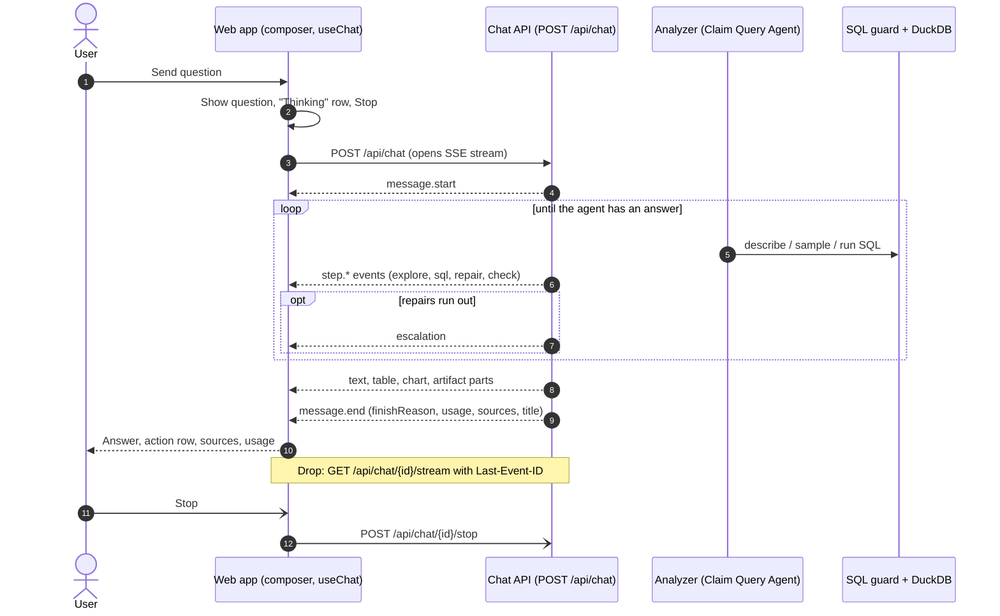
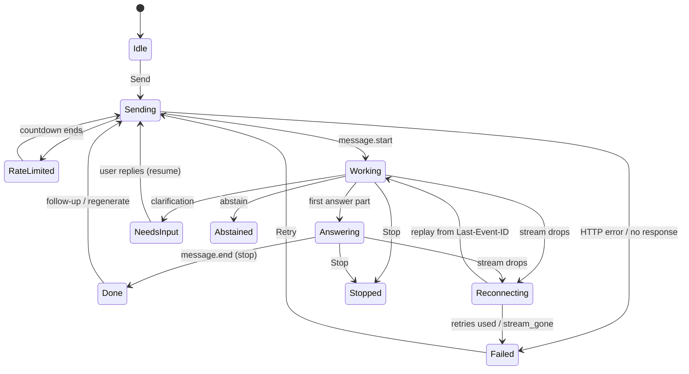

# ClaimClarity · Frontend ↔ backend interaction

**Related:** [ClaimClarity · Data backend architecture](claimclarity-backend-architecture.md) · API contract: `api/CONTRACT.md` (contract **1.24.0**) · Frontend code: `web/` (React + TypeScript + Vite)

> **Note:** Screenshots come from a **local** run of `web/` against the `api/` demo backend (scripted model, synthetic data), or the offline mock adapter where marked. Images named `*-annotated.png` have numbered red callouts; the legend sits under each one. Replace the files in place with captures from the deployed app when you can.

---

## 1. Diagram: how a question flows



## 2. Summary

The user types a question in the composer. The web app posts it to `POST /api/chat` and reads the reply as a Server-Sent Events (SSE) stream. On the server, the analyzer explores the semantic views, runs SQL through the guard, repairs failed queries and checks the result. Each of those steps is sent as a stream event. The web app feeds every event through one reducer (`reduceV1`) and renders it at once: live steps first, then the answer text, tables, charts and artifacts. `message.end` closes the turn and carries the outcome, usage and sources.

The same reducer replays stored steps when a saved chat is opened, so a reloaded answer looks like a live one.

## 3. Turn state machine



"Working" covers the thinking row and the live steps. Clarify, abstain, stop and error all end with `message.end`; only the `finishReason` differs.

## 4. Stream events and what the user sees

| Event | What the user sees |
|---|---|
| `message.start` | The turn gets its server id. Stop now also calls `/stop`. |
| `status` | A short status line (also used for transport states like the 429 countdown). |
| `step.explore` | A step such as "Looked at sem.claims" or "Read schema". |
| `step.sql_running` | A running step "Running query" and a table skeleton. |
| `step.sql_result` | The step turns ✓ ("7 rows · 8ms") or ✕ with the error. |
| `step.repair_attempt` | "Repairing the query", then "Repaired the query". |
| `step.check` | "Verified the result", with ⚠ on a warning. |
| `step.candidates` | "Compared 3 candidates". |
| `escalation` | "Handed off to Sonnet" step and a note under the timeline. |
| `reasoning.delta` / `reasoning.end` | Folded into the one "Thought for N s" row. |
| `text.start` / `text.delta` / `text.end` | Answer prose streams in with a caret. |
| `table.start` / `table.rows` | Table header first, then rows fill in. |
| `chart.start` / `chart.points` | Chart draws from the first points. |
| `part` / `part.patch` | A complete part (code, table, chart, callout, file, artifact, clarification, abstain, error) is added or replaced. |
| `message.end` | Action row, Sources chip, usage line, and the chat title in the sidebar. |
| `heartbeat` | Nothing visible. Keeps the 45 s idle guard from firing. |

Unknown events are ignored. Unknown part types show as "Unsupported content".

**finishReason values:** `stop` (answer), `needs_input` (clarify), `abstain`, `error`, `aborted` (stopped).

## 5. API contract basics

### 5.1 Endpoints used by a turn

| Method and path | Used for |
|---|---|
| `POST /api/chat` | Ask, follow-up, edit, regenerate, clarify reply. Returns the SSE stream. |
| `GET /api/chat/{messageId}/stream` | Re-attach after a drop (with `Last-Event-ID`). |
| `POST /api/chat/{messageId}/stop` | Stop a running turn. |
| `GET /api/download/{id}` | Full CSV or file behind a table preview (15 min, tied to the user). |
| `GET /api/conversations/{id}` | Open a saved chat; stored steps are replayed. |
| `GET /api/capabilities` | Server feature flags, read once per session. |

Auth: cookie session plus `x-cc-csrf: 1` on writes. Demo builds send a demo bearer token (`demo:customer:user`).

### 5.2 Request shape

```json
{
  "conversationId": "c_…",
  "messages": [{ "id": "u_…", "role": "user", "text": "…", "parentId": "…", "editOf": "…" }],
  "resume": { "clarificationId": "…", "choiceIds": ["c2"], "text": "…" },
  "regenerate": { "messageId": "m_…", "style": "default | concise | detailed" }
}
```

The request never chooses the model, strategy or data scope. Fields like `options.model`, `customer` or `tables` get a 422. Data scope comes from the signed-in identity only.

### 5.3 Stream framing, reconnect and stop

- Each event is one SSE frame: `id: messageId:seq` and `data:` with one JSON event. `seq` starts at 0 and has no gaps.
- The server sends a `heartbeat` (no id) after 15 s of silence. The client gives up after 45 s with no data.
- **Reconnect:** on a drop before `message.end`, the client calls `GET /api/chat/{messageId}/stream` with `Last-Event-ID`. It retries after 250 ms, 1 s, 2 s and 4 s. The server replays only the missed events and keeps the replay for 60 s after the run ends.
- **Disconnect is not cancel:** the server keeps the run going for 10 s after the last client drops, so a quick reconnect continues the same run.
- **Stop:** `POST /api/chat/{messageId}/stop`. The server interrupts the running query, closes every open step, and sends `message.end` with `finishReason: aborted` within 1 s.

---

## 6. Key features

### 6.1 Sending and thinking


| # | What it is |
|---|---|
| 1 | The question, added at once. |
| 2 | Thinking row, shown before `message.start` arrives. |
| 3 | Stop button. |
| 4 | New chat in the sidebar. |

As soon as the user sends, the question appears with a collapsed "Thinking" row and a Stop button. The row shows before the server answers, so the user sees a response with no delay. The same row later holds the steps, so nothing jumps.

**Notes / TODO**
- The row is client-side only until `message.start`; Stop before that just aborts the fetch.

### 6.2 Live agent steps and thinking


| # | What it is |
|---|---|
| 1 | Live header: the current step's label. |
| 2 | Running step; it turns ✓ or ✕ in place. |
| 3 | Escalation note. |
| 4 | Table skeleton while the query runs. |
| 5 | Stop. |

While the agent works, one muted line names the current step. Expanding it shows each `step.*` event as a row: probes, queries, repairs and checks. After the answer, the row collapses to "Thought for N s · Ran 2 queries, 1 check", and each step can be opened to see its SQL and timings.

**Notes / TODO**
- Real backends send only short reasoning summaries; they are folded into this row.
- _TODO: confirm the KPI gate path shows sensible step labels on the deployed build (not checked in a browser yet)._

### 6.3 Streamed answer


| # | What it is |
|---|---|
| 1 | Caret on the streaming text. |
| 2 | Timeline collapsed to "Thought for N s · Ran …". |

The answer text streams in below the steps from `text.delta` events. Text is paced over frames, so it flows even when it arrives in one chunk. Markdown is rendered as it streams, with unfinished syntax repaired.

**Notes / TODO**
- **Math crashes the app (open).** See section 7, item 1. Do not rely on `$…$` in answers until this is fixed.
- No raw HTML is rendered; remote images become alt text.

### 6.4 Tables


| # | What it is |
|---|---|
| 1 | Chat title from `message.end.conversationTitle`. |
| 4 | Collapsed steps row. |
| 5 | Answer prose. |
| 6 | Result table with provenance footer. |
| 7 | View SQL for this table. |
| 8 | Chart. |

A table part shows up to 50 preview rows, with a footer like "from sem.claims · Showing 7 of 7 rows · 1.83 s". Columns sort on click. Download CSV uses the server's full file (`GET /api/download/{id}`) when there is one. PHI columns are masked (`•••• 56`) and left out of copy and CSV.

**Notes / TODO**
- Tables stream: header on `table.start`, rows on `table.rows`. A partial table is dropped if the turn is stopped.
- The chat title is built server-side from column names, never from the question.

### 6.5 Charts


| # | What it is |
|---|---|
| 1 | Download PNG / SVG / CSV. |
| 3 | Expand into the artifact panel. |
| 4 | The plot. |

Charts are Vega-Lite specs with inline data only; the client strips any data URL. They can draw progressively from `chart.start` and `chart.points`. Hovering shows a toolbar; clicking a point offers "Ask about …" as a follow-up.

**Notes / TODO**
- If the chart code fails to load, the frame shows the raw module URL. Other surfaces hide raw errors. _TODO: decide if this is acceptable._

### 6.6 Artifact panel


| # | What it is |
|---|---|
| 1 | Resize handle. |
| 2 | Tabs (Table / SQL, Chart / Spec / Data, Code, Report). |
| 3 | Copy. |
| 4 | Download. |
| 5 | Full screen. |
| 6 | Close. |
| 7 | Body, with "Filter rows" for tables. |

Tables, charts, code and reports can open in a panel on the right. An `artifact` part shows as a card in the answer; clicking it opens the panel. On a phone the panel is a full-screen sheet.

**Notes / TODO**
- The panel is a read-only view of what the backend sent.
- _TODO: document artifact versions and the auto-open rules._

### 6.7 SQL, sources and usage


| # | What it is |
|---|---|
| 1 | Assumption callout ("Change" edits the assumption). |
| 2 | Sources chip. |
| 4–5 | Thumbs up / down (sent to the feedback endpoint). |
| 6–7 | Regenerate and answer style. |
| 9 | Usage line: "SQL · 2 queries · 2s · cost". Opens the SQL inspector and details. |

After `message.end`, each answer shows what it used. The Sources chip lists the views consulted (from `message.end.sources`). The usage line comes from `message.end.usage`: queries, time, tokens and cost. Each table also has a "View SQL" disclosure with the query that made it.

**Notes / TODO**
- Shown SQL may have literals masked as `?` (`Capabilities.sqlLiteralMasking`).
- The cost is an estimate when `costIsEstimate` is set.

### 6.8 Clarify


| # | What it is |
|---|---|
| 1 | The clarifying question. |
| 2 | Choice chip. |
| 3 | Composer, placeholder "Reply…". |

When the question is ambiguous, the agent asks before running anything. The turn ends with `finishReason: needs_input` and a clarification part. A chip or free text sends `resume` on the next `POST /api/chat`, and the run continues.

**Notes / TODO**
- Up to four questions can come as one form (contract 1.23.0).
- An old clarification gets 409 `clarification_expired`; the UI says "Ask again".

### 6.9 Abstain


| # | What it is |
|---|---|
| 1 | Reason. |
| 2 | What would be needed. |
| 3 | "Try asking" suggestions. |

When the agent can't answer reliably (data not available, forecasts, unsupported questions), it abstains. The turn ends with `finishReason: abstain` and a card with the reason and suggested questions. Requests for patient identifiers are refused in a similar card.

**Notes / TODO**
- _TODO: confirm whether the PHI refusal is sent as `abstain` or `stop`._

### 6.10 Escalation


When the small model runs out of repairs or fails a check, the run moves to a larger model. The `escalation` event shows as a "Handed off to …" step with a note under the timeline. The answer then continues as normal, and the usage details list both models.

**Notes / TODO**
- Triggers: `verifier_fail`, `low_confidence`, `repair_exhausted`, `complexity`, `disagreement`, `user`.
- An escalation can still end in abstain.

### 6.11 Guard rejection


| # | What it is |
|---|---|
| 1 | Header "Ran 1 query · 1 failed". |
| 2 | Failed step: "Blocked by guard: only sem.* views are allowed." |
| 3 | Error part `access_denied` with Details. |
| 4 | Retry. |

The SQL guard allows only read-only queries on `sem.*` views. It blocks anything else before DuckDB runs. Here the user sees a failed step and an "Access denied" error.

**Notes / TODO**
- This capture is the **mock** fixture. On the real analyzer a `guard_blocked` result goes back to the model and is usually repaired without the user seeing an error.
- _TODO: decide what the user should see when the guard blocks every attempt, and capture it from the deployed app._

### 6.12 Stop


| # | What it is |
|---|---|
| 1 | Header counts the stopped step. |
| 2 | "Stopped" note. |
| 3 | Action row on what did arrive. |

Stop aborts the stream and calls `POST /api/chat/{messageId}/stop`. The server closes every open step and ends the turn with `finishReason: aborted` within 1 s. Steps and text that already arrived stay; partial tables are dropped.

**Notes / TODO**
- The contract asks clients to show "Stopping…" until `message.end`. It was not seen locally because the stop landed within one frame. _TODO: check on the deployed app._
- Retry shows only when nothing came back.

### 6.13 Follow-up and regenerate


| # | What it is |
|---|---|
| 1 | Answer versions `‹ 2/2 ›`. |

A follow-up is a new `POST /api/chat` in the same conversation. Regenerate sends `regenerate {messageId, style}`; the reply is stored as a sibling version of the answer. Editing a question sends `editOf` and also makes a new version.

**Notes / TODO**
- Styles: default, concise, detailed.
- Regenerate is offered on the last answer only.

### 6.14 HTTP errors


| # | What it is |
|---|---|
| 1 | Error line. |
| 2 | Retry. |
| 3 | Action row (Copy only on a failed turn). |

Errors before the stream starts show as one plain line in the answer column with a Retry when it makes sense. The title comes from the error `code`, falling back to the HTTP status. 5xx errors never show the server's message.

| Status | code | What the user sees | Retry |
|---|---|---|---|
| 400 / 422 | `validation` | Couldn't send that | no |
| 401 | `auth_expired` | Session expired (sends cookie users to sign-in) | no |
| 403 | `access_denied` | Not available | no |
| 409 | `clarification_expired` | Ask again | no |
| 413 | `payload_too_large` | Message too long (body limit 1 MiB) | no |
| 429 | `rate_limited` | Auto-retry first (6.15) | yes |
| 5xx | `internal` | Analyst unavailable | yes |
| no response | — | Can't reach the analyst | yes |

**Notes / TODO**
- The composer keeps the question, so Retry re-sends it.

### 6.15 Rate limit (429)


| # | What it is |
|---|---|
| 1 | Countdown status line. |
| 2 | Stop cancels the wait. |

The API allows 3 unfinished runs per user and returns 429 with `Retry-After` above that. The client shows a countdown and retries on its own, up to 2 times, waiting 30 s at most. If it still fails, the user gets the error line with Retry.

**Notes / TODO**
- Dev builds can force this with `?fault=429`.

### 6.16 Reconnect and connection lost


If the stream drops mid-answer, the turn stays alive and shows "Reconnecting…". The client re-attaches with `Last-Event-ID` and the answer continues from where it stopped. If all retries fail, or the server says `stream_gone` (the replay expired), the turn ends with "Connection lost" (`images/frontend/89-connection-lost.png`).

**Notes / TODO**
- If no data arrives for 45 s, the turn ends with "The analyst stopped responding" (retryable). _TODO: capture this._
- After `stream_gone`, the client reloads the chat from `GET /api/conversations/{id}`.

---

## 7. Open questions

1. **Math crashes the whole app (seen locally).** A text part with `$…$` or `$$…$$` threw "This document requires 'TrustedHTML' assignment" and the app-level error screen replaced the page (`images/frontend/97-app-crash-boundary.png`). KaTeX writes through `innerHTML`, but only Shiki and chart tooltips may create TrustedHTML (`web/src/security/trustedTypes.ts`). The same CSP applies in production (`web/src/security/headers.ts`). The math unit tests run in jsdom, which has no Trusted Types, so they miss it. _TODO: confirm on a production build; give math its own policy, or at least contain the failure to the one part._
2. **Guard rejection on the real analyzer.** The "Access denied" card is a mock fixture. _TODO: what should the user see when every attempt is blocked?_
3. **"Stopping…" state** between `/stop` and `message.end`. Not observed. _TODO._
4. **PHI refusal finishReason:** `abstain` or `stop`? _TODO._
5. **KPI gate step labels** not checked in a browser. _TODO._
6. **Chart load failure** shows a raw URL. _TODO._
7. _TODO: replace local screenshots with captures from the deployed app (real sign-in, data scope and model labels)._
