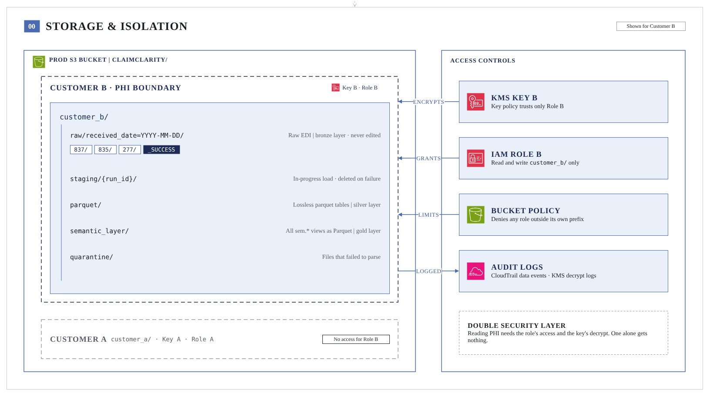
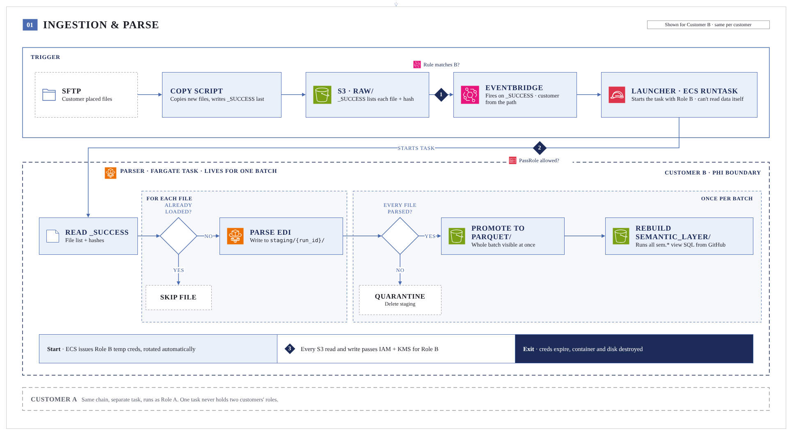
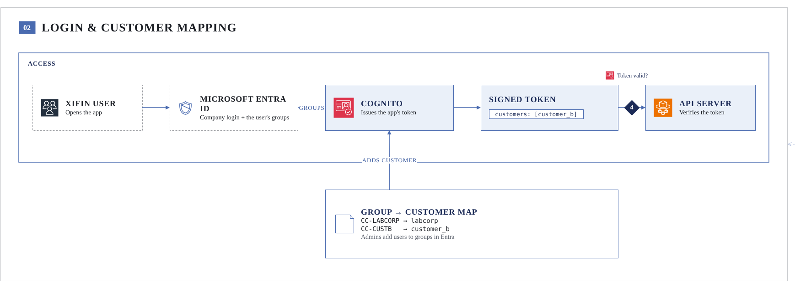
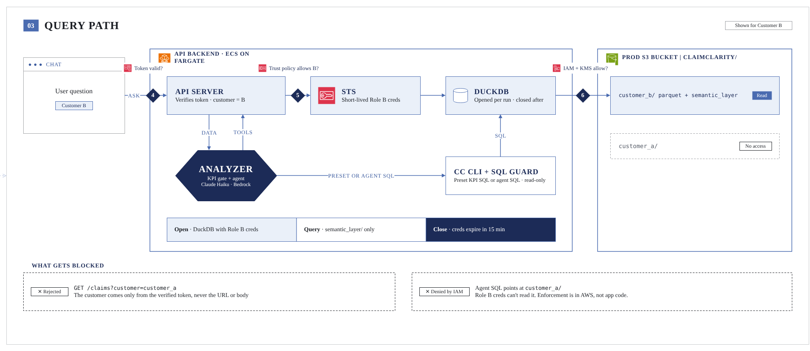
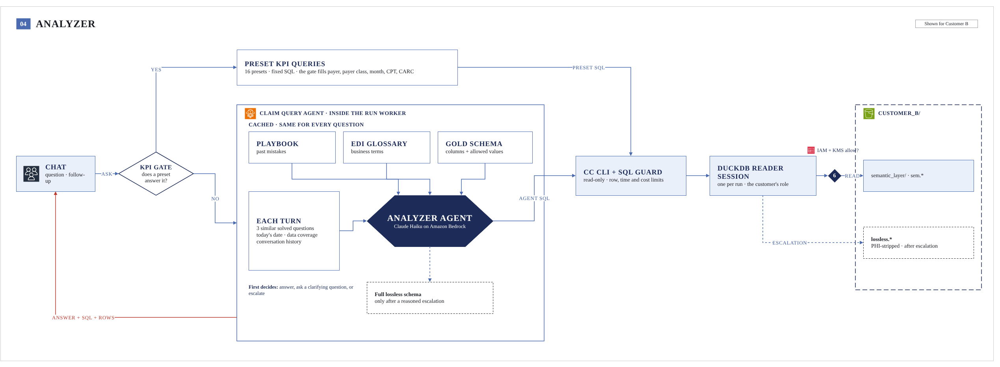
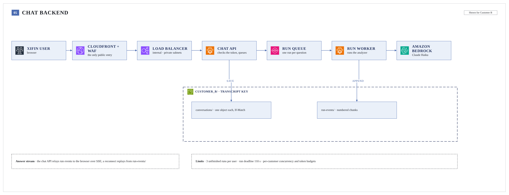
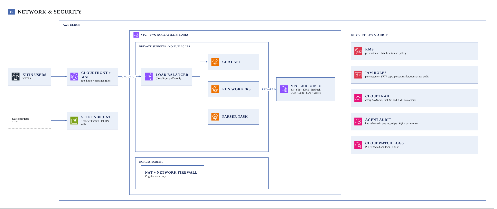
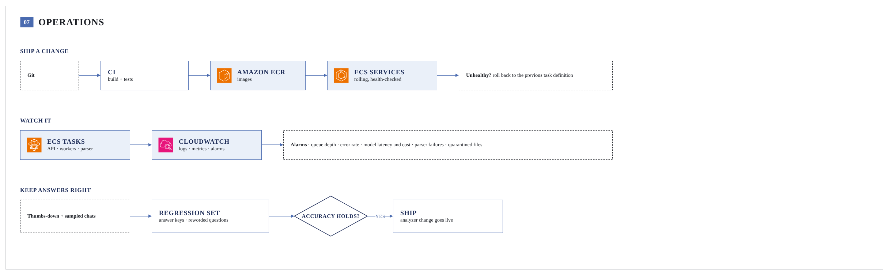

# ClaimClarity architecture

ClaimClarity answers questions about a clinical lab's claims (837P) and remittances (835). Each customer's data
sits in its own S3 prefix under its own KMS keys and IAM roles. Six AWS checks, the numbered diamonds, enforce that
on every write and read. The main board shows the whole system, and boards 00–07 zoom into each part.

## Data backend

| Part | What it does | Key facts |
|---|---|---|
| SFTP | Each lab sends daily 837 · 835 · 277 files | AWS Transfer Family, lab IP addresses only |
| ClaimClarity bucket | One prefix per customer: raw → silver → gold | One bucket for all customer data. Web app and access logs have their own buckets. |
| Compute · write | EventBridge → ECS RunTask → one Fargate parser task per batch | Runs as the customer's parser role. Gates 1–3. |
| Access | Entra ID → Cognito → signed token naming the customer | The token is the only source of the customer |
| Compute · read | API server → STS → DuckDB reader session → analyzer | 15-minute credentials, this customer's gold only. Gates 4–6. |

## 00 · Storage & isolation

| Part | Key facts |
|---|---|
| `raw/` | Write-once (Object Lock, 7 years). Never edited. |
| `parquet/` (silver) · `semantic_layer/` (gold) | Lossless tables, then the curated `sem.*` tables the chat reads |
| `staging/` · `quarantine/` | The batch lease, and files that failed to parse (kept 1 year) |
| KMS keys | Per customer: a lake key and a transcript key. The key policy trusts only that customer's roles. |
| IAM roles | Per customer: SFTP copy, parser, reader, transcripts, audit |
| Bucket policy | Denies any role outside its own prefix, and any request without TLS |
| Audit | CloudTrail data events for every S3 and KMS call |

## 01 · Ingestion & parse

| Step | What happens | Check |
|---|---|---|
| Copy | Files go into `raw/received_date=…/`, then `_SUCCESS` is written last | Create-only, customer's lake key |
| Trigger | `_SUCCESS` fires the customer's EventBridge rule | Gate 1 |
| Launch | ECS RunTask starts the parser task as the customer's role | Gate 2 (PassRole). 3 attempts, then a dead-letter queue. |
| Parse | Each file is parsed. Bad files go to `quarantine/`. | Gate 3 (IAM + KMS) on every read and write |
| Publish | The whole batch becomes visible at once. Gold is rebuilt and the `CURRENT` version is swapped. | Old versions stay readable for open sessions |
| Exit | The task stops | Task size 4–8 GB memory |

## 02 · Login & customer mapping

| Part | Key facts |
|---|---|
| Microsoft Entra ID | Company sign-in. The ClaimClarity app is assigned to groups. |
| Group → customer map | One Entra group maps to exactly one customer |
| Amazon Cognito | Federates Entra and issues an ID token naming the customer, valid 60 minutes |
| Session | The token sits in an httpOnly, Secure, SameSite=Strict cookie. The refresh token never reaches the browser. |
| API server | Verifies the signature, audience, expiry and customer claim (gate 4) |

## 03 · Query path

| Part | Key facts |
|---|---|
| API server | Takes the customer only from the verified token, never from the URL or body |
| STS | Exchanges the token for 15-minute credentials of the customer's reader role (gate 5). Renewed in long chats. |
| DuckDB | Opened per run, read-only, closed after the run |
| cc CLI + SQL guard | Every query passes it: preset or agent SQL |
| Customer's gold | IAM and KMS allow this customer's current gold version only (gate 6). Another customer's prefix is denied by AWS. |

## 04 · Analyzer

| Part | Key facts |
|---|---|
| KPI gate | One model call. If a preset KPI query fits, it fills the parameters (payer, payer class, month, CPT, CARC). The values are checked against the data. |
| Preset KPI queries | 16 fixed, reviewed SQL queries |
| Claim Query Agent | Strands agent on Claude Haiku in Amazon Bedrock, inside the run worker |
| Cached prompt | Playbook, EDI glossary, gold schema with allowed values: the same for every question |
| Each turn | 3 similar solved questions, today's date, data coverage, conversation history |
| First decision | Answer, ask a clarifying question, or escalate to the lossless tables. Escalation needs a reason, which is logged and shown to the user. |
| SQL guard | Read-only SELECT. 25 s per query, 60 s per question, 1,000 rows. Joins over 100 million row pairs are refused. |
| Answer | The server re-runs the final SQL, so the numbers come from the database |

## 05 · Chat backend

| Part | Key facts |
|---|---|
| CloudFront + WAF | The only public web entry. Rate limits and managed rules. Serves the web app from its own bucket. |
| Load balancer | Internal. Accepts CloudFront traffic only. |
| Chat API (Fargate) | Checks the token, saves the question, queues one run. Streams the answer over SSE. |
| Run queue (SQS) | One message per run, no automatic reruns |
| Run worker (Fargate) | Runs the analyzer, appends run events, writes the audit record |
| Chat state | `conversations/` (one object each, If-Match writes) and `run-events/` (numbered chunks), under the customer's transcript key |
| Limits | 3 unfinished runs per user, 110 s run deadline, per-customer concurrency and token budgets |

## 06 · Network & security

| Part | Key facts |
|---|---|
| Entry | CloudFront + WAF for the web, the Transfer Family SFTP endpoint for labs (port 22, lab IP addresses only) |
| VPC | Two availability zones. Every task is in a private subnet with no public IP. |
| VPC endpoints | S3, STS, KMS, Bedrock, ECR, CloudWatch Logs, SQS, Secrets Manager |
| Egress | NAT + Network Firewall, allowing only the Cognito hosts |
| Keys and roles | Per customer: lake and transcript keys, plus SFTP copy, parser, reader, transcript and audit roles |
| Audit | CloudTrail (6 years), the hash-chained agent audit (one record per SQL, write-once), PHI-redacted app logs (1 year) |

## 07 · Operations

| Part | Key facts |
|---|---|
| Ship a change | Git → CI builds and tests → images in ECR → rolling, health-checked ECS deploy, rolled back if unhealthy |
| Watch it | CloudWatch alarms on queue depth, error rate, model latency and cost, parser failures and quarantined files |
| Keep answers right | Thumbs-down answers and sampled chats feed a regression set with answer keys and reworded questions. An analyzer change ships only if accuracy holds. |

## Open decisions

| Question | Default shown |
|---|---|
| SFTP: AWS Transfer Family or an EC2 host? | Transfer Family, with a copy step into `raw/` |
| Does the audit record keep the SQL text? | Yes, the first 500 characters |
| Queue and run workers | SQS + Fargate run workers. The current code answers inside the API service. |
| Per-customer limits | Concurrency and token budgets still need values |
