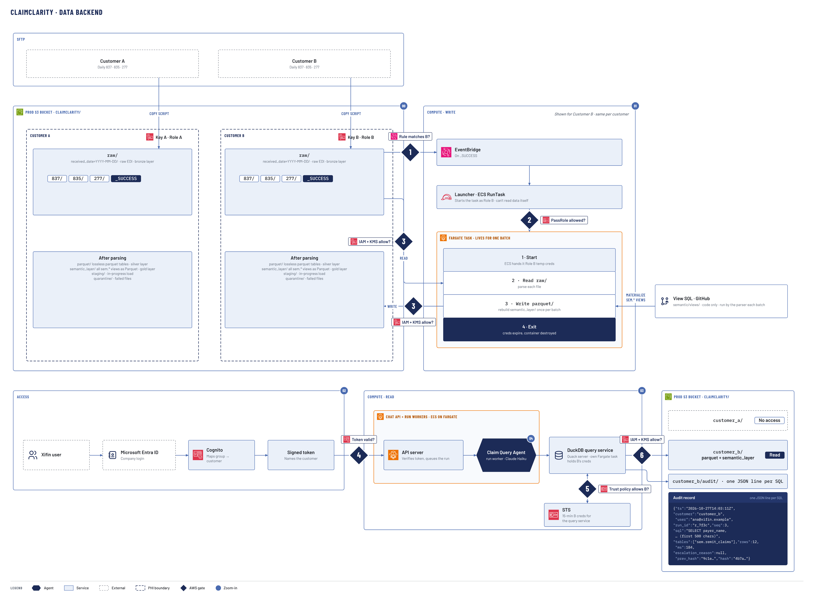

# ClaimClarity architecture

ClaimClarity answers questions about a customer's claims (837P) and remittances (835). Each customer's data
sits in its own S3 prefix, under its own KMS key and IAM roles. Six AWS checks, the numbered diamonds, enforce that
on every write and read. The main board shows the whole system, and drill-downs 00–04 zoom into each part.

The numbered diamonds on every board are the six permission checks. Each number means the same check on every
board, and sits on the arrow it guards. The matrix below shows what each role can do in one customer's prefix.

## Gates and access

| Gate | Checked by | What has to be true | If not | Boards |
|---|---|---|---|---|
| 1 | EventBridge rule | The `_SUCCESS` file is under this customer's `raw/` | No parser task starts | main, 01 |
| 2 | IAM (`iam:PassRole`) | The launcher passes this customer's parser role, and only to an ECS task | The task can't start | main, 01 |
| 3 | IAM + KMS | The parser role and the customer's key allow the read or write | The read or write fails | main, 00, 01 |
| 4 | Chat API | The token is valid and names the customer | The request is refused | main, 02 |
| 5 | STS (role trust policy) | The reader role trusts this token's customer | No credentials are issued | main, 03 |
| 6 | IAM + KMS | The reader role and the customer's key allow the read | The read fails | main, 00, 03, 04 |

**Access matrix**, shown for customer B. Every customer has the same set of roles, each limited to its own prefix
`customer_b/` and its own key.

| Role (used by) | `raw/` | `quarantine/` | `parquet/` | `semantic_layer/` | `audit/` | Key | Gate |
|---|---|---|---|---|---|---|---|
| SFTP copy role B (Transfer Family) | Write once | – | – | – | – | Customer key B | – |
| Launcher (EventBridge → ECS RunTask) | – | – | – | – | – | – | 1, 2 (may pass parser role B only) |
| Parser role B (Fargate parser task) | Read | Write | Write | Write a new version | – | Customer key B | 3 |
| Reader role B (DuckDB query service) | – | – | Read, only after escalation | Read the current version | – | Customer key B, decrypt only | 5, 6 |
| Audit role B (DuckDB query service) | – | – | – | – | Append, write once | Platform audit key | – |
| Chat API, run worker (Claim Query Agent) | – | – | – | – | – | – | 4 |
| Any customer A role | Denied | Denied | Denied | Denied | Denied | Denied | 3, 6 |

`raw/` and `audit/` are write-once (Object Lock): nobody can change or delete them, including the roles that write
them. "Only after escalation" is enforced by the SQL guard; IAM allows the read. The chat API and the run worker
hold no AWS data credentials at all.

## Data backend

| Part | What it does | Key facts |
|---|---|---|
| SFTP | Each customer sends daily 837 · 835 · 277 files | AWS Transfer Family, customer IP addresses only, straight into `raw/` |
| ClaimClarity data bucket | One prefix per customer: raw → silver → gold, plus quarantine and audit | One bucket for all customer data |
| Compute · write | EventBridge → ECS RunTask → one Fargate parser task per batch | Runs as the customer's parser role. Gates 1–3. |
| Access | Entra ID → Cognito → token naming the customer | The token is the only source of the customer. Gate 4. |
| Compute · read | Chat API → run worker (the Claim Query Agent) → DuckDB query service → STS → gold | 15-minute credentials, this customer's gold only. Gates 5–6. |

## 00 · Storage & isolation

| Part | Key facts |
|---|---|
| Bucket | One bucket for all customer data, one prefix per customer. The web app and the access logs have their own buckets. |
| Prefixes | `raw/` (write-once, Object Lock 7 years, `_SUCCESS` written last), `parquet/` (silver), `semantic_layer/` (gold), `quarantine/` (bad files, kept 1 year), `audit/` |
| IAM roles | Per customer: SFTP copy, parser, reader, audit. IAM prefix policies keep the roles apart. |
| KMS keys | The customer key, one per customer, covers raw, silver, gold and quarantine. The platform audit key covers `audit/`, with one key-policy statement per customer. |
| Bucket policy | Only customer B's roles reach `customer_b/`. Customer A's roles are denied by the bucket policy and the key policy. |
| Query audit | The DuckDB query service writes one JSON Lines record per SQL statement: write-once, kept 6 years, each record chained by hash to the one before |
| Gates | 3 on the parser's reads and writes, 6 on the reader's reads |

## 01 · Ingestion & parse

| Step | What happens |
|---|---|
| Intake | The customer uploads over SFTP (port 22, customer IP addresses only). Transfer Family writes straight into `raw/` as the SFTP copy role, `_SUCCESS` last. |
| Gate 1 | The customer's EventBridge rule matches `_SUCCESS` under `customer_b/raw/` only |
| Launch | ECS RunTask starts one parser task. EventBridge retries the launch 3 times. |
| Gate 2 | `iam:PassRole` lets the launcher pass only customer B's parser role, and only to ECS tasks |
| Parser task | Fargate, 4–8 GB of memory, one per batch. It holds the batch lease, a lock object, while it runs. Bad files go to `quarantine/`. |
| Gate 3 | IAM + KMS on every read of `raw/` and every write to silver and gold |
| Publish | Gold is written as a new version, and `CURRENT` moves by compare-and-set. Old versions stay readable for sessions already open. |

## 02 · Login & customer mapping

| Part | Key facts |
|---|---|
| Microsoft Entra ID | Company sign-in. The ClaimClarity app is assigned to groups. |
| Assigned group | One group per customer |
| Amazon Cognito | Single sign-on with Entra ID. Maps the user's group to exactly one customer and issues a token naming that customer. A user in no ClaimClarity group, or in more than one, is refused. |
| Gate 4 | The chat API accepts a request only with a valid token, and takes the customer only from it |

## 03 · Query path

| Part | Key facts |
|---|---|
| Run worker | The Claim Query Agent sends SQL through `cli.py` and the SQL guard. It holds no AWS credentials. |
| SQL guard | Read-only SELECT. Blocks queries that would fail against the schema. 25 s per query, 60 s per question, 1,000 rows. Refuses keyless joins over 100 million row pairs. |
| Quack | SQL goes to the DuckDB query service over Quack with a per-run token, and rows come back the same way |
| Gate 5 | The reader role's trust policy accepts only this token's customer. STS returns read-only credentials for 15 minutes, renewed with the same token when fewer than 3 minutes remain. |
| Gate 6 | IAM + KMS allow reader role B only the current gold version in `customer_b/semantic_layer/`, and `customer_b/parquet/` after an escalation |
| `lossless.*` | PHI-stripped tables published next to gold, read only after the agent escalates with a reason |
| Customer A | Denied twice: the API takes the customer only from the token, and IAM + KMS deny reader role B on `customer_a/` |

## 04 · Analyzer

| Part | Key facts |
|---|---|
| KPI gate | One Claude Haiku call with structured output. If a preset fits, it fills the parameters (payer, payer class, month, CPT, CARC), which are checked against the data. Anything else goes to the agent. |
| Preset KPI queries | 16 fixed SQL queries. They pass the SQL guard like any other SQL. |
| Claim Query Agent | The run worker itself (Fargate): Claude Haiku, Strands on Amazon Bedrock |
| Prompt | Cached: rules, EDI glossary, semantic schema with allowed values, tool and CLI reference, system prompt and history. Per question: the 3 most similar solved examples and the newest prompt. |
| First decision | Answer, ask a clarifying question, or escalate to the lossless tables with a reason, which is logged |
| `cli.py` · SQL guard | The agent's one tool: `sql`, `lookup`, `describe`, `list`, `escalate`, then `answer`, `ask` or `refuse`. Every query passes the guard's checks (limits in 03). A failed check goes back to the agent as an error. |
| Answer | Streams back with live steps. The server re-runs the final SQL, so the numbers come from the database. |

Network, operations, log retention and session handling are owned by IT.

## Open decisions

| Question | Default shown |
|---|---|
| SFTP: AWS Transfer Family or an EC2 host? | Transfer Family, writing straight into `raw/` |
| Does the audit record keep the SQL text? | Yes, the first 500 characters |
| Queue and run workers | SQS + Fargate run workers |
| Per-customer limits | Concurrency and token budgets still need values |
