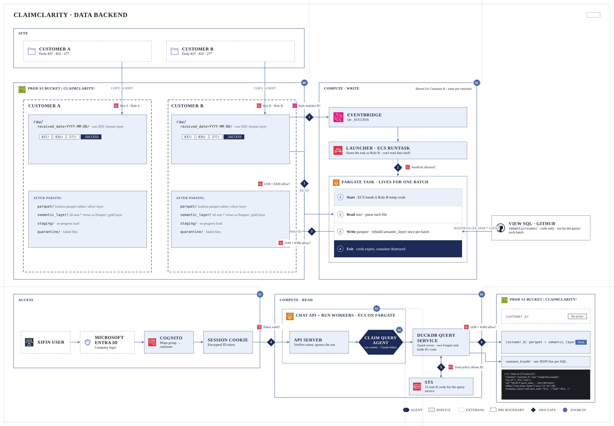
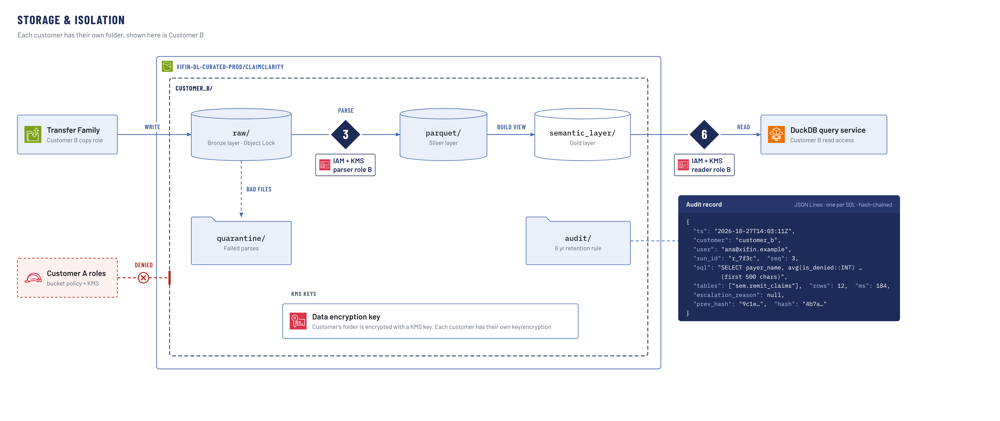
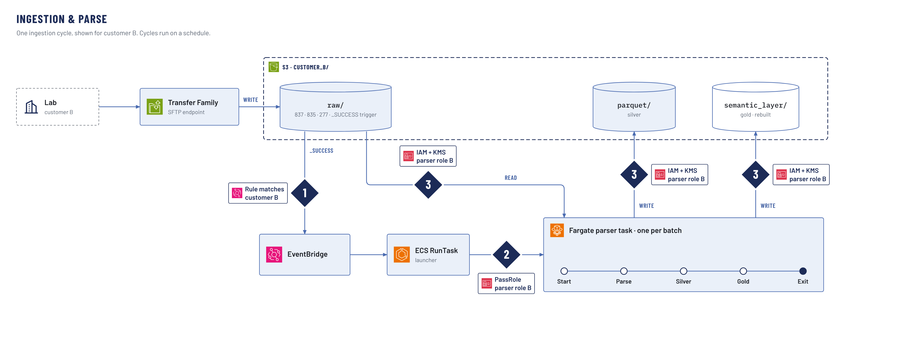
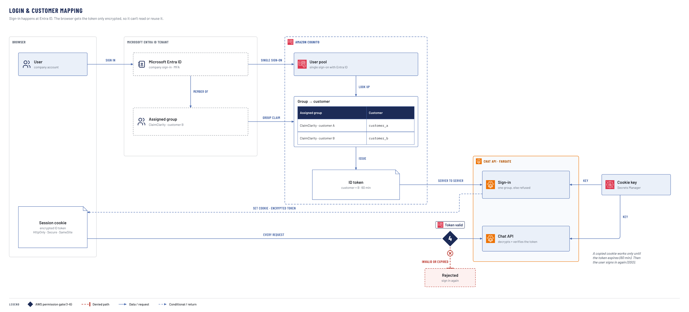
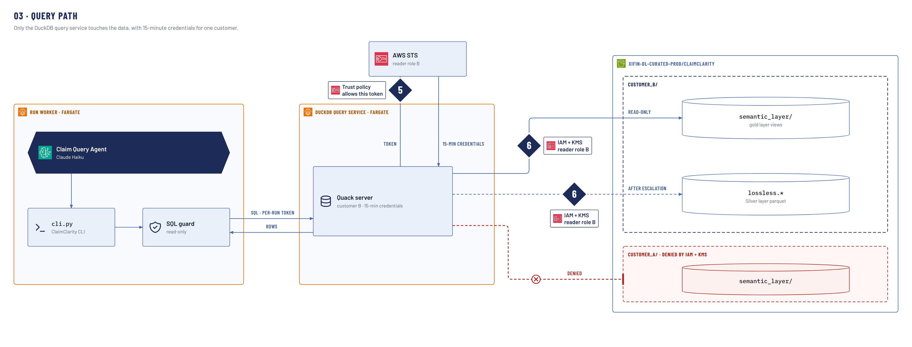
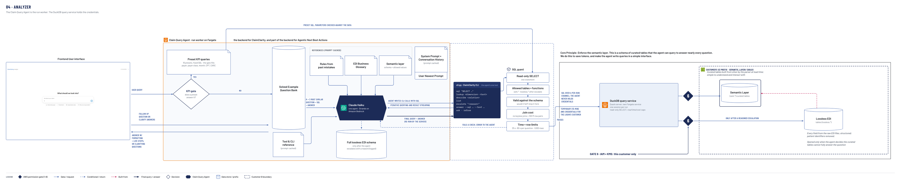
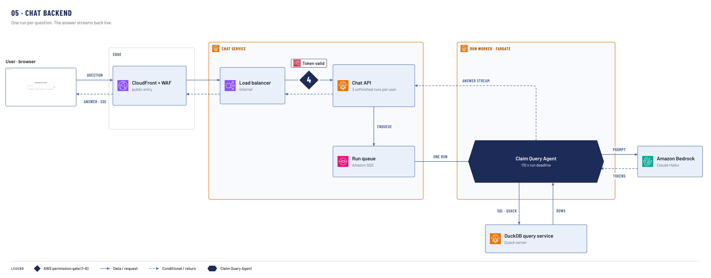

# ClaimClarity architecture

ClaimClarity answers questions about a clinical lab's claims (837P) and remittances (835). Each customer's data
sits in its own S3 prefix, under its own KMS key and IAM roles. Six AWS checks, the numbered diamonds, enforce that
on every write and read. The main board shows the whole system, and drill-downs 00–05 zoom into each part.

| Gate | What AWS checks |
|---|---|
| 1 | The EventBridge rule matches the customer |
| 2 | `iam:PassRole` allows only the customer's parser role |
| 3 | IAM + KMS for the parser |
| 4 | The token is valid |
| 5 | The reader role's trust policy allows this token (STS) |
| 6 | IAM + KMS for the reader |

## Data backend

| Part | What it does | Key facts |
|---|---|---|
| SFTP | Each lab sends daily 837 · 835 · 277 files | AWS Transfer Family, lab IP addresses only, straight into `raw/` |
| ClaimClarity data bucket | One prefix per customer: raw → silver → gold, plus quarantine and audit | One bucket for all customer data |
| Compute · write | EventBridge → ECS RunTask → one Fargate parser task per batch | Runs as the customer's parser role. Gates 1–3. |
| Access | Entra ID → Cognito → ID token naming the customer, kept in an encrypted cookie | The token is the only source of the customer. The browser can't read it. Gate 4. |
| Compute · read | Chat API → run worker (the Claim Query Agent) → DuckDB query service → STS → gold | 15-minute credentials, this customer's gold only. Gates 5–6. |

## 00 · Storage & isolation

| Part | Key facts |
|---|---|
| Bucket | One bucket for all customer data, one prefix per customer. The web app and the access logs have their own buckets. |
| Prefixes | `raw/` (write-once, Object Lock 7 years, `_SUCCESS` written last), `parquet/` (silver), `semantic_layer/` (gold), `quarantine/` (bad files, kept 1 year), `audit/` |
| IAM roles | Per customer: SFTP copy, parser, reader, audit. IAM prefix policies keep the roles apart. |
| KMS keys | The customer key, one per customer, covers raw, silver, gold and quarantine. The platform audit key covers `audit/`, with one key-policy statement per customer. |
| Bucket policy | Only customer B's roles reach `customer_b/`. Customer A's roles are denied by the bucket policy and the key policy. |
| Query audit | The DuckDB query service writes one JSON Lines record per SQL statement: write-once, kept 6 years, each record chained by hash to the one before |
| Gates | 3 on the parser's reads and writes, 6 on the reader's reads |

## 01 · Ingestion & parse

| Step | What happens |
|---|---|
| Intake | The lab uploads over SFTP (port 22, lab IP addresses only). Transfer Family writes straight into `raw/` as the SFTP copy role, `_SUCCESS` last. |
| Gate 1 | The customer's EventBridge rule matches `_SUCCESS` under `customer_b/raw/` only |
| Launch | ECS RunTask starts one parser task. EventBridge retries the launch 3 times. |
| Gate 2 | `iam:PassRole` lets the launcher pass only customer B's parser role, and only to ECS tasks |
| Parser task | Fargate, 4–8 GB of memory, one per batch. It holds the batch lease, a lock object, while it runs. Bad files go to `quarantine/`. |
| Gate 3 | IAM + KMS on every read of `raw/` and every write to silver and gold |
| Publish | Gold is written as a new version, and `CURRENT` moves by compare-and-set. Old versions stay readable for sessions already open. |

## 02 · Login & customer mapping

| Part | Key facts |
|---|---|
| Microsoft Entra ID | Company sign-in. The ClaimClarity app is assigned to groups. |
| Assigned group | One group per customer |
| Amazon Cognito | Single sign-on with Entra ID (OIDC). Maps the group to a customer and issues an ID token naming that customer, valid 60 minutes. |
| Sign-in (chat API) | Gets the tokens from Cognito server to server, with the code from the sign-in redirect. Refuses a user in no ClaimClarity group or in more than one. |
| Session cookie | The ID token, encrypted by the chat API (AES-GCM, key in Secrets Manager): `HttpOnly`, `Secure`, `SameSite=Strict`. The browser can't read or reuse the token, and other sites can't send the cookie. No server-side session store. |
| Gate 4 | The chat API decrypts the cookie and checks the token's signature, audience, expiry and customer on every request. An invalid or expired token is rejected. |
| Expiry and sign-out | The cookie lives as long as the token (60 minutes); then the user signs in again, usually without a prompt (single sign-on). Sign-out clears the cookie; a copy made before then keeps working until the token expires. A WAF rule limiting the app to company networks narrows that further. |

## 03 · Query path

| Part | Key facts |
|---|---|
| Run worker | The Claim Query Agent sends SQL through `cli.py` and the SQL guard. It holds no AWS credentials. |
| SQL guard | Read-only SELECT. Blocks queries that would fail against the schema. 25 s per query, 60 s per question, 1,000 rows. Refuses keyless joins over 100 million row pairs. |
| Quack | SQL goes to the DuckDB query service over Quack with a per-run token, and rows come back the same way |
| Gate 5 | The reader role's trust policy accepts only this token's customer. STS returns read-only credentials for 15 minutes, renewed with the same token when fewer than 3 minutes remain. |
| Gate 6 | IAM + KMS allow reader role B only `customer_b/semantic_layer/`, current gold version |
| `lossless.*` | PHI-stripped tables published next to gold, read only after the agent escalates with a reason |
| Customer A | Denied twice: the API takes the customer only from the token, and IAM + KMS deny reader role B on `customer_a/` |

## 04 · Analyzer

| Part | Key facts |
|---|---|
| KPI gate | One Claude Haiku call with structured output. If a preset fits, it fills the parameters (payer, payer class, month, CPT, CARC), which are checked against the data. Anything else goes to the agent. |
| Preset KPI queries | 16 fixed SQL queries. They pass the SQL guard like any other SQL. |
| Claim Query Agent | The run worker itself (Fargate): Claude Haiku, Strands on Amazon Bedrock |
| Prompt | Cached: rules, EDI glossary, semantic schema with allowed values, tool and CLI reference, system prompt and history. Per question: the 3 most similar solved examples and the newest prompt. |
| First decision | Answer, ask a clarifying question, or escalate to the lossless tables with a reason, which is logged |
| `cli.py` · SQL guard | The agent's one tool: `sql`, `lookup`, `describe`, `list`, `escalate`, then `answer`, `ask` or `refuse`. Every query passes the guard's checks (limits in 03). A failed check goes back to the agent as an error. |
| Answer | Streams back with live steps. The server re-runs the final SQL, so the numbers come from the database. |

## 05 · Chat backend

| Part | Key facts |
|---|---|
| CloudFront + WAF | The only public web entry |
| Load balancer | Internal. Accepts traffic from CloudFront only. |
| Chat API (Fargate) | Gate 4 on every request. Queues one run per question and streams the answer over SSE. 3 unfinished runs per user. |
| Run queue (SQS) | One message per run |
| Run worker (Fargate) | The Claim Query Agent. Calls Bedrock and the DuckDB query service. 110 s run deadline. |
| Chat storage | Out of scope: answers stream live, and conversations are not stored |

Network, operations and log retention are owned by IT.

## Open decisions

| Question | Default shown |
|---|---|
| SFTP: AWS Transfer Family or an EC2 host? | Transfer Family, writing straight into `raw/` |
| Does the audit record keep the SQL text? | Yes, the first 500 characters |
| Queue and run workers | SQS + Fargate run workers |
| Per-customer limits | Concurrency and token budgets still need values |
