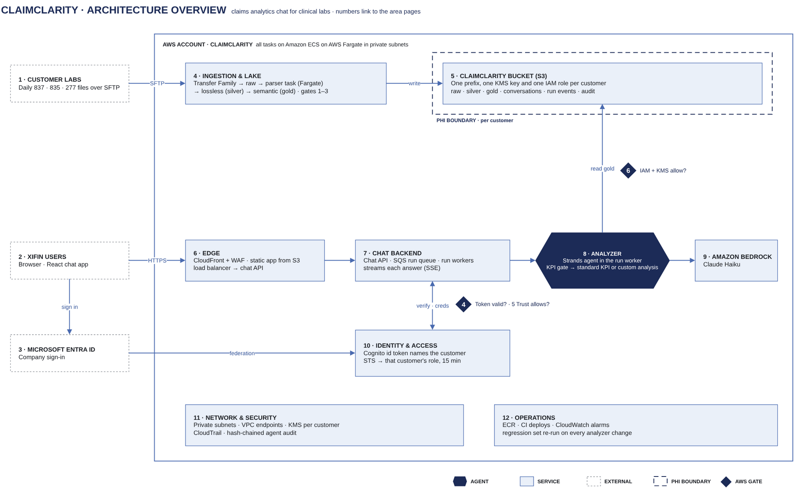

# ClaimClarity architecture overview

ClaimClarity is a chat assistant for XiFin staff. It answers questions about a clinical lab customer's claims (837P) and
remittances (835) in plain language, and shows the SQL and data behind every answer.

Each customer's data stays inside its own boundary: its own S3 prefix, its own KMS key and its own IAM role. A
signed-in user can only reach the one customer their token names. The design is built on three principles:
- The AI interprets the question.
- Governed data and fixed SQL compute the numbers.
- Every data access is checked by AWS and recorded.

## In this diagram

| # | Box | What it does | Details |
|---|---|---|---|
| 1 | Customer labs | Send daily 837, 835 and 277 files over SFTP | [Ingestion & lake](10-ingestion.md) |
| 2 | XiFin users | Use the React chat app in the browser | [Chat backend](30-chat-backend.md) |
| 3 | Microsoft Entra ID | Company sign-in. The CC app is assigned to groups. | [Identity & access](20-identity.md) |
| 4 | Ingestion & lake | Lands files in raw. A parser task per batch writes the lossless (silver) and semantic (gold) tables. | [Ingestion & lake](10-ingestion.md) |
| 5 | ClaimClarity bucket | One S3 bucket, with one prefix, KMS key and IAM role per customer. It holds the lake and all chat state. | [S3 layout](12-s3-layout.md) |
| 6 | Edge | CloudFront and WAF serve the web app and pass API calls to the chat API through the load balancer | [Edge](31-edge.md) |
| 7 | Chat backend | The chat API accepts a question and queues a run. Run workers execute it and stream the answer back. | [Chat backend](30-chat-backend.md) |
| 8 | Analyzer | Strands agent inside the run worker. A KPI gate sends each question to a standard KPI query or to custom analysis. | [Agent analyzer](40-analyzer.md) |
| 9 | Amazon Bedrock | Claude Haiku: the only model the analyzer calls | [Model calls](45-model-calls.md) |
| 10 | Identity & access | The Cognito id token names the customer. STS exchanges it for 15-minute credentials of that customer's role. | [Identity & access](20-identity.md) |
| 11 | Network & security | Private subnets, VPC endpoints, KMS per customer, CloudTrail and the agent audit | [Network & security](50-network-security.md) |
| 12 | Operations | Images, deploys, monitoring and the regression set that gates analyzer changes | [Operations](60-operations.md) |

## How it works

1. A customer lab drops its daily files on SFTP (1). They land in that customer's raw prefix in the ClaimClarity bucket (5).
2. When a batch is complete, EventBridge starts a parser task on Fargate as that customer's role (4). The task
   writes the lossless tables, then publishes a new version of the gold tables. Gates 1–3 check every step.
3. A XiFin user signs in with Entra ID (3). Cognito issues an id token that names the customer. The browser
   holds it in an httpOnly session cookie (10).
4. The user asks a question in the chat app (2). It goes through CloudFront and WAF (6) to the chat API (7). The
   API verifies the token (gate 4) and queues a run.
5. A run worker exchanges the token at STS for that customer's role (gate 5). It opens a read-only session on
   the current gold version only (gate 6).
6. The analyzer (8) first asks the KPI gate whether a standard KPI query answers the question exactly:
   - **Yes:** fixed SQL runs with the values filled in.
   - **No:** the custom analysis agent writes SQL over gold behind a guard.

   Every model call goes to Claude Haiku on Bedrock (9).
7. The server runs the final SQL itself, so the numbers come from the database. The answer, with its SQL and
   result, streams back to the browser. The conversation, run events and an audit record of every query are
   stored under the customer's prefix, encrypted with the customer's key (5).

## Areas

- [Ingestion & lake](10-ingestion.md): SFTP intake, S3 layout, the parse trigger, the parser task, gold publishing
- [Identity & access](20-identity.md): sign-in, token to credentials, customer isolation
- [Chat backend](30-chat-backend.md): edge, one chat turn, state, limits
- [Agent analyzer](40-analyzer.md): KPI gate, standard KPI path, custom analysis agent, SQL guard, model calls
- [Network & security](50-network-security.md): network, encryption and keys, audit and logging
- [Operations](60-operations.md): deploy, monitoring, evaluation and regression

Appendix: [AWS service catalog](90-service-catalog.md) · [IAM and KMS matrix](91-iam-kms-matrix.md) ·
[Glossary](92-glossary.md)

The diagrams and examples use a synthetic data set of two customers (acme_labs, acme_diagnostics). It contains
no real patient data.
