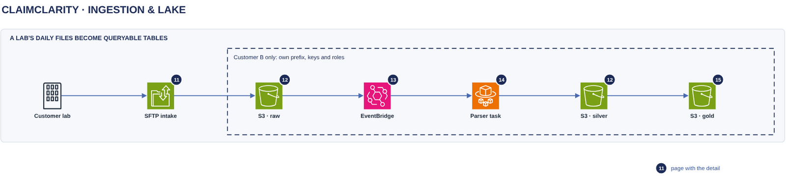

# Ingestion & lake

[Overview](00-overview.md) › Ingestion & lake

A customer lab's daily 837P, 835 and 277 files arrive over SFTP and are kept, unchanged and locked, in that
customer's raw zone. One short-lived parser task per batch turns them into lossless tables (silver) and publishes
a new version of the semantic tables (gold) that the chat reads, all inside the customer's own prefix and keys.

## In this diagram

| Item | What it does | Details |
|---|---|---|
| Customer lab | Sends one received day of EDI files over SFTP. | |
| SFTP intake | AWS Transfer Family receives the files, and a copy step writes them into raw. | [SFTP intake](11-sftp-intake.md) |
| S3 · raw | Holds the files as received, write-once and locked for 7 years. | [S3 layout](12-s3-layout.md) |
| EventBridge | Starts one parser task when Customer B's `_SUCCESS` marker lands (gates 1 and 2). | [Parse trigger](13-parse-trigger.md) |
| Parser task | Parses the day on ECS Fargate as Customer B's parser role (gate 3), then exits. | [Parser task](14-parser-task.md) |
| S3 · silver | Holds the lossless tables, one part file per table per batch. | [S3 layout](12-s3-layout.md) |
| S3 · gold | Holds the `sem.*` tables and PHI-stripped `lossless.*` tables, one version per batch. | [Gold publish](15-gold-publish.md) |

## How it works

1. The lab uploads a day's files to Transfer Family. A copy step writes them into `raw/received_date=YYYY-MM-DD/`
   and writes `_SUCCESS` last.
2. Customer B's EventBridge rule matches the marker and starts the parser task.
3. The task takes Customer B's batch lease, parses the files it has not loaded yet, and quarantines bad ones.
4. It writes silver, with `edi.source_file` last as the commit record.
5. It rebuilds the touched claims in gold, writes a new manifest and moves `CURRENT` to it.
6. It releases the lease and exits. Chat sessions read gold through `CURRENT`.

## Specification

| Item | Value |
|---|---|
| Isolation | Each customer has its own prefix, roles (SFTP copy, parser, reader, transcripts, audit) and KMS keys (lake, transcripts), plus its own EventBridge rule and parser task definition |
| Data held / PHI | Raw, silver and quarantine: full PHI. Gold: no direct patient identifiers. |
| Encryption | SSE-KMS with the customer's lake key on every lake object |
| Raw retention | Object Lock COMPLIANCE, 2,555 days; never deleted |
| One batch at a time | A lease object per customer (`staging/LOCK`) |
| Failure | A bad file is quarantined and the rest loads. A failed batch commits nothing and is re-run. |
| Logging | CloudTrail for every S3, KMS, ECS and IAM call; `edi.ingest_run` and `edi.source_file` rows per batch; run summary in CloudWatch Logs |

## Pages in this area

- [SFTP intake](11-sftp-intake.md) · [S3 layout](12-s3-layout.md) · [Parse trigger](13-parse-trigger.md) ·
  [Parser task](14-parser-task.md) · [Gold publish](15-gold-publish.md)

## Related

Up: [Overview](00-overview.md) · See also: [Customer isolation](23-customer-isolation.md) ·
[Encryption keys](52-encryption-keys.md) · [Audit logging](53-audit-logging.md)
