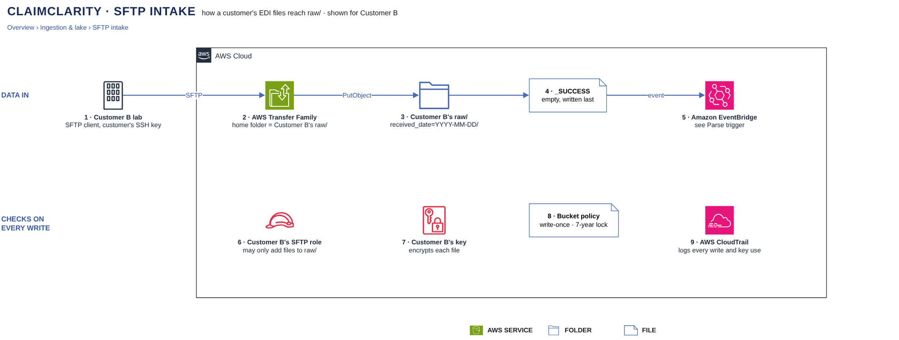

# SFTP intake

[Overview](00-overview.md) › [Ingestion & lake](10-ingestion.md) › SFTP intake

Labs deliver EDI files over SFTP to AWS Transfer Family, which lands them in the customer's `landing/` prefix. A
copy step then writes each file into `raw/` as create-only, locked for 7 years and encrypted with the customer's
lake key, and writes `_SUCCESS` last to start the parser.

## In this diagram

| Item | What it does | Details |
|---|---|---|
| Customer lab | Uploads one received day over SFTP with the customer's SSH key. | |
| AWS Transfer Family | SFTP server; the customer's user can only write to its own `landing/`. | |
| S3 · landing | Holds uploaded files until the copy step has moved them. | [S3 layout](12-s3-layout.md) |
| Copy step | Copies the day into `raw/` as Customer B's SFTP copy role. | |
| S3 · raw | Keeps the files as received, write-once. | [S3 layout](12-s3-layout.md) |
| `_SUCCESS` | Empty marker the copy step writes last; it means the day is complete. | |
| EventBridge | Starts the parser for this customer. | [Parse trigger](13-parse-trigger.md) |
| B's SFTP copy role | The only identity that writes Customer B's raw files. | |
| B's lake key | KMS key that encrypts every lake object of Customer B. | [Encryption keys](52-encryption-keys.md) |
| Bucket policy | Refuses any raw write that is not create-only, locked and under the owner's key. | [Customer isolation](23-customer-isolation.md) |
| CloudTrail | Records every write and key use, allowed or denied. | [Audit logging](53-audit-logging.md) |

## How it works

1. The lab connects to Transfer Family (SSH, port 22) and uploads into `received_date=YYYY-MM-DD/837/`, `835/`
   and `277/` under its `landing/` folder, then an empty `_SUCCESS`.
2. The lab's `_SUCCESS` in `landing/` starts the copy step for that day.
3. The copy step writes each file to the same path under `raw/`, create-only, with Object Lock and Customer B's
   lake key.
4. It writes `raw/…/_SUCCESS` last, then deletes the day from `landing/`.
5. S3 sends the Object Created event for `raw/…/_SUCCESS` to EventBridge, which starts the parser.

## Specification

### Permissions

| Who | May | May not |
|---|---|---|
| Customer B's Transfer Family user | Upload to Customer B's `landing/`, through B's Transfer Family role (put only, B's lake key) | See any other folder; read, overwrite or delete |
| Customer B's SFTP copy role | Read and delete `landing/`; `s3:PutObject` and `s3:PutObjectRetention` on `raw/` | Overwrite or delete `raw/`; touch any other customer |
| Customer B's lake key | Encrypt and decrypt for Customer B's lake roles, through S3 only | Be used by any other principal |

### Raw write rules (bucket policy)

| Rule | Value |
|---|---|
| Transport | TLS only |
| Encryption | SSE-KMS with the key in the writer's `kms_key_arn` tag |
| Create-only | `If-None-Match: *` required |
| Retention | Object Lock COMPLIANCE, at least 2,555 days remaining |
| Deletes | Denied for everyone |

### Data, limits and failure

| Item | Value |
|---|---|
| Endpoint | Internet-facing SFTP endpoint, TCP 22; its security group admits each lab's listed source addresses only; one SSH key per lab user |
| Copy step | A Lambda function per upload day, started by the lab's `_SUCCESS` in `landing/`, as the customer's SFTP copy role |
| Data held / PHI | Full PHI in `landing/` and `raw/` |
| A file name that already exists in raw | Refused; the lab sends a corrected file under a new name, and both are kept |
| A day without the lab's `_SUCCESS` | Nothing is copied or parsed |
| A refused raw write | The copy step stops before `raw/…/_SUCCESS`; the day is re-run |
| Logging | CloudTrail S3 data events and KMS calls; Transfer Family session logs (user, file names, no contents) in CloudWatch Logs |

## Related

Up: [Ingestion & lake](10-ingestion.md) · Next: [Parse trigger](13-parse-trigger.md) · See also:
[S3 layout](12-s3-layout.md)
