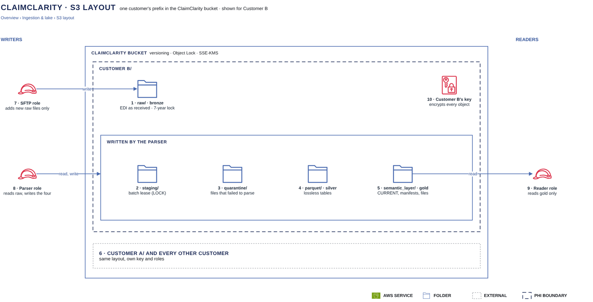

# S3 layout

[Overview](00-overview.md) › [Ingestion & lake](10-ingestion.md) › S3 layout

All customer data lives in one bucket, the ClaimClarity bucket. Each customer has one prefix, and everything
under it is encrypted with that customer's own KMS key. Inside the prefix, each zone has a fixed role: raw is
written once by the SFTP role, the parser alone writes the derived zones, and the chat reader can only read gold.



## In this diagram

| # | Item | What it does | Details |
|---|---|---|---|
| 1 | `raw/` (bronze) | EDI files exactly as received. Write-once, Object Lock COMPLIANCE for 7 years. | [SFTP intake](11-sftp-intake.md) |
| 2 | `staging/` | Holds `LOCK`, the customer's batch lease | [Parser task](14-parser-task.md) |
| 3 | `quarantine/` | Copies of raw files that failed to parse, one folder per run | [Parser task](14-parser-task.md) |
| 4 | `parquet/` (silver) | The lossless tables, one folder per table and received month | [Parser task](14-parser-task.md) |
| 5 | `semantic_layer/` (gold) | `CURRENT`, one manifest per version, and the gold data files | [Gold publish](15-gold-publish.md) |
| 6 | Other customers | The same layout under their own prefix, key and roles | [Customer isolation](23-customer-isolation.md) |
| 7 | SFTP role | Adds new raw files for Customer B | [SFTP intake](11-sftp-intake.md) |
| 8 | Parser role | Reads raw; reads and writes zones 2–5 | [Parser task](14-parser-task.md) |
| 9 | Reader role | Reads gold only | [Token to credentials](22-token-to-credentials.md) |
| 10 | Customer B's key | Encrypts every object under Customer B's prefix | [Encryption keys](52-encryption-keys.md) |

## How it works

1. The SFTP role (7) adds raw files (1). Nothing can change or delete them.
2. The parser role (8) reads raw, takes the lease in `staging/` (2), copies bad files to `quarantine/` (3),
   writes silver (4) and publishes gold (5).
3. The reader role (9) reads gold (5) and nothing else.
4. Every object is encrypted with Customer B's key (10). The bucket policy refuses a write with any other key.
5. Every other customer (6) has the same layout, with its own key and roles.

## Specification

### Full key layout

```
<customer>/
├── raw/received_date=YYYY-MM-DD/{837,835,277}/<file>     bronze, write-once
│   └── _SUCCESS                                          completion marker, written last
├── staging/LOCK                                          batch lease
├── quarantine/<run_id>/<file>                            files that failed to parse
├── parquet/<table>/received_month=YYYY-MM/
│   ├── part-<run_id>.parquet                             one per table per batch
│   └── compacted-<run_id>.parquet                        a month's parts merged
├── semantic_layer/
│   ├── CURRENT                                           "v=<run_id>"
│   ├── v=<run_id>/manifest.json                          one gold version
│   └── <relation>/<partition>/part-<run_id>-<n>.parquet  gold data files
├── transcripts/ · audit/queries/                         chat state and query audit (see Chat state)
```

`run_id` is `run_<start time to the microsecond>_<received day>`. Run ids increase per customer, because only
one batch runs at a time.

### Zones

| Zone | Contents | PHI | Format | Retention |
|---|---|---|---|---|
| `raw/` | X12 837P, 835, 277 as received | Yes | X12 text | Object Lock COMPLIANCE, 2,555 days; no deletes; no lifecycle rule |
| `staging/` | `LOCK` (holder, expiry, nonce) | No | JSON | Old versions expire after 1 day |
| `quarantine/` | Rejected raw files | Yes | X12 text | Kept for review; deletable by the parser role |
| `parquet/` | 24 lossless tables plus `edi.ingest_run`; every element of every segment | Yes | Parquet, ZSTD | Live files kept; old versions expire after 7 days |
| `semantic_layer/` | 10 `sem.*` relations and 15 PHI-stripped `lossless.*` copies, manifests, `CURRENT` | No direct patient identifiers | Parquet, ZSTD, 1,048,576-row groups | Retired files deleted after 20 minutes; old versions expire after 1 day |

`edi.segment` in silver records where each segment sits in the raw object (byte offset and length), so any
value can be traced back to the exact bytes received.

### Bucket settings

| Setting | Value |
|---|---|
| Versioning | On |
| Object Lock | Enabled. Retention is set per raw object, not as a bucket default. |
| Default encryption | SSE-KMS with a platform key. The bucket policy refuses that key for customer prefixes, so every write must name the customer's key. |
| Bucket policy | TLS only; principals without a `customer` tag denied; object access only under `${aws:PrincipalTag/customer}/`; listing only with that prefix; writes only with the principal's `kms_key_arn`; raw write-once, locked, never deleted |
| Who may change bucket settings | Only the Terraform deploy role (policy, lifecycle, versioning, Object Lock, encryption) |
| Lifecycle | Expired delete markers removed. Noncurrent versions: `semantic_layer/` 1 day, `staging/` 1 day, `parquet/` 7 days. None for `raw/`. |

The bucket policy is the same document for any number of customers. Isolation comes from the `customer` and
`kms_key_arn` tags on each role.

### Permissions by zone

| Zone | SFTP role | Parser role | Reader role |
|---|---|---|---|
| `raw/` | Put, PutObjectRetention | Get, GetObjectVersion | – |
| `staging/` | – | Get, Put, Delete | – |
| `quarantine/` | – | Put, Delete | – |
| `parquet/` | – | Get, Put, Delete | – |
| `semantic_layer/` | – | Get, Put, Delete | Get, List |
| List the bucket | – | Prefix `<customer>/` only | Prefix `<customer>/semantic_layer/` only |

## Related

Up: [Ingestion & lake](10-ingestion.md) · See also: [SFTP intake](11-sftp-intake.md) ·
[Parser task](14-parser-task.md) · [Gold publish](15-gold-publish.md) · [IAM and KMS matrix](91-iam-kms-matrix.md)
