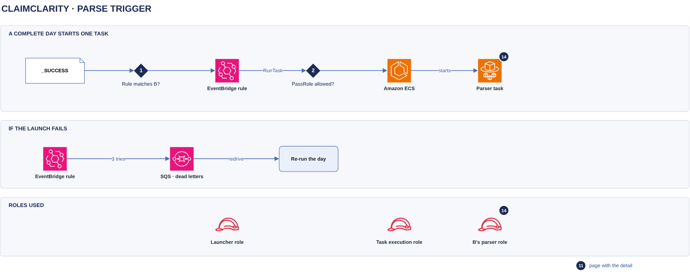

# Parse trigger

[Overview](00-overview.md) › [Ingestion & lake](10-ingestion.md) › Parse trigger

When a customer's day in `raw/` is complete, its `_SUCCESS` marker starts exactly one parser task for that
customer. An EventBridge rule per customer matches the marker, and ECS starts a Fargate task from that customer's
task definition; the launcher can start tasks but can never read data.

## In this diagram

| Item | What it does | Details |
|---|---|---|
| `_SUCCESS` | Marks a complete day in Customer B's `raw/`. | [SFTP intake](11-sftp-intake.md) |
| Gate 1 · Rule matches B? | Only a key under Customer B's raw prefix matches Customer B's rule. | |
| EventBridge rule | Calls ECS RunTask as the launcher role. | |
| Gate 2 · PassRole allowed? | The launcher may pass only the parser roles, only to ECS tasks. | |
| Amazon ECS | Runs Customer B's parser task definition on Fargate. | |
| Parser task | Parses the day as Customer B's parser role. | [Parser task](14-parser-task.md) |
| SQS · dead letters | Keeps events the rule could not deliver. | |
| Re-run the day | Starts the task again for that day; loaded files are skipped. | |
| Launcher role | The rule's target role: RunTask and PassRole only. | |
| Task execution role | Lets ECS pull the image and write container logs. | |
| B's parser role | The only credentials the code in the task gets. | [Parser task](14-parser-task.md) |

## How it works

1. The `_SUCCESS` object lands; S3 sends an Object Created event to EventBridge.
2. Customer B's rule matches it (gate 1) and calls RunTask with `SUCCESS_KEY` and `EVENT_ID`.
3. ECS checks that the launcher may pass Customer B's parser role (gate 2) and starts the task on Fargate.
4. If RunTask fails 3 times, the event goes to the dead-letter queue and the day is re-run from there.

## Specification

| Item | Value |
|---|---|
| Rule pattern | `source = aws.s3`, `detail-type = Object Created`, the ClaimClarity bucket, key `<customer>/raw/received_date=*/_SUCCESS` |
| Target | ECS RunTask, ClaimClarity cluster, Fargate, private subnets, no public IP |
| Task environment | `CUSTOMER`, `BUCKET`, `KMS_KEY_ARN` fixed in the task definition; `SUCCESS_KEY`, `EVENT_ID` from the event |
| Retry policy | 3 attempts, then the SQS dead-letter queue |
| Launcher role | Trusted by EventBridge in this account; `ecs:RunTask` on parser task definitions in the ClaimClarity cluster; `iam:PassRole` on the parser roles and the task execution role to `ecs-tasks.amazonaws.com`; no S3 or KMS access |
| Task execution role | Pull the parser image from ECR; write container logs |
| Parser role | Trusted by ECS tasks of this account; sessions up to 1 hour |
| Task credentials | They can outlive the task (up to about 6 hours). The boundary is the role's permissions: Customer B's prefix only. |
| Duplicate event | A second task waits for the lease, finds every file loaded and exits with status `noop` |
| Task fails after start | No EventBridge retry; the task stops with a non-zero exit code; re-run the day |
| Logging | CloudTrail: RunTask, PassRole, failed invocations. `EVENT_ID` and the task ARN are stored in `edi.ingest_run`. |

## Related

Up: [Ingestion & lake](10-ingestion.md) · Previous: [SFTP intake](11-sftp-intake.md) · Next:
[Parser task](14-parser-task.md)
