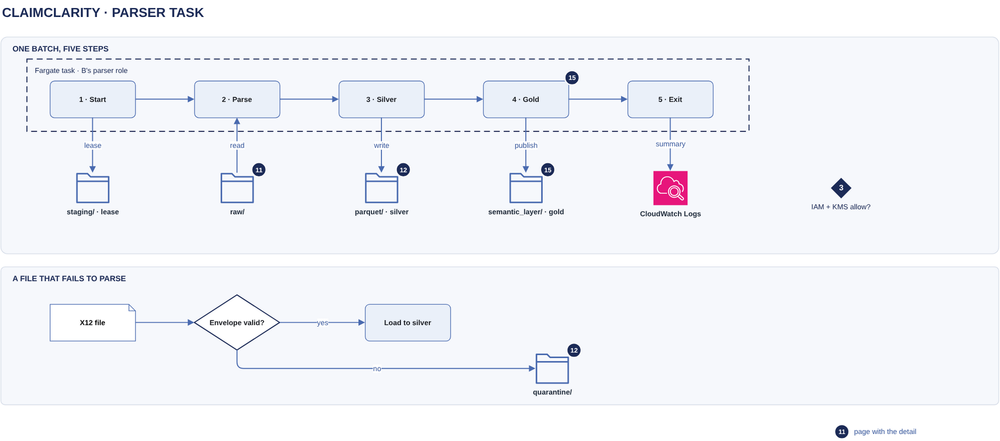

# Parser task

[Overview](00-overview.md) › [Ingestion & lake](10-ingestion.md) › Parser task

The parser task turns one customer's received day into silver and gold, on ECS Fargate as that customer's parser
role, and exits. A lease allows one batch per customer at a time, and a commit record makes every batch
all-or-nothing.

## In this diagram

| Item | What it does | Details |
|---|---|---|
| 1 · Start | Takes Customer B's batch lease and deletes leftovers of crashed batches. | |
| `staging/` · lease | Holds the lease object `LOCK`. | [S3 layout](12-s3-layout.md) |
| 2 · Parse | Reads the day's new raw files by version and parses them inside the task. | |
| `raw/` | The source files; the parser only reads them. | [SFTP intake](11-sftp-intake.md) |
| 3 · Silver | Writes one part file per table, then `edi.source_file` as the commit record. | |
| `parquet/` · silver | The lossless tables. | [S3 layout](12-s3-layout.md) |
| 4 · Gold | Publishes a new gold version, then compacts silver months. | [Gold publish](15-gold-publish.md) |
| `semantic_layer/` · gold | Gold files, manifests and `CURRENT`. | [Gold publish](15-gold-publish.md) |
| 5 · Exit | Releases the lease and logs a run summary; the container is destroyed. | |
| CloudWatch Logs | Keeps the run summary. | [Monitoring](62-monitoring.md) |
| Gate 3 · IAM + KMS allow? | Every S3 call needs the parser role's IAM permission and the lake key's permission. | |
| X12 file → Envelope valid? | A file with a broken envelope is not loaded. | |
| Load to silver | A valid file is staged and loaded. | |
| `quarantine/` | Keeps a copy of each rejected file. | [S3 layout](12-s3-layout.md) |

## How it works

1. **Start:** take `staging/LOCK`; delete part files of runs that never committed.
2. **Parse:** list the day folder; skip files whose key and version are already in `edi.source_file`; stage rows in
   DuckDB under the lossless schema. A broken file gets a `REJECTED` row and a copy in `quarantine/<run_id>/`.
3. **Silver:** renew the lease; write `parquet/<table>/received_month=YYYY-MM/part-<run_id>.parquet`;
   write `edi.source_file` last.
4. **Gold:** renew the lease; publish the new version ([Gold publish](15-gold-publish.md)); compact silver.
5. **Exit:** release the lease, log the summary, exit.

## Specification

### Task and permissions

| Item | Value |
|---|---|
| Size | 4–8 GB memory for 5 MB of raw EDI per day; `PARSE_WORKERS` = task vCPUs |
| Storage | Fargate ephemeral storage, removed with the task; staged rows spill to disk above 256 MB |
| Settings | `GOLD_MODE` (`incremental` or `full`), `PARSE_WORKERS`, `SILVER_OPEN_MONTH_MAX_PARTS` (4) |
| List | The ClaimClarity bucket, prefix `<customer>/` only |
| Read | `raw/`, `staging/`, `parquet/`, `semantic_layer/` (Get, GetObjectVersion) |
| Write | `staging/`, `parquet/`, `semantic_layer/`, `quarantine/` (Put, Delete) |
| Key | Customer B's lake key: Decrypt and GenerateDataKey through S3, for objects under `<customer>/` only |
| Never | Write or delete `raw/`; touch another prefix or key |

### Lease and fencing

| Item | Value |
|---|---|
| Take | Create `staging/LOCK` with `If-None-Match: *`, or take an expired one over with `If-Match` |
| Wait | Up to 15 minutes, then the task fails |
| Lease | 2 hours |
| Renew | `If-Match` on its own ETag before the commit record, compaction and `CURRENT` |
| Fencing | A failed renew stops the task (`LockLost`) before that write |
| Release | Overwrite with an expired lease, `If-Match`; never removes another holder's lease |

### Compaction

| Partition | When | Result |
|---|---|---|
| Closed month | Once, after gold includes every committed run | One `compacted-<run_id>.parquet` per table |
| Open month | When a table gold reads has 4 daily parts | The same |

### Failure behaviour

| Event | What happens |
|---|---|
| Broken envelope (no ISA, missing trailer, mismatched control numbers, segment outside a transaction) | File rejected and quarantined; the rest loads |
| Wrong SE01 count | Loaded and flagged |
| Any other error | Batch fails before its commit record; nothing is visible; re-run the day |
| Lease busy 15 minutes | Task fails without writing; re-run the day |
| Crash after the silver commit | The next batch catches gold up |

### Data held and logging

| Item | Value |
|---|---|
| PHI | Full PHI in memory and on task storage while it runs; written only to `parquet/` and `quarantine/` |
| `edi.ingest_run` | Run id, times, parser version, files seen / loaded / rejected, task ARN, event id |
| `edi.source_file` | Per file: S3 key, version id, ETag, size, SHA-256, KMS key, parse status, messages |
| Run summary | CloudWatch Logs: status, counts, timings; no PHI |
| API calls | CloudTrail, allowed or denied |

## Related

Up: [Ingestion & lake](10-ingestion.md) · Previous: [Parse trigger](13-parse-trigger.md) · Next:
[Gold publish](15-gold-publish.md)
