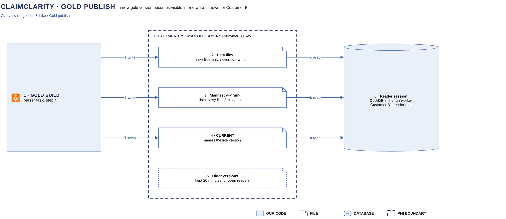

# Gold publish

[Overview](00-overview.md) › [Ingestion & lake](10-ingestion.md) › Gold publish

Gold is what the chat reads. Each batch publishes a new gold version in a way readers can never see half-built:
data files are written first under new names, then a manifest that lists them, and last a one-line pointer,
`CURRENT`, is moved with a compare-and-set. A reader always follows `CURRENT` to one manifest and reads exactly
the files it lists. Older versions stay readable long enough for every open reader to finish.

## In this diagram

| # | Item | What it does | Details |
|---|---|---|---|
| 1 | Gold build | Step 4 of the parser task, as Customer B's parser role | [Parser task](14-parser-task.md) |
| 2 | Data files | Gold Parquet files. Each write has a new key; no file is ever overwritten. | |
| 3 | Manifest `v=<run>` | One gold version: every file of every relation, plus build state | |
| 4 | `CURRENT` | One line, `v=<run_id>`: the live version | |
| 5 | Older versions | Files and manifests a newer version stopped listing, kept 20 minutes | |
| 6 | Reader session | DuckDB in a chat run worker, as Customer B's reader role | [Chat turn](32-chat-turn.md) |

## How it works

1. The build (1) reads `CURRENT` and its ETag, then the manifest it names. That manifest says which silver runs
   gold already includes (`silver_through`). The newer committed runs are pending.
2. It loads the pending runs' silver files, plus every older silver row of the claims they touch, and runs the
   semantic view SQL from git over them.
3. **1 write:** it writes the rewritten partitions as new data files (2), named
   `<relation>/<partition>/part-<run_id>-<n>.parquet`.
4. **2 write:** it writes the manifest `v=<run_id>/manifest.json` (3), listing every live file per relation and
   the files it retires.
5. **3 swap:** it renews the lease and writes `CURRENT` (4) with `If-Match` on the ETag read in step 1. If
   another build published in between, the write fails and this build stops; its files are swept later.
6. It deletes files retired more than 20 minutes ago (5).
7. A reader (6) reads `CURRENT` (a), then that manifest (b), then opens views over exactly the listed files (c).

## Specification

### What gold holds

| Relations | Partitioned by | Notes |
|---|---|---|
| 7 claim relations: `sem.remit_claims`, `remit_lines`, `claims`, `claim_lines`, `adjustments`, `remarks`, `diagnoses` | Claim cohort: the month the claim key first arrived. The 3 newest months have one file each; older months fold into one file per quarter. | Sorted by `payer_key, claim_key` |
| 3 small relations: `sem.payments`, `provider_adjustments`, `payers` | None (one file each) | Rewritten every batch |
| 15 `lossless.*` copies for audited escalation | Received month, then quarter | PHI removed: patient, subscriber and other person names, ids, addresses, birth dates, bank accounts and most REF qualifiers. Only listed non-person REF qualifiers are kept. |

Each relation also lists a zero-row schema file first, so binding a view reads one tiny file. Files are Parquet,
ZSTD, with row groups of 1,048,576 rows.

### Incremental and full builds

| Build | When | What it does |
|---|---|---|
| Incremental (default) | Every ordinary batch | Recomputes only the touched claims from their full silver history and rewrites only the partitions that hold them. Payments and lossless rows are appended; `sem.payers` is merged. |
| Full | `GOLD_MODE=full`; the first build; a change to the view SQL, reference data or layout (the rules hash); pending runs not all in the newest month (a late batch, or catching up across a month close) | Rebuilds every relation from all of silver, in the same layout |

An incremental build gives the same rows as a full rebuild. That equality is part of the regression tests.

### Month close (gold compaction)

When the newest month changes, the build re-tiers gold: every partition except the new month becomes one file,
and months older than the 3 newest fold into their quarter's file. Rows are copied, not recomputed. It also
sweeps orphan files left by crashed or losing builds. Silver compaction follows in the same task.

### Manifest

| Field | Meaning |
|---|---|
| `version` | `v=<run_id>` |
| `previous` | The version this build started from |
| `rules` | Hash of the view SQL, reference data and layout settings |
| `silver_through` | The newest silver run this version includes |
| `last_month` | The newest received month |
| `relations` | For each relation and partition, the exact file keys |
| `retired` | Files (and the previous manifest) this version stopped listing, with the time they were retired |

Before publishing, the build checks the manifest: it refuses a version that lists a missing file or a file it
also retires.

### CURRENT rules

- One small object, `semantic_layer/CURRENT`, containing `v=<run_id>`.
- The first publish creates it with `If-None-Match: *`. Every later one uses `If-Match` on the ETag the build
  started from.
- It only moves forward: a build whose run id is not newer than `CURRENT` publishes nothing.
- Only the parser role can write it. The reader role can only read it.

### Old versions kept for open readers

A retired file is deleted only once it has been retired for 1,200 seconds: the reader credential lifetime
(900 s) plus 300 s. A session that opened any recent version can finish its queries. S3 lifecycle then removes
the noncurrent bytes after 1 day. Gold has no long-term history: an older state is rebuilt from silver.

### Permissions and encryption

| Role | On `semantic_layer/` |
|---|---|
| Customer B's parser role | Get, Put, Delete |
| Customer B's reader role | Get and List only |

Everything is encrypted with Customer B's key. The reader's DuckDB session is limited to Customer B's gold
prefixes: the 10 `sem.*` relations, plus the `lossless.*` copies only for an escalated session (gate 6, see
[Token to credentials](22-token-to-credentials.md) and [SQL guard and escalation](44-sql-guard-escalation.md)).

### Failure behaviour

| Event | What happens |
|---|---|
| Crash before the `CURRENT` write | Readers keep the old version. The new files are orphans, swept at month close or after a full rebuild. |
| `CURRENT` compare-and-set fails | Another build won. This build stops; the next batch builds on the new version. |
| Crash after silver commit, before gold | The next batch sees `silver_through` behind and includes the missing runs |

### Logging

The run summary in CloudWatch Logs carries the gold build report: full or incremental, touched claims, files
and MB written, and time per phase. CloudTrail records each PutObject to `CURRENT`.

## Related

Up: [Ingestion & lake](10-ingestion.md) · Previous: [Parser task](14-parser-task.md) · See also:
[Chat turn](32-chat-turn.md) · [S3 layout](12-s3-layout.md)
