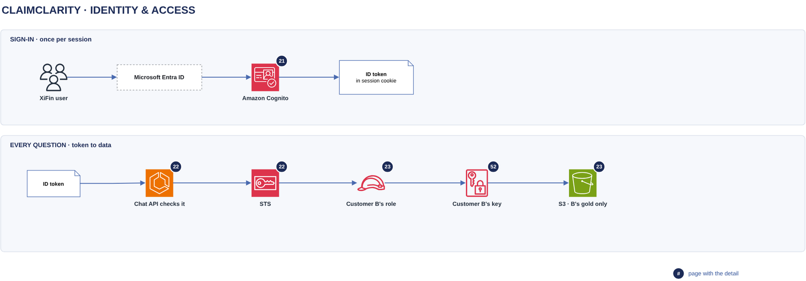

# Identity & access

[Overview](00-overview.md) › Identity & access

A XiFin user signs in with Microsoft Entra ID, and Amazon Cognito issues an ID token that names exactly one
customer. On every question, STS exchanges that token for 15-minute credentials of the customer's reader role, and
those credentials can read only that customer's gold data.

## In this diagram

| Item | What it does | Details |
|---|---|---|
| XiFin user | Opens the ClaimClarity web app and signs in. | [Sign-in](21-sign-in.md) |
| Microsoft Entra ID | Company login. Issues a token only to members of the groups assigned to the ClaimClarity app. | [Sign-in](21-sign-in.md) |
| Amazon Cognito | Federates Entra ID, maps the user to one customer and issues the ID token. | [Sign-in](21-sign-in.md) |
| ID token | Names the customer. Kept in an httpOnly session cookie for 60 minutes. | [Sign-in](21-sign-in.md) |
| Chat API checks it | Verifies the token on every request (gate 4). | [Token to credentials](22-token-to-credentials.md) |
| STS | Exchanges the token for 15-minute credentials if the role's trust policy allows it (gate 5). | [Token to credentials](22-token-to-credentials.md) |
| Customer B's role | The reader role the credentials belong to. It reads Customer B's gold prefix and nothing else. | [Customer isolation](23-customer-isolation.md) |
| Customer B's key | Decrypts Customer B's objects, only for Customer B's roles, only through S3 (gate 6). | [Encryption keys](52-encryption-keys.md) |
| S3 · B's gold only | The current version of Customer B's gold tables. | [Customer isolation](23-customer-isolation.md) |

## How it works

1. The user signs in at Entra ID. Users outside the assigned groups are refused.
2. Cognito refuses users with no customer mapping, and issues a 60-minute ID token for the others.
3. The chat API stores the token in the `cc_session` cookie and verifies it on every request (gate 4).
4. A run worker exchanges the token at STS for Customer B's reader role (gate 5). The credentials last 15 minutes
   and are renewed with the same token in long chats.
5. Each read of Customer B's gold prefix needs IAM, the bucket policy and Customer B's key to allow it (gate 6).

## Specification

| Item | Value |
|---|---|
| Identity provider | Microsoft Entra ID, one enterprise app with "Assignment required" on |
| Federation | Cognito user pool with Entra ID as its only identity provider |
| Customer claim | `custom:customer`, set by an administrator, not writable by the user |
| ID token | 60 minutes. The user signs in again when it expires |
| Session cookie | `cc_session` · HttpOnly · Secure · SameSite=Strict · Path=/api · Max-Age 3600 |
| Reader credentials | AssumeRoleWithWebIdentity, 900 s, renewed when fewer than 3 minutes remain |
| Reader scope | List and read `<customer>/semantic_layer/`, current object versions only |
| The customer's roles and keys | Parser, reader, SFTP copy, transcript and audit roles; a lake key and a transcript key. See [IAM and KMS matrix](91-iam-kms-matrix.md) |
| Logging | Entra sign-in log; CloudTrail for every STS, S3 and KMS call. Tokens are never logged |

## Pages in this area

- [Sign-in](21-sign-in.md): Entra ID, Cognito and the session cookie
- [Token to credentials](22-token-to-credentials.md): gates 4, 5 and 6
- [Customer isolation](23-customer-isolation.md): why Customer A's session cannot reach Customer B's data

## Related

Up: [Overview](00-overview.md) · See also: [Network & security](50-network-security.md) ·
[IAM and KMS matrix](91-iam-kms-matrix.md)
