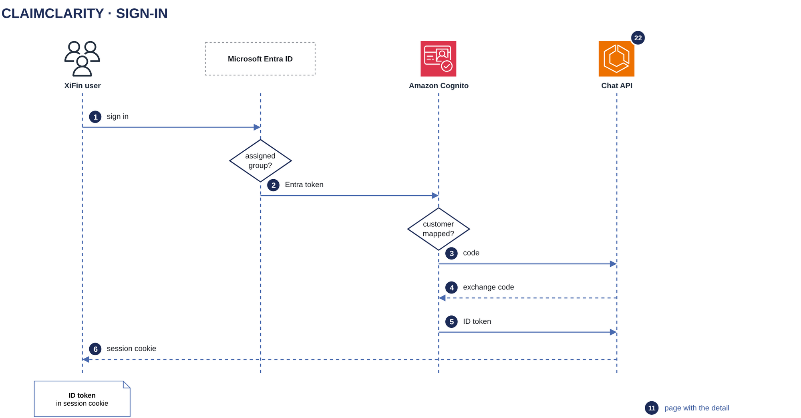

# Sign-in

[Overview](00-overview.md) › [Identity & access](20-identity.md) › Sign-in

Entra ID decides whether a person may use ClaimClarity at all, and Cognito decides which one customer they work for.
The result is a Cognito ID token that the chat API keeps in an httpOnly cookie, so no script in the page can read it.

## In this diagram

| Item | What it does | Details |
|---|---|---|
| XiFin user | Opens the app in a browser with no valid session and is sent to sign in. | |
| Microsoft Entra ID | Company login and MFA. Signs in only members of the assigned groups ("assigned group?"). | [Entra ID card](90-service-catalog.md) |
| Amazon Cognito | Verifies the Entra token, refuses users with no customer ("customer mapped?") and issues the ID token. | [Cognito card](90-service-catalog.md) |
| Chat API | Exchanges the authorization code for the ID token and sets the session cookie. | [Token to credentials](22-token-to-credentials.md) |
| ID token | Held in the `cc_session` cookie and sent with every API call. | |

## How it works

1. The user signs in at Entra ID. Entra issues a token only if the user is in a group assigned to the app.
2. Cognito verifies the Entra token (issuer, tenant, client id) and creates the Cognito user on first sign-in. It
   refuses a user that no administrator has mapped to a customer.
3. Cognito adds the session tags `customer` and `user` (the `sub`) to the token, then sends an authorization code
   to the chat API's sign-in callback.
4. The chat API exchanges the code at the Cognito token endpoint, using the app client secret from Secrets Manager.
5. Cognito returns the ID token. The chat API verifies it (gate 4).
6. The chat API sets the `cc_session` cookie and sends the user back to the app.

## Specification

### ID token

| Claim | Value |
|---|---|
| `iss`, `aud` | The ClaimClarity user pool and app client |
| `token_use` | `id` |
| `sub` | Cognito user id. Conversations are keyed by customer and `sub` |
| `custom:customer` | The one customer the user works for |
| `https://aws.amazon.com/tags` | Session tags `customer`, `user` and, for customer admins, `transcript_admin` |
| `exp` | 3600 s after issue. Signed RS256 |

### Session cookie

| Attribute | Value |
|---|---|
| Name and value | `cc_session` = the ID token |
| Flags | HttpOnly · Secure · SameSite=Strict · Path=/api · Max-Age 3600 |
| Writes | Cookie-borne POST, PUT, PATCH and DELETE need the header `x-cc-csrf: 1`, or the API answers 403 |
| Never | In a URL or in browser storage |

### Lifetimes and revocation

| Item | Lifetime | To cut it off |
|---|---|---|
| Entra session | Company policy | Disable the account or remove it from the assigned groups |
| ID token | 60 minutes | It stays valid until it expires. Disable the Cognito user to stop new sign-ins |
| Refresh token | 30 days, kept by Cognito, never given to the browser | Global sign-out |
| Reader credentials | 15 minutes | "Revoke active sessions" on the customer's reader role |

Sign-out (`POST /api/auth/sign-out`) revokes the user's Cognito tokens, expires the cookie and sends
`Clear-Site-Data: "cache", "storage"`.

### Failure behaviour

| Case | Result |
|---|---|
| Not in an assigned group | Entra refuses (AADSTS50105). No token |
| No customer mapping | Cognito refuses. No token |
| Expired cookie | 401 `auth_expired`. The app sends the user through sign-in once |

### Logging

Entra keeps its sign-in log. Cognito API calls are in CloudTrail. The API records `signed_out` with customer and
user only. Tokens are never logged.

## Related

Up: [Identity & access](20-identity.md) · Next: [Token to credentials](22-token-to-credentials.md) ·
See also: [Network](51-network.md)
