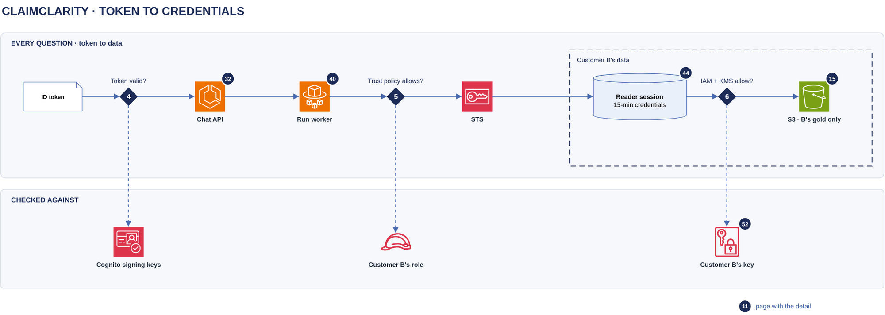

# Token to credentials

[Overview](00-overview.md) › [Identity & access](20-identity.md) › Token to credentials

Every question passes three AWS checks before any customer data is read: the token (gate 4), the role's trust
policy (gate 5) and IAM plus KMS on every read (gate 6). The run worker has no standing access to customer data: it
gets 15-minute credentials for one customer's reader role, for one run.

## In this diagram

| Item | What it does | Details |
|---|---|---|
| ID token | Arrives in the `cc_session` cookie with each API call. | [Sign-in](21-sign-in.md) |
| Gate 4 · Token valid? | Checks the token against the Cognito signing keys. | |
| Chat API | Takes the customer from the verified token only, then queues the run. | [Chat turn](32-chat-turn.md) |
| Run worker | Holds the verified token for the run and calls STS. | [Analyzer](40-analyzer.md) |
| Gate 5 · Trust policy allows? | Customer B's role accepts only ClaimClarity tokens tagged `customer = B`. | |
| STS | Returns 15-minute credentials for Customer B's reader role. | [STS card](90-service-catalog.md) |
| Reader session | DuckDB session opened with those credentials, limited to B's gold relations. | [SQL guard & escalation](44-sql-guard-escalation.md) |
| Gate 6 · IAM + KMS allow? | Each S3 read must pass B's role policy, the bucket policy and B's key policy. | |
| S3 · B's gold only | The version of `B/semantic_layer/` that `CURRENT` names. | [Gold publish](15-gold-publish.md) |
| Cognito signing keys | Public keys the chat API verifies the token with. Cached. | [Network](51-network.md) |
| Customer B's role | The reader role and its trust policy. | [IAM and KMS matrix](91-iam-kms-matrix.md) |
| Customer B's key | Decrypts B's objects, only for B's roles, only through S3. | [Encryption keys](52-encryption-keys.md) |

## How it works

1. **Gate 4.** The chat API checks the token: RS256 with a key from the Cognito signing keys, issuer, audience
   (the ClaimClarity app client), expiry, `token_use = id` and a `custom:customer` claim. Any failure is a 401.
2. The API takes the customer and user from the token. Nothing in the body, query string or headers can change
   them. It queues the run.
3. **Gate 5.** The run worker calls AssumeRoleWithWebIdentity for Customer B's reader role, with session name
   `u--<request id>` and a duration of 900 s. STS verifies the token again and evaluates the trust policy.
4. The worker opens the reader session: it reads `CURRENT` and that version's manifest, then mounts one view per
   gold table, each with its own scoped secret and allowed directory. External access is off and the
   configuration is locked.
5. **Gate 6.** Every S3 read needs B's role policy, the bucket policy and B's key policy to allow it.
6. In long chats, the worker renews the credentials with the same token when fewer than 3 minutes remain, on the
   same gold version. SQL is never run on expired credentials.

## Specification

### Trust policy of Customer B's reader role (gate 5)

| Element | Value |
|---|---|
| Principal | The IAM OIDC provider for the ClaimClarity Cognito user pool |
| Actions | `sts:AssumeRoleWithWebIdentity`, `sts:TagSession` |
| Condition | `<pool>:aud` = the ClaimClarity app client, and `aws:RequestTag/customer` = B |
| Session length | 900 s requested; the role's maximum is 3600 s |

### Customer B's reader role policy (gate 6, IAM part)

| Allowed | On |
|---|---|
| `s3:ListBucket` | The ClaimClarity bucket, prefix `B/semantic_layer/*` only |
| `s3:GetObject` | `B/semantic_layer/*` |

No `GetObjectVersion`, no raw or silver, no transcripts, no writes. `lossless.*` tables are PHI-stripped copies
published next to gold, so even an escalated session never reads a silver object.

### Limits

| Item | Value |
|---|---|
| Credentials | 900 s, renewed when fewer than 180 s remain |
| ID token | 3600 s. No renewal after it expires: the run ends and the user signs in again |
| Signing keys | Cached 24 h; refetched on an unknown key id, at most every 5 minutes |
| Reader session | 2 GB memory, no temp directory, configuration locked |

### Failure behaviour

| Failure | Result |
|---|---|
| Gate 4 | 401 `auth_expired`. No run is queued |
| Gate 5 | The run ends with a sign-in-again message. CloudTrail has the denied call |
| Gate 6 | The SQL call fails and the agent audit records `outcome=error` |
| Credentials expired at a SQL call | Refused and audited as `expired` |
| STS throttled | 3 retries with backoff, then the run fails |

### Logging

CloudTrail records every AssumeRoleWithWebIdentity, S3 GetObject and KMS Decrypt, allowed or denied. The agent
audit records the session opening (customer, user, gold version, escalation flag, a hash of the token) and every SQL
call. See [Audit logging](53-audit-logging.md).

## Related

Up: [Identity & access](20-identity.md) · Previous: [Sign-in](21-sign-in.md) · Next:
[Customer isolation](23-customer-isolation.md)
