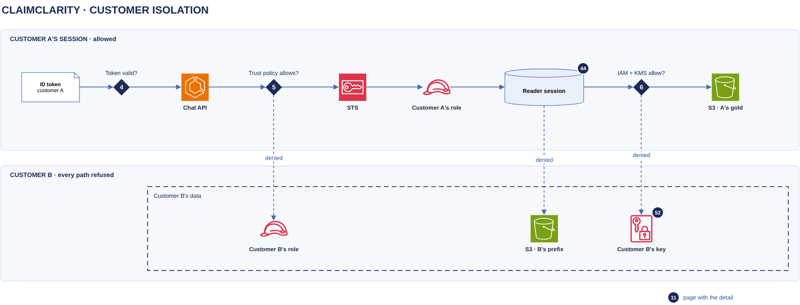

# Customer isolation

[Overview](00-overview.md) › [Identity & access](20-identity.md) › Customer isolation

Customer A's and Customer B's data sit in the same ClaimClarity bucket, separated by independent layers that each
refuse on their own. A Customer A session follows its own path to A's gold, and every branch toward Customer B is
denied.

## In this diagram

| Item | What it does | Details |
|---|---|---|
| ID token · customer A | Signed by Cognito with `custom:customer = A` and the session tag `customer = A`. | [Sign-in](21-sign-in.md) |
| Gate 4 · Token valid? | The chat API takes the customer from the verified token only. | [Token to credentials](22-token-to-credentials.md) |
| Chat API | Ignores any customer named in the request body, URL or headers. | |
| Gate 5 · Trust policy allows? | Only A's roles trust a token tagged `customer = A`. B's role refuses it. | |
| STS | Returns credentials for Customer A's reader role only. | |
| Customer A's role | Reads `A/semantic_layer/` only. | [IAM and KMS matrix](91-iam-kms-matrix.md) |
| Reader session | Its SQL guard and allowed directories cover A's gold relations only. | [SQL guard & escalation](44-sql-guard-escalation.md) |
| Gate 6 · IAM + KMS allow? | A's role policy, the bucket policy and the key policy decide each read. | |
| S3 · A's gold | The only data the session can read. | |
| Customer B's role | Refuses A's token at gate 5. | |
| S3 · B's prefix | Unreachable: the reader session refuses the path, and IAM and the bucket policy deny the read. | |
| Customer B's key | Refuses to decrypt for any role that is not Customer B's. | [Encryption keys](52-encryption-keys.md) |

## How it works

1. A request that names Customer B still runs as Customer A: the customer comes from the verified token (gate 4).
   Conversations are keyed by customer and `sub`, so B's conversations are not found either.
2. A's token cannot assume B's role. B's trust policy requires `aws:RequestTag/customer = B`, and Cognito writes
   that tag from an attribute only an administrator can set (gate 5). A forged token fails the signature check.
3. A's credentials cannot read B's objects (gate 6). A's role policy allows `A/semantic_layer/*` only. The bucket
   policy denies object access outside `${aws:PrincipalTag/customer}/`. B's key decrypts only for B's roles.
4. SQL that names a path under B's prefix never runs. The SQL guard rejects file and network functions, DuckDB's
   allowed directories list only A's gold relations, and the configuration is locked.

## Specification

| Layer | Checks | Set in | Refusal |
|---|---|---|---|
| Entra ID | User is in an assigned group | Entra enterprise app | AADSTS50105 |
| Cognito | User has a customer mapping | Cognito user attribute, administrators only | No token |
| Chat API (gate 4) | Signature, issuer, audience, expiry, customer claim | API configuration | 401 |
| STS (gate 5) | Cognito provider, app client, `customer` tag | Each reader role's trust policy | `AccessDenied` |
| IAM role policy (gate 6) | `<customer>/semantic_layer/*`, current version only | Each reader role | `AccessDenied` |
| Bucket policy (gate 6) | Object access only under the caller's `customer` tag; principals without the tag denied | One policy for all customers | `AccessDenied` |
| KMS key policy (gate 6) | The customer's roles only, through S3, under that customer's prefix | Each customer's keys | `AccessDenied` |
| Reader session | SQL guard, allowed directories, scoped secrets, locked configuration | Opened per run | Guard error |
| Chat state | Keyed by customer and `sub` | Chat API | 404 |

To take a customer offline at once, disable that customer's keys: every one of its objects becomes unreadable. A
key admin can disable a key but cannot decrypt with it.

**Logging.** Refusals at gates 5 and 6 are CloudTrail events with `errorCode = AccessDenied` and raise the
cross-customer denial alarm. Guard refusals are agent-audit records with `outcome = blocked`. See
[Audit logging](53-audit-logging.md).

## Related

Up: [Identity & access](20-identity.md) · Previous: [Token to credentials](22-token-to-credentials.md) · See also:
[Encryption keys](52-encryption-keys.md) · [IAM and KMS matrix](91-iam-kms-matrix.md)
