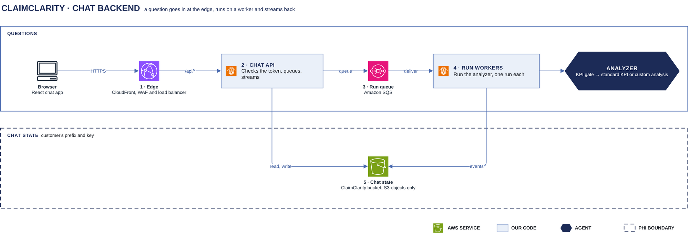

# Chat backend

[Overview](00-overview.md) › Chat backend

The chat API takes a question, queues a run and streams the answer back. A run worker on Fargate does the work.
All chat state is kept in S3 objects under the customer's prefix, and there is no database.

## In this diagram

| Item | What it does | Details |
|---|---|---|
| XiFin user | Asks a question in the React chat app and reads the answer as a stream | |
| CloudFront + WAF | Serves the web app, filters every request, and passes `/api/*` on | [Edge](31-edge.md) |
| Load balancer | Spreads API calls across the chat API tasks | [Edge](31-edge.md) |
| Chat API | Checks the token and limits, saves the question, queues the run, streams the events | [Chat turn](32-chat-turn.md) |
| S3 · chat state | Conversations, run-event chunks and cancel flags under the customer's prefix | [State](33-state.md) |
| Run queue | Amazon SQS. Holds one message per admitted run. | [Limits](34-limits.md) |
| Run worker | Runs the analyzer for one question with the customer's reader credentials | [Analyzer](40-analyzer.md) |
| S3 · gold | The customer's `sem.*` tables, read-only | [Gold publish](15-gold-publish.md) |
| Amazon Bedrock | Claude Haiku, called by the run worker | [Model calls](45-model-calls.md) |

## How it works

1. The browser sends the question to `POST /api/chat` through CloudFront, WAF and the load balancer.
2. The chat API checks the token and the limits, saves the question and puts a run on the queue.
3. A run worker takes the run and exchanges the user's token for the customer's reader credentials.
4. The analyzer in the worker reads gold and calls Claude Haiku on Amazon Bedrock.
5. The worker writes every event to S3. The chat API streams the events to the browser as server-sent events.
6. The worker saves the answer in the conversation.

## Specification

| Item | Value |
|---|---|
| Compute | Two ECS services on Fargate in private subnets: chat API and run workers |
| API contract | Version 1.24.0. `GET /api/contract` returns the version and the schema. |
| Auth | `cc_session` cookie (HttpOnly, Secure, SameSite=Strict, Path=/api). Cookie writes need `x-cc-csrf: 1`. |
| Access | The customer's roles and keys: the transcript role and key for chat state, the reader role and lake key for gold |
| PHI | Questions, answers, table previews and CSV files. They are kept only under the customer's prefix, never in logs or URLs. |
| Buckets | Customer data in the ClaimClarity bucket. The web app and the access logs have their own buckets. |

## Pages in this area

- [Edge](31-edge.md) · [Chat turn](32-chat-turn.md) · [State](33-state.md) · [Limits](34-limits.md)

## Related

Up: [Overview](00-overview.md) · See also: [Identity & access](20-identity.md), [Analyzer](40-analyzer.md)
