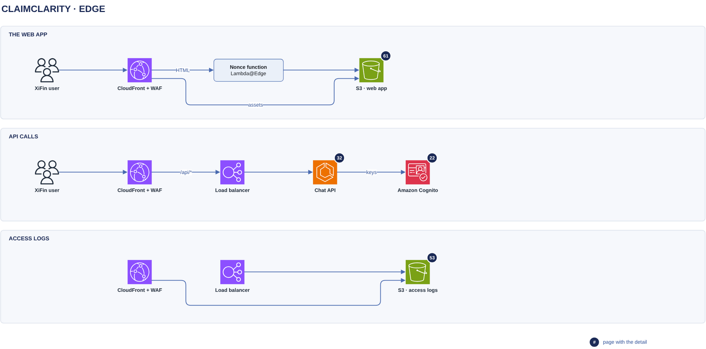

# Edge

[Overview](00-overview.md) › [Chat backend](30-chat-backend.md) › Edge

One CloudFront distribution with AWS WAF serves the web app and the API on the same origin, so there is no CORS.
The web app comes from its own S3 bucket, and API calls go through a load balancer to the chat API.

## In this diagram

| Item | What it does | Details |
|---|---|---|
| XiFin user | Opens the app and calls `/api/*` on the same origin | |
| CloudFront + WAF | TLS, WAF rules and rate limit, routing by path | [Service catalog](90-service-catalog.md) |
| Nonce function | Lambda@Edge. Returns `index.html` with a fresh CSP nonce on every response. | |
| S3 · web app | The web app bucket: hashed assets and the HTML template. No PHI. | [Deploy](61-deploy.md) |
| Load balancer | Application Load Balancer. Accepts traffic from CloudFront only. | [Service catalog](90-service-catalog.md) |
| Chat API | Checks the token on every call | [Chat turn](32-chat-turn.md) |
| Amazon Cognito | Publishes the keys that sign ID tokens | [Token to credentials](22-token-to-credentials.md) |
| S3 · access logs | The log bucket: CloudFront and load balancer access logs | [Audit & logging](53-audit-logging.md) |

## How it works

1. WAF checks every request at CloudFront.
2. HTML goes through the nonce function. `/assets/*` comes straight from the web app bucket.
3. `/api/*` goes to the load balancer with caching off, and the response is streamed.
4. The chat API checks the ID token's signature, audience, expiry and customer, using Cognito's keys.
5. CloudFront and the load balancer write access logs to the log bucket.

## Specification

| Item | Value |
|---|---|
| Caching | `/assets/*` cached for 1 year (immutable). HTML and `/api/*` are `no-store`. |
| Integrity | Subresource Integrity on every script and stylesheet. Edge features that rewrite JS, CSS or HTML stay off. |
| Load balancer access | Security group allows only the CloudFront prefix list. The listener also requires a secret origin header. |
| Timeouts | SSE heartbeat 15 s. CloudFront origin read timeout 60 s. ALB idle timeout 60 s. |
| Body limit | 1 MiB at the API (413). WAF and the load balancer allow at least that. |
| Chat API egress | NAT gateway with Network Firewall, allowing only the Cognito hosts |
| Access logs | Full paths with opaque ids, so treated as PHI-bearing: encrypted, security team only, 1 year |
| Permissions | CloudFront reads the web app bucket through origin access control. The nonce function reads only the HTML template. |
| Failure | WAF block: 403, or 429 for the rate rule. Nonce function down: the app doesn't load, and the API keeps working. |

## Related

Up: [Chat backend](30-chat-backend.md) · See also: [Network](51-network.md), [Deploy](61-deploy.md)
