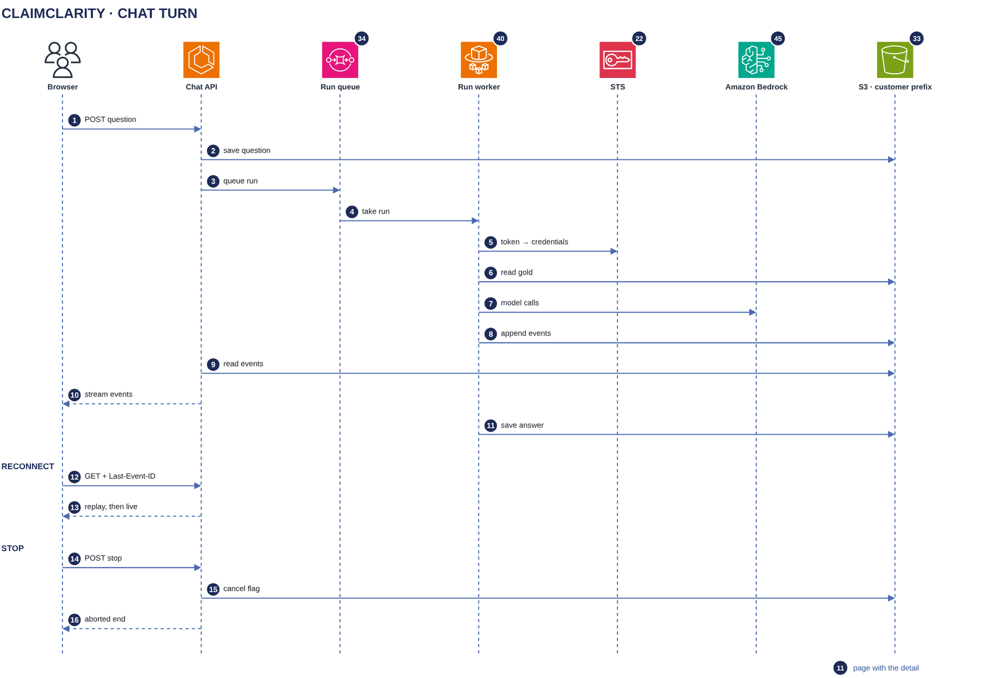

# Chat turn

[Overview](00-overview.md) › [Chat backend](30-chat-backend.md) › Chat turn

One question goes from the browser to a run worker, and its events come back through S3 and the chat API. Because
the events are stored, a dropped connection can resume on any API task, and Stop reaches the worker as a flag.

## In this diagram

| Item | What it does | Details |
|---|---|---|
| Browser | Sends the question, reads the stream, reconnects, presses Stop | |
| Chat API | Saves the question, queues the run, relays the events | [Limits](34-limits.md) |
| Run queue | Holds the run until a worker is free | [Limits](34-limits.md) |
| Run worker | Runs the analyzer and writes events and the answer | [Analyzer](40-analyzer.md) |
| STS | Exchanges the user's token for 15-minute reader credentials | [Token to credentials](22-token-to-credentials.md) |
| Amazon Bedrock | Claude Haiku | [Model calls](45-model-calls.md) |
| S3 · customer prefix | The conversation, run-event chunks, cancel flag and gold | [State](33-state.md) |

## How it works

1. **Ask (1–3).** `POST /api/chat` with the cookie and `x-cc-csrf: 1`. The chat API saves the question with an
   If-Match write and queues the run. It answers `200 text/event-stream`.
2. **Run (4–8).** A worker takes the run, gets reader credentials from STS and reads gold. It calls the model, and
   appends numbered events to chunks: every 64 events, every 1 s, and at `message.end`.
3. **Stream (9–10).** The chat API reads new chunks every 0.5 s. It sends each event as `id: <messageId>:<seq>`,
   and a heartbeat after 15 s of silence.
4. **Save (11).** The worker adds the answer to the conversation. It never creates a conversation, so a deleted chat
   stays deleted.
5. **Reconnect (12–13).** `GET /api/chat/{messageId}/stream` with `Last-Event-ID`. The API replays events with a
   higher `seq`, then follows live. Replay is available for 60 s after the end.
6. **Stop (14–16).** `POST /api/chat/{messageId}/stop` writes a cancel flag. The worker checks it every 0.5 s,
   interrupts the SQL and ends with `message.end {finishReason: "aborted"}` within about 1 s.

## Specification

| Item | Value |
|---|---|
| Queue message | Ids (message, conversation, customer, user hash) and the user's ID token. Never the question text. |
| Reader credentials | 15 minutes. Renewed with the same ID token when fewer than 3 minutes remain. |
| Outcomes | `stop`, `abstain`, `needs_input` (clarification, answerable for 30 minutes), `error`, `aborted` |
| Disconnect | No client attached for 10 s: the run is cancelled |
| Client retry | Reconnects after 250 ms, 1 s, 2 s and 4 s, then reloads the conversation. Also reconnects after 45 s of silence. |
| Errors | 401 `auth_expired`, 404 `stream_gone`, 409 `clarification_expired`, 413, 422 `validation`, 429 `rate_limited` |
| PHI on the wire | Step events carry counts and column names only. Shown SQL has PHI literals replaced by `?`. No PHI in URLs. |
| Worker failure | Not retried. The stream stops, and after 60 s with no events the client reloads and the user retries. |
| Chunk write failure | Logged. The live stream goes on. Only a replay can miss those events. |

## Related

Up: [Chat backend](30-chat-backend.md) · See also: [State](33-state.md), [Limits](34-limits.md)
