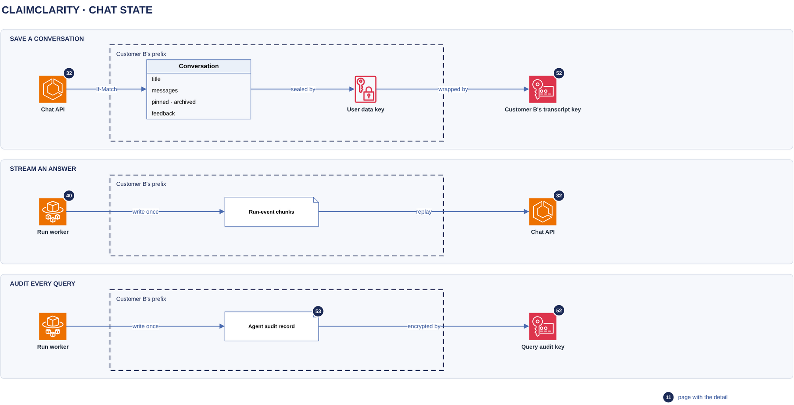

# State

[Overview](00-overview.md) › [Chat backend](30-chat-backend.md) › State

Everything the chat backend keeps is an S3 object in the ClaimClarity bucket, under the customer's prefix and
encrypted with the customer's key. There is no DynamoDB. Each conversation is one object, changed by read,
change and a conditional write (If-Match on the ETag), which is the same compare-and-set pattern the gold
CURRENT pointer uses. Message text is also sealed with a per-user data key, so deleting a user's key destroys
their transcripts even where an object copy survives.

## In this diagram

| # | Box | What it does | Details |
|---|---|---|---|
| 1 | Chat API | Lists, reads, renames, pins, archives and deletes conversations. Saves the user's question. | [Chat turn](32-chat-turn.md) |
| 2 | Run worker | Writes run-event chunks, the final answer and one agent-audit record per SQL call | [Chat turn](32-chat-turn.md) |
| 3 | Conversation index | One small JSON object per conversation: ids, times and message count. No text. | |
| 4 | Conversation object | One sealed object per conversation: title, messages, flags and feedback. Written with If-Match. | |
| 5 | Run-event chunks | Numbered, write-once objects holding one answer's stream events | |
| 6 | Agent audit record | One write-once record per SQL statement, kept 6 years | [Audit & logging](53-audit-logging.md) |
| 7 | User data key | A per-user AES-256 key, stored only in wrapped form. Seals the conversation objects and event chunks. | [Encryption keys](52-encryption-keys.md) |
| 8 | Customer B's key | The customer's KMS key. Wraps every user data key and is the bucket's SSE-KMS key for the prefix. | [KMS](52-encryption-keys.md) |

## How it works

1. To list chats, the chat API reads the index objects (3), which hold no text. To open a chat it reads the
   conversation object (4) and opens it with the user data key.
2. To change a conversation (a new question, a rename, a pin, feedback), the chat API reads the object and its
   ETag, applies the change and writes it back with `If-Match: <ETag>`. A new conversation is written with
   `If-None-Match: *`. If another task wrote in between, S3 answers 412. The chat API reads it again and
   reapplies the change, up to 8 times with a short random backoff. After that the request fails with
   `conflict`.
3. The run worker appends events to numbered chunk objects (5), each written once with `If-None-Match: *`.
   Any API task can replay a run from them.
4. When the answer is done, the run worker appends it to the conversation object (4), with the same If-Match
   loop. It never creates a conversation, so an answer cannot bring back a deleted chat.
5. For every SQL statement, the reader session writes an agent-audit record (6): customer, user, request id,
   the SQL and its SHA-256, the outcome and the row count, never result cells.
6. The user data key (7) is created on the user's first save and stored wrapped by Customer B's key (8). Each
   seal binds customer, user and object name as associated data, so a blob copied to another user or chat
   does not open.

## Specification

### Object layout (under the customer's prefix)

| Object | Key | Written | PHI |
|---|---|---|---|
| Conversation index | `transcripts/users/{user}/meta/{conversation}.json` | after each conversation change | No: ids, times, counts |
| Conversation object | `transcripts/users/{user}/content/{conversation}.bin` | If-Match (If-None-Match: * when new) | Yes: questions, answers, table previews, feedback comments |
| Run-event chunk | `transcripts/users/{user}/runs/{conversation}/{message}/{000000}.bin` | once, If-None-Match: * | Yes: answer text and table rows |
| Cancel flag | `transcripts/users/{user}/runs/{conversation}/{message}/cancel` | once, by the chat API | No |
| User data key | `transcripts/users/{user}/dek.bin` | once, If-None-Match: * (the first writer wins) | No (wrapped key) |
| Retention setting | `transcripts/users/{user}/retention.json` | on change | No: a number of days |
| Conversation owner | `transcripts/conversation-owners/{conversation}.json` | once, If-None-Match: * | No: the owning user hash |
| CSV download | `transcripts/users/{user}/downloads/{fileId}.bin` | once, sealed like the content | Yes: full result rows |
| Agent audit | `audit/queries/{yyyy-mm-dd}/{request}.json` | once, If-None-Match: *, Object Lock compliance mode | Yes: SQL text |

`{user}` is a 32-character hash of customer and user id, never the e-mail address. `{conversation}` and
`{message}` are opaque ids (`[A-Za-z0-9_:.-]`, at most 128 characters, never derived from data).

### Conversation object fields

| Field | Content |
|---|---|
| `title` | "New analysis" at first. After the first answered question it is set from the result's column names only (for example "Paid amount by payer"), never from the question. A user rename always wins. |
| `messages` | User messages (`text`, `parentId`, `editOf`) and assistant messages (`parts`, `finishReason`, `usage`, `steps`, `sources`, `feedback`). Edits and regenerations are siblings, so the history is a tree. |
| `pinned`, `archived` | Booleans. Archiving drops the pin, and pinning unarchives. |
| `feedback` | Thumbs up or down, reason ids and a comment of at most 1,000 characters, on assistant messages |

A pending clarification is the assistant message's clarification part. It can be answered for 30 minutes.

### Encryption

| Layer | How |
|---|---|
| At rest in S3 | SSE-KMS with Customer B's key. The bucket policy denies PUTs under the prefix with any other key. |
| Application seal | AES-256-GCM with the user data key. Associated data: customer, user hash and object name. |
| User data key | Wrapped by Customer B's key with encryption context `customer`, `purpose=transcript-dek`, `user` |
| Delete all chats | Deletes every object under the user's prefix, the wrapped data key included |
| Customer shred | Disabling the customer's key makes every chat unreadable. The API then answers 410 `transcripts_unavailable`. |

### Permissions

| Who | Can do |
|---|---|
| Chat API, with the user's session credentials (Customer B's role, tagged with the user) | Get, put, delete and list under `transcripts/users/{this user}/`. Get and put the owner record. Decrypt and generate data keys with Customer B's key only for this user's encryption context. |
| Run worker, same credentials | Put chunks and the answer under the same user prefix. Read the cancel flag. Put agent-audit records (no get, no delete). |
| Audit reader | Get and list `audit/queries/` for one customer. No chat objects. |
| Anyone else | Nothing. Another user's conversation id is answered with 404, never 403. |

### Retention and deletion

| Item | Value |
|---|---|
| Conversations | 90 days after the last change. A user may choose fewer days (0 to 90). |
| Sweep | Every hour, and once at startup. When a user has nothing left, their data key is deleted too. |
| Run-event chunks | Deleted with their conversation |
| CSV downloads | 15 minutes, bound to the user, revoked when the conversation is deleted |
| Agent audit | 6 years (2,190 days), write-once, never deleted |
| Temporary chats | Never written to S3. Held in the memory of one chat API task (the load balancer keeps the user on it) for 1 hour idle, at most 20 per user. They are lost if that task stops. Their run events still pass through chunk objects, because that is how a worker reaches the API. The chunks are deleted 60 s after the run ends, with a 1-day lifecycle rule as a backstop. |

### Failure behaviour

- If the conversation keeps changing under all 8 attempts, the request fails. The client shows "This
  conversation changed in the meantime".
- A crash between the content write and the index write leaves the conversation unlisted. It is not read and
  expires with the sweep.
- A failed chunk write is logged. The live stream continues. Only a replay can miss those events.
- Nothing here logs text. Audit and log events carry ids, counts and timings only.

## Related

Up: [Chat backend](30-chat-backend.md) · See also: [S3 layout](12-s3-layout.md),
[Encryption keys](52-encryption-keys.md), [Audit & logging](53-audit-logging.md),
[Customer isolation](23-customer-isolation.md)
