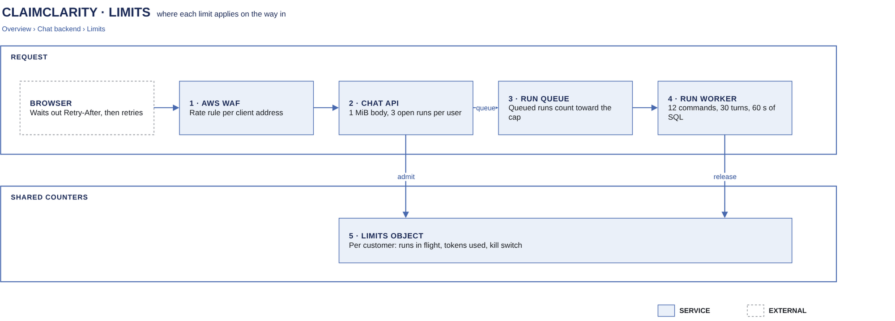

# Limits

[Overview](00-overview.md) › [Chat backend](30-chat-backend.md) › Limits

Limits stop one user or one customer from using up the run workers or the model budget. They also bound
what a single question can cost. Each limit applies at the first place that can enforce it. It always ends in
a clear message or a normal answer outcome, never a hung spinner. Counters that must hold across API tasks
live in one S3 limits object per customer, written with If-Match like a conversation.

## In this diagram

| # | Box | What it does | Details |
|---|---|---|---|
| – | Browser | Waits out `Retry-After` on a 429 and retries up to 2 times, then shows the error | |
| 1 | AWS WAF | Rate rule per client address, before anything reaches an origin | [WAF card](../cards/waf.md) |
| 2 | Chat API | Body size, request shape, unfinished runs per user, runs in flight per customer, budget and kill switch | [Chat turn](32-chat-turn.md) |
| 3 | Run queue | Queued runs already count toward the customer's limit, so the queue cannot be flooded | [SQS card](../cards/sqs.md) |
| 4 | Run worker | Budgets inside one question: commands, model turns, output tokens, SQL time, rows, run deadline | [Agent analyzer](40-analyzer.md) |
| 5 | Limits object | Per customer: settings, runs in flight (leases) and tokens used today | [State](33-state.md) |

## How it works

1. WAF counts requests per client address. Over the rule's rate it answers 429 at the edge.
2. The chat API rejects a body over 1 MiB (413) before it parses it, and a malformed request (422).
3. It counts the user's unfinished runs. A fourth run is refused with 429.
4. It admits the run in the customer's limits object with an If-Match write. It adds a lease (message id, user
   hash, expiry) if the customer is under its runs-in-flight limit, under its daily token budget, and not
   switched off. Expired leases are ignored, so a crashed worker never holds a slot for long.
5. The run waits in the queue until a worker is free. The ECS service scales the workers on queue depth.
6. The run worker applies the per-question budgets while the analyzer works ([Agent analyzer](40-analyzer.md)).
7. At the end the worker releases the lease and adds the run's tokens to today's usage, again with If-Match.

## Specification

### Limits and what the user sees

| Limit | Value | Where | What the user sees |
|---|---|---|---|
| Requests per client address | WAF rate rule, 5-minute window | WAF | 429 `rate_limited`. The client waits `Retry-After` and retries twice, then shows "Too many requests". |
| Request body | 1 MiB | Chat API | 413 `payload_too_large`: "Message too long" (not retryable) |
| Message text | 8,000 characters per message | Chat API | 422 `validation` |
| Unfinished runs per user | 3, across all tabs and sessions | Chat API, counted from the limits object | 429 "Too many answers in progress. Wait for one to finish.", `Retry-After: 3`. The client retries on its own. |
| Runs in flight per customer | Set per customer in the limits object (queued and running) | Chat API | 429 `rate_limited` with `Retry-After: 3` |
| Daily token budget per customer | Set per customer in the limits object | Chat API, at admission | 429 `rate_limited` with `Retry-After` until midnight UTC. The client shows "Too many requests". |
| Kill switch per customer | On or off in the limits object | Chat API | 503: "Analyst unavailable". Nothing runs. |
| Analyzer commands | 12 per question (a failed command does not count) | Run worker | The analyzer answers with what it has, or abstains |
| Model turns | 30 per question | Run worker | The run ends as `error`: "The analysis failed. Try again." |
| Model output | 4,096 tokens per model call | Run worker | The call ends early. The analyzer goes on or ends as above. |
| Time per SQL statement | 25 s | Reader session | `step.sql_result` with `error.code: "timeout"`. The analyzer may repair it. |
| SQL time per question | 60 s in total | Reader session | The analyzer is told the time is used up, and answers or abstains |
| Rows per query | 1,000 (the guard adds the LIMIT). The model sees 20. The user sees a 50-row preview plus a CSV. | Reader session | The table shows "Showing n of N rows" |
| Reader credentials | 15 minutes | STS | Queries after expiry are refused |
| Run deadline | 110 s from the start of the run, inside the 120 s ECS stop timeout, so a deploy never cuts a run | Run worker | The run ends as `error`. The lease expires at the same time. |
| Time in the queue | 2 minutes | Run worker | A run that waited longer ends as `error` without running. `usage.latency.queueMs` records the wait. |
| Clarification reply | 30 minutes | Chat API | 409 `clarification_expired`: "Ask again" |
| Stream replay | 60 s after the run ends | Chat API | 404 `stream_gone`. The client reloads the saved answer. |
| Disconnect grace | 10 s with no client attached | Chat API | The run is cancelled and saved as aborted |
| CSV download | 15 minutes | Chat API | 404: "Not found or expired" |
| Temporary chats | 20 per user, 1 hour idle | Chat API | The least recently used one is dropped |

### Back-pressure

- Admission happens before the message is queued, so the queue only grows by what customers are allowed to run.
- The run worker service scales on the queue's `ApproximateNumberOfMessagesVisible` per task. Each worker runs
  one question at a time.
- An alarm fires when the oldest message is older than 30 s ([Monitoring](62-monitoring.md)).
- While a run waits in the queue, the stream sends heartbeats every 15 s, so the connection stays open.

### Limits object

| Item | Value |
|---|---|
| Key | `chat/limits.json` under the customer's prefix |
| Holds | Settings (runs in flight, daily tokens, kill switch), leases `{messageId, user, expiresAt}`, today's token count |
| Writes | Read, change, If-Match write. Up to 8 attempts with jittered backoff. The same loop as the conversation object. |
| Who changes settings | The operations role, through the deploy pipeline. Users and the chat API cannot change settings. |
| PHI | None |

### Logging

Each refusal writes an audit event with the customer, the user and the reason (for example
`chat_rate_limited`, `reason=concurrent_runs`). These events feed the limits metrics in
[Monitoring](62-monitoring.md).

## Related

Up: [Chat backend](30-chat-backend.md) · See also: [Chat turn](32-chat-turn.md),
[Model calls](45-model-calls.md), [Monitoring](62-monitoring.md)
