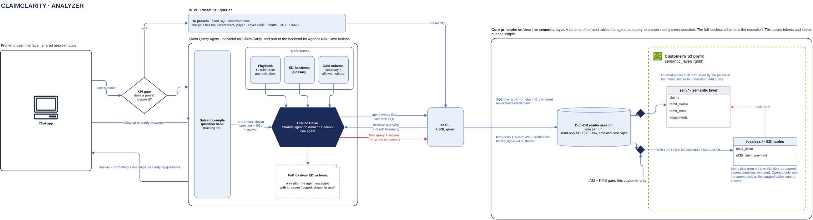

# Analyzer

[Overview](00-overview.md) › Analyzer

The analyzer is code inside the run worker (ECS on Fargate) that turns one question into one answer, using Claude
Haiku on Amazon Bedrock. A KPI gate sends each question to a preset KPI query or to the Claim Query Agent, and both
read the customer's gold tables only through the cc CLI and SQL guard, on a read-only reader session.

## In this diagram

| Item | What it does (one sentence) | Details |
|---|---|---|
| Chat app | The frontend, shared between apps, where the user asks and sees answers, live steps and clarifying questions. | [Chat turn](32-chat-turn.md) |
| KPI gate | Decides whether one preset KPI query answers the question exactly. | [KPI gate](41-kpi-gate.md) |
| Preset KPI queries | 16 reviewed, fixed SQL queries; the gate fills their parameters (payer, payer class, month, CPT, CARC). | [Preset KPI queries](42-standard-kpi-path.md) |
| Claim Query Agent | The Strands agent that answers every other question; also part of the backend for Agentic Next Best Actions. | [Claim Query Agent](43-custom-analysis-agent.md) |
| Each turn: solved example question bank | Gives the agent the 3 most similar solved questions, with today's date, the data coverage and the conversation history. | [Claim Query Agent](43-custom-analysis-agent.md) |
| Cached: Playbook, EDI business glossary, Gold schema | The parts of the agent's prompt that are the same for every question, cached by Bedrock. | [Model calls](45-model-calls.md) |
| Claude Haiku | The model behind the gate and the agent, on Amazon Bedrock. | [Model calls](45-model-calls.md) |
| Full lossless EDI schema | Described to the agent only after it escalates with a reason, which is logged and shown to the user. | [cc CLI + SQL guard](44-sql-guard-escalation.md) |
| cc CLI + SQL guard | The only way to the data: it checks every query from both paths, and the server re-runs the agent's final query. | [cc CLI + SQL guard](44-sql-guard-escalation.md) |
| DuckDB reader session | One read-only session per run, with row, time and cost caps, using the customer's 15-minute credentials. | [Token to credentials](22-token-to-credentials.md) |
| Customer's S3 prefix | Holds `sem.*` (gold, read by default) and `lossless.*` (PHI-stripped EDI tables, only after escalation). | [S3 layout](12-s3-layout.md) |
| IAM + KMS gate | AWS allows the reader to read this customer's data only (gate 6). | [Customer isolation](23-customer-isolation.md) |

## How it works

1. The user asks a question in the chat app. The KPI gate checks whether a preset answers it exactly.
2. **Yes:** the preset's fixed SQL runs with the gate's values, and a short reply is written from the result.
3. **No:** the Claim Query Agent gets the question with 3 similar solved examples and its cached references. It
   answers, asks a clarifying question, or escalates to the lossless schema with a stated reason.
4. The agent writes cc CLI calls with SQL. Each one passes the SQL guard and runs on the DuckDB reader session, and
   the results stream back to the agent.
5. The agent submits its final query and answer. The server re-runs that query, so the numbers come from the
   database.
6. The answer streams back to the chat app with its formatting, SQL and live steps, or as clarifying questions.

## Specification

| Item | Value |
|---|---|
| Where it runs | Inside the run worker (ECS on Fargate). The analyzer is not a separate service. |
| Model | Claude Haiku on Amazon Bedrock, called with the run worker's task role |
| Data read | The signed-in customer's `sem.*`. `lossless.*` only after a reasoned escalation. Never another customer, never silver objects. |
| Credentials | The customer's reader role, for 15 minutes. The agent never holds credentials; SQL goes to the reader over a per-run channel. |
| Writes | None. Every query is one read-only SELECT. |
| Guard limits | 25 s per query, 60 s total query time per question, 1,000 rows per query, keyless joins over 100 million row pairs refused |
| PHI | Query results are treated as PHI. Identifier columns are redacted before results leave the reader. |
| Failure | If the gate or a preset fails, the question goes to the Claim Query Agent. If the agent ends without an answer, the user gets a retryable error. |
| Logging | Every query, escalation and refusal is audited under the customer's audit key. Model token usage is recorded per run. |

## Pages in this area

- [KPI gate](41-kpi-gate.md)
- [Preset KPI queries](42-standard-kpi-path.md)
- [Claim Query Agent](43-custom-analysis-agent.md)
- [cc CLI + SQL guard](44-sql-guard-escalation.md)
- [Model calls](45-model-calls.md)

## Related

Up: [Overview](00-overview.md) · See also: [Chat turn](32-chat-turn.md) · [Customer isolation](23-customer-isolation.md)
