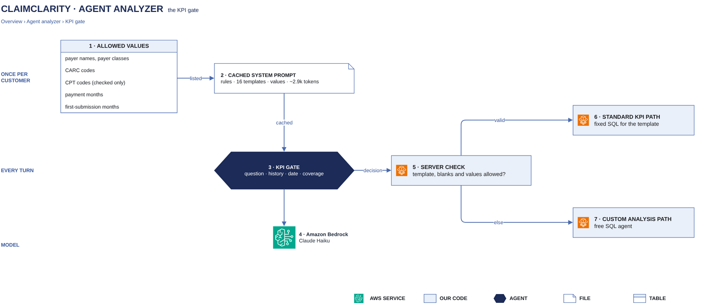

# KPI gate

[Overview](00-overview.md) › [Agent analyzer](40-analyzer.md) › KPI gate

The KPI gate is the first model call of every turn. It decides whether one standard KPI template computes exactly
what the user asked and, if so, fills in the template's values. It is built to say no when in doubt: a wrong
template would give a confident wrong answer, while "no" only costs the time of the custom analysis path. The
server checks every decision before any SQL runs.



## In this diagram

| # | Box | What it does | Details |
|---|---|---|---|
| 1 | Allowed values | The values a template blank may take, computed once per customer and gold version through the SQL guard | [SQL guard and escalation](44-sql-guard-escalation.md) |
| 2 | Cached system prompt | The gate's instructions, the template catalog and the allowed values, with a cache point after them (about 2.9k tokens) | [Model calls](45-model-calls.md) |
| 3 | KPI gate | A Strands agent with no tools. It reads the turn input and returns a `GateDecision`. | |
| 4 | Amazon Bedrock | Claude Haiku, on the same model and session as the analyzer | [Amazon Bedrock card](90-service-catalog.md) |
| 5 | Server check | Code that accepts or rejects the decision | |
| 6 | Standard KPI path | Runs the template's fixed SQL | [Standard KPI path](42-standard-kpi-path.md) |
| 7 | Custom analysis path | The free-SQL agent, for everything else | [Custom analysis agent](43-custom-analysis-agent.md) |

## How it works

1. When a customer's gold version is first used, the run worker computes the allowed values (1) through the guard
   and builds the gate's system prompt (2). Both are reused for every turn of that customer and gold version.
2. For each turn, the gate (3) gets:
   - the question;
   - the conversation's earlier questions, each with how it was answered (template id and values, or "custom
     analysis"), so a follow-up such as "and for Cigna?" keeps the measure;
   - today's date and the customer's data coverage.
3. The gate makes one call to Claude Haiku on Bedrock (4). The cached prompt is read from the prompt cache; only the
   turn input is new. The answer is structured output, a `GateDecision`.
4. The server check (5) accepts the decision only when the template exists, the values have exactly that template's
   blanks, and every value is in its allowed list.
5. A valid decision goes to the standard KPI path (6). Everything else goes to the custom analysis path (7).
6. The user sees one step: "Standard KPI · &lt;template id&gt; · &lt;values&gt;" or
   "Custom analysis · &lt;gate reason&gt;".

## Specification

**The decision**

```
GateDecision {
  fits: bool                 # true only when one template computes exactly what was asked
  template_id: str           # the template, when fits is true
  values: dict[str, str]     # one value per blank of that template
  assumptions: list[str]     # shown with the answer
  reason: str                # one line, shown in the step when the question goes to custom analysis
}
```

**Prompt rules**

- `fits=true` only when one template computes exactly what was asked: the same measure, population, filters and
  grouping.
- Any extra filter, a different grouping, a comparison, a "why", several numbers or a different definition means
  `fits=false`.
- When unsure, `fits=false`.
- The gate never asks the user anything. Clarifying questions belong to the custom analysis path.

**Allowed values** (per customer and gold version, read through the SQL guard)

| Blank | Source | In the prompt |
|---|---|---|
| `payer` | payer names | listed |
| `payer_class` | payer classes | listed |
| `carc` | CARC codes | listed |
| `cpt` | CPT/HCPCS codes billed | not listed; the server checks the value against the list |
| `month` | payment months | given as the covered range |
| `month` (two submission-month templates) | first-submission months | checked against this list instead |

**Template catalog:** `analyzer/kpi_templates.yaml`, version 1, 16 templates. Each has a definition (the text the
gate sees), its blanks and fixed SQL with DuckDB named parameters (`$payer`, `$payer_class`, `$month`, `$cpt`,
`$carc`) and an alias on every output column. Changing the catalog is a reviewed change, and the version is part of
every answer (`template:<id>@v1`).

| Template id | Blanks | What it computes |
|---|---|---|
| `payer_denial_rate` | payer | Share of one payer's current claim adjudications that are denials (each claim once per payer) |
| `payer_class_denial_rate` | payer_class | Denial rate of all payers in one payer class, over current adjudications |
| `payer_paid_in_month` | payer, month | Total one payer paid in one calendar month, current adjudications, by payment date |
| `cpt_denied_lines` | cpt | Denied service lines billed with one CPT code, current adjudications |
| `claims_first_submitted_in_month` | month | Claims whose first submission fell in one calendar month |
| `denials_with_carc` | carc | Denied current claim and payer adjudications carrying one CARC under group CO |
| `payer_avg_paid_per_paid_claim` | payer | Average payment per claim for one payer, over current adjudications that paid more than $0 |
| `reversals_in_month` | month | Claim reversals (claim status 22) with a payment date in one calendar month |
| `payer_patient_responsibility` | payer | Total patient responsibility one payer assigned on its current adjudications |
| `never_remitted_submitted_in_month` | month | Claims first submitted in one month that never received any 835 |
| `payer_top_denial_carcs` | payer | One payer's denial CARCs (group CO) ranked by denied claims, current adjudications |
| `payer_monthly_denial_rate` | payer | One payer's denial rate per payment month, current adjudications |
| `payer_days_to_first_remit` | payer | For one payer as primary: average days from first submission to that payer's first 835, one decimal |
| `payer_partial_line_denials` | payer | Lines one payer denied on claims whose current adjudication is not a denial |
| `secondary_paid_for_primary` | payer | Total paid by secondary payers on claims whose primary payer is the given payer |
| `cpt_share_of_line_payments` | cpt | Share of all service-line paid dollars on lines billed with one CPT code |

**Failure behaviour.** Every failure sends the turn to the custom analysis path and is logged: invalid values, an
exception, a timeout, no structured output, a SQL error or a failed reply on the standard path. The user never sees
a gate error; the turn simply takes the custom analysis path.

**Measured**

| Measure | Value |
|---|---|
| Gate latency | about 2.3 s per call |
| Gate cost | about $0.0004 per call |
| Wrong template answers on the validation set | 0 of 28 |
| Same decision on repeated runs | every question |

The validation set's hand-written questions are all multi-step analyses, which the gate correctly sends to custom
analysis. Its 11% template share is therefore not an estimate of how many real questions the standard KPI path
answers.

**Data and logging.** The prompt holds payer names and codes, not patient data. The question and history are
conversation content and are stored only with the conversation (see [State](33-state.md)). The run log records the
decision (template id or "custom analysis") and any failure type, not the question text.

## Related

Up: [Agent analyzer](40-analyzer.md) · See also: [Standard KPI path](42-standard-kpi-path.md) ·
[Model calls](45-model-calls.md) · [Evaluation and regression](63-eval-regression.md)
