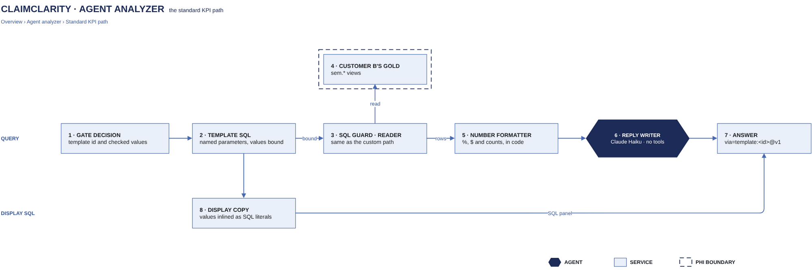

# Preset KPI queries

[Overview](00-overview.md) › [Analyzer](40-analyzer.md) › Preset KPI queries

When the KPI gate finds a fitting preset, the answer comes from reviewed, fixed SQL with the values bound as
parameters, so the model cannot change the query. Code formats the numbers, and Claude Haiku writes a short reply
from them.

## In this diagram

| Item | What it does (one sentence) | Details |
|---|---|---|
| Chat app | Sends the question and shows the answer and its SQL. | [Chat turn](32-chat-turn.md) |
| KPI gate | Picks the preset and its values. | [KPI gate](41-kpi-gate.md) |
| Preset KPI queries | 16 fixed SQL queries with named parameters for payer, payer class, month, CPT and CARC. | |
| Display SQL | The same SQL with the values written in, used wherever SQL is shown or saved. | |
| cc CLI + SQL guard | Checks and runs the query, exactly as for the agent. | [cc CLI + SQL guard](44-sql-guard-escalation.md) |
| DuckDB reader session | Runs the query read-only on the customer's gold. | [cc CLI + SQL guard](44-sql-guard-escalation.md) |
| IAM + KMS gate | AWS allows the reader to read this customer's data only (gate 6). | [Customer isolation](23-customer-isolation.md) |
| Customer's S3 prefix · `sem.*` | The gold tables the presets read. | [S3 layout](12-s3-layout.md) |
| Number formatting | Formats rates as 12.3%, money as $1,234.56 and counts as 1,649, in code. | |
| Claude Haiku · reply writer | Writes 1–3 sentences from the formatted rows, copying the values exactly. | [Model calls](45-model-calls.md) |

## How it works

1. The gate's preset and values become bound parameters. No value is pasted into the SQL that runs.
2. The query passes the SQL guard and runs on the reader session against `sem.*`.
3. Code formats the numbers in the result.
4. Claude Haiku writes a short reply with the gate's assumptions. It has no tools and writes no table.
5. The answer has the same parts as an agent answer (text, table, SQL, assumptions) and is marked
   `via="template:<id>@v1"`.
6. The display SQL is what the SQL panel, history, run events and exports show. It runs as-is to the same rows.

## Specification

| Item | Value |
|---|---|
| SQL that runs | The preset's fixed SQL with bound parameters. Never written by the model. |
| Data read | `sem.*` of the current gold version only. Presets never escalate. |
| Credentials | The customer's reader role, as for every query |
| Limits | The SQL guard's: 25 s per query, 60 s per question, 1,000 rows |
| PHI | Result rows are treated as PHI; identifier columns are redacted |
| Failure | A SQL error, timeout or failed reply sends the question to the Claim Query Agent and is logged |
| Logging | Preset id, version and values, plus the query's audit record |

## Related

Up: [Analyzer](40-analyzer.md) · See also: [KPI gate](41-kpi-gate.md) · [cc CLI + SQL guard](44-sql-guard-escalation.md)
