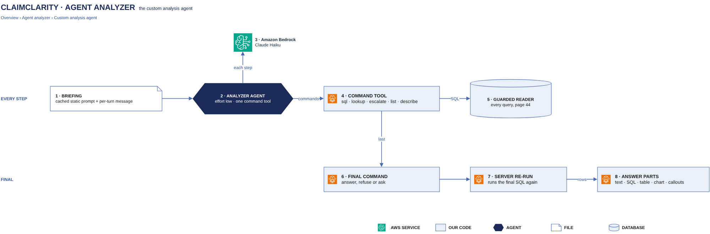

# Claim Query Agent

[Overview](00-overview.md) › [Analyzer](40-analyzer.md) › Claim Query Agent

The Claim Query Agent answers every question no preset fits: a Strands agent on Claude Haiku that writes its own
read-only SQL over the customer's gold tables through the cc CLI. The server re-runs its final query, so the numbers
in the answer come from the database, never from the model.

## In this diagram

| Item | What it does (one sentence) | Details |
|---|---|---|
| Chat app | Sends questions, follow-ups and clarify answers, and shows the answer. | [Chat turn](32-chat-turn.md) |
| KPI gate | Sends the question here when no preset fits. | [KPI gate](41-kpi-gate.md) |
| Each turn: solved example question bank | Adds the 3 most similar solved questions, today's date, the data coverage and the conversation history. | |
| Cached: Playbook, EDI business glossary, Gold schema | Fixed guidance and the generated description of the gold tables, cached by Bedrock. | [Model calls](45-model-calls.md) |
| Claude Haiku | The Strands agent on Amazon Bedrock; it decides to answer, ask or escalate. | [Model calls](45-model-calls.md) |
| Full lossless EDI schema | Shown to the agent only after a reasoned escalation. | [cc CLI + SQL guard](44-sql-guard-escalation.md) |
| cc CLI + SQL guard | The agent's one tool: every command and query goes through it. | [cc CLI + SQL guard](44-sql-guard-escalation.md) |
| cc commands | `sql`, `lookup`, `escalate`, `list` and `describe`, then one of `answer`, `refuse` or `ask`. | |
| DuckDB reader session | Runs the queries read-only. | [cc CLI + SQL guard](44-sql-guard-escalation.md) |

## How it works

1. The agent gets the question, the cached references and the turn's examples and context.
2. It sends cc CLI calls with SQL; results stream back. Each command shows in the chat as a live step.
3. If gold cannot answer, it escalates with a reason and can then read the lossless schema.
4. It finishes with exactly one of: an answer (final SQL and text), a refusal, or up to 4 clarifying questions.
5. For an answer, the server re-runs the final SQL and builds the parts: text, SQL, table (50-row preview, full CSV
   download), chart when it fits, assumptions and caveats.
6. A clarify reply comes back as a follow-up and the agent answers without asking again.

## Specification

| Item | Value |
|---|---|
| Model | Claude Haiku on Amazon Bedrock, through the Strands agent, one tool |
| Command budget | 12 commands besides the final one; failed commands do not count |
| Query limits | The SQL guard's: 25 s per query, 60 s per question, 1,000 rows, 20 rows shown to the model |
| Customer scope | From the verified token only. The agent has no command that takes a customer. |
| Refuses | Patient identifiers, other customers, any change to data |
| Prompt safety | Query results are data, never instructions |
| Clarifications | Kept 30 minutes for the user to answer |
| Stop | The user's Stop cancels the model call; no further command runs |
| Failure | No final command: a retryable error ("I couldn't answer that") |
| Logging | A step event per command; an audit record per query, escalation and refusal; token usage per run |

## Related

Up: [Analyzer](40-analyzer.md) · See also: [cc CLI + SQL guard](44-sql-guard-escalation.md) · [Model calls](45-model-calls.md)
