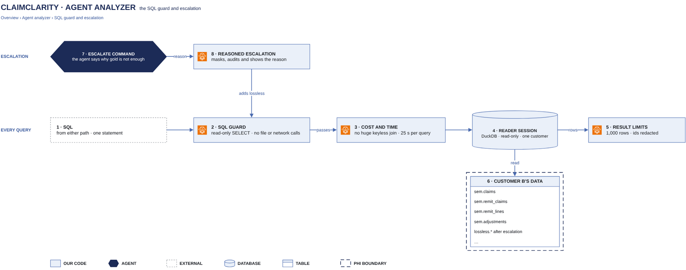

# SQL guard and escalation

[Overview](00-overview.md) › [Agent analyzer](40-analyzer.md) › SQL guard and escalation

Every query the analyzer runs, from either path, passes the same checks before it reaches data: one read-only
SELECT, no functions that touch files, the network or settings, no runaway joins and a fixed time budget. The
reader session behind it can only see one customer's data. The lossless tables are closed by default and open only
when the agent states why gold cannot answer; that reason is masked, audited and shown to the user.

## In this diagram

| # | Box | What it does | Details |
|---|---|---|---|
| 1 | SQL | A query from the standard KPI path or the custom analysis agent | [Agent analyzer](40-analyzer.md) |
| 2 | SQL guard | Parses the SQL and refuses anything but one read-only SELECT over the allowed schemas | below |
| 3 | Cost and time | Refuses keyless joins over 100 million row pairs; enforces 25 s per query and 60 s per question | below |
| 4 | Reader session | DuckDB, read-only, opened with the customer's temporary role credentials | [Token to credentials](22-token-to-credentials.md) |
| 5 | Result limits | Caps rows and redacts identifier columns before anything leaves the tool layer | below |
| 6 | Customer B's data | Gold (`sem.*`) always; lossless (`lossless.*`) only after escalation | [S3 layout](12-s3-layout.md) |
| 7 | Escalate command | The agent's `escalate "<reason>"` | [Custom analysis agent](43-custom-analysis-agent.md) |
| 8 | Reasoned escalation | Masks and audits the reason, re-opens the session with lossless mounted, and lets the guard allow `lossless.*` | below |

## How it works

1. A query (1) reaches the guard (2). It is parsed as DuckDB SQL and checked; anything that fails returns a clear
   error to the caller, and nothing runs.
2. The cost and time check (3) reads DuckDB's plan (`EXPLAIN`) and refuses a keyless join of large inputs before it
   runs. The query then runs under a watchdog that interrupts it at its time limit.
3. The reader session (4) runs the query against the customer's data (6). AWS checks the read itself (gate 6: IAM +
   KMS allow the reader).
4. The result limits (5) cap the rows and redact identifier columns. The caller gets the rows and a note of any
   redaction.
5. **Escalation.** When gold cannot answer (for example, which files the parser received, rejected or quarantined,
   or segment-level EDI detail), the agent sends `escalate` with a reason (7). The reasoned escalation (8) masks
   the reason, records it, re-opens the session for the same signed-in customer with the lossless tables mounted,
   and from then on the guard also allows `lossless.*` (2). The user sees a step "Reason: &lt;masked reason&gt;".

## Specification

**SQL guard** (checks, in order)

| Check | Rule |
|---|---|
| Size | At most 32,768 characters |
| Statements | Exactly one |
| Kind | `SELECT`, `UNION`, `INTERSECT` or `EXCEPT` only. No insert, update, delete, create, drop, alter, merge, copy, set, pragma, attach, detach, use, describe, show, install, load, export or transaction statements anywhere in the tree. |
| Recursion | No recursive CTEs |
| Relations | Only schema-qualified `sem.*` (and `lossless.*` after escalation) or the query's own CTEs. No catalog-qualified names, no table functions. |
| Functions | Banned: file and format readers (`read_*`, `parquet_*`, `glob`, `iceberg_scan`, `delta_scan` …), database scanners (`sqlite_*`, `postgres_*`, `mysql_*`), `http_*`, secrets and settings (`duckdb_secrets`, `current_setting`, `getenv` …), extension loading, `query`, `eval`, `shell`, `system` |
| Row cap | The query is wrapped as `SELECT * FROM (<query>) LIMIT 1000` (the limit can be set from 1 to 10,000) |

**Cost and time**

| Limit | Value | When it is hit |
|---|---|---|
| Keyless join | Refused when a join without an equality key (cross product, nested-loop, block-wise or piecewise merge join) pairs more than 100,000,000 rows and both sides have more than one row | Before execution, with a message that says what to change (join on a key, filter first, aggregate one side) |
| Per query | 25 s, or less if the question's budget is nearly used | The watchdog interrupts the query; the caller gets a timeout error |
| Per question | 60 s total query time, across every query of the turn | No more SQL runs; the agent is told to refuse and ask for a narrower question |

**Reader session**

- One DuckDB connection per run, in the run worker, opened with the customer's temporary role credentials.
- It holds exactly the mounted relations of that customer's current gold version. It cannot read other files or
  the network, and its configuration is locked.
- Queries run one at a time on it.

**Result limits**

| Limit | Value |
|---|---|
| Rows returned | 1,000 per query (the guard's cap) |
| Rows shown to the model | 20 |
| Rows in the answer preview | 50; the full result is a short-lived CSV download |
| Identifier columns | Redacted on the way out, by name: patient and member names and ids, subscriber ids, birth dates, addresses, SSNs, bank accounts, raw EDI text and file names |

**Escalation**

| Item | Value |
|---|---|
| Who can escalate | Only the custom analysis agent, with the `escalate` command. The standard KPI path never escalates. A request cannot ask for it: the chat API refuses requests that try to choose data scope. |
| Reason | Required. Put on one line, with quoted strings, dates, e-mail addresses, long or mixed ids and SSN- or phone-like values masked, cut to 300 characters. |
| What opens | The lossless (silver) tables of the same customer, which have patient identifiers removed. Patient identifiers stay unavailable. |
| Same customer only | The session is re-opened through the same opener, which holds the verified token. No customer id is accepted from the model. |
| Shown to the user | A step "Reason: &lt;masked reason&gt;", or "Failed: …" if the re-open is refused |
| Audit | `escalation_requested`, then `escalation_granted` (with the gold version) or `escalation_failed` |
| After escalation | `list` and `describe` work on `lossless.*`; the answer is marked as reading lossless |

**Failure behaviour.** A refused or failed query is returned to the agent as `ERROR: <message>` and does not use the
command budget. A failed escalation is shown as a failed step; the agent continues on gold.

**Logging and audit.** Every query produces an audit record: event, customer, user, gold version, escalated or not,
ok or failed, row count, seconds, the error if any and the first 500 characters of the SQL. These records are stored
with the customer's run data under the customer's prefix and key; server logs carry no SQL, question text or rows.
Escalations and refusals are recorded the same way. Error
messages shown to users are scrubbed (quoted literals and long digit runs masked, at most 500 characters). See
[Audit and logging](53-audit-logging.md).

## Related

Up: [Agent analyzer](40-analyzer.md) · See also: [Customer isolation](23-customer-isolation.md) ·
[Token to credentials](22-token-to-credentials.md) · [Encryption and keys](52-encryption-keys.md)
