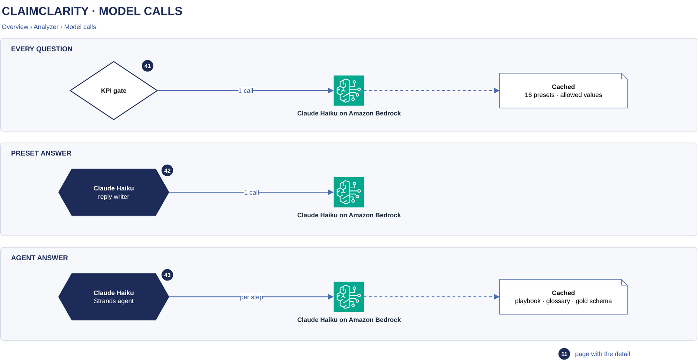

# Model calls

[Overview](00-overview.md) › [Analyzer](40-analyzer.md) › Model calls

Every model call in ClaimClarity goes from the run worker to Claude Haiku on Amazon Bedrock: one KPI gate call per
question, then one reply-writer call for a preset answer or one call per step for an agent answer. The parts of
the prompts that are the same for every question are cached by Bedrock.

## In this diagram

| Item | What it does (one sentence) | Details |
|---|---|---|
| KPI gate | One call per question. | [KPI gate](41-kpi-gate.md) |
| Claude Haiku on Amazon Bedrock | Runs every call, in all three strips. | [Service catalog](90-service-catalog.md) |
| Cached: 16 presets · allowed values | The gate's fixed prompt, cached per customer and gold version. | |
| Claude Haiku · reply writer | One call for a preset answer, no tools. | [Preset KPI queries](42-standard-kpi-path.md) |
| Claude Haiku · Strands agent | One call per agent step, until its final command. | [Claim Query Agent](43-custom-analysis-agent.md) |
| Cached: playbook · glossary · gold schema | The agent's fixed prompt and tool, cached per customer and gold version. | |

## How it works

1. Every question starts with the KPI gate call.
2. A preset answer adds one reply-writer call: two calls in all.
3. An agent answer adds one call per step. Each call returns one command; the run worker runs it and sends the
   result with the next call. The run ends at the final command, without another call.
4. Bedrock reads the cached part of each prompt from its prompt cache and processes only the new part.

## Specification

| Item | Value |
|---|---|
| Caller | The run worker's task role; it may invoke only Claude Haiku. The chat API and the parser cannot call Bedrock. |
| Calls per question | Preset answer: 2. Agent answer: 1 + one per step, at most 30 steps. |
| Output | At most 4,096 tokens per call |
| Prompt cache | Kept by Bedrock for 5 minutes after last use |
| Data sent | The question, the conversation history and query results (up to 20 rows per query, identifiers redacted). Treated as PHI. |
| Data kept by Bedrock | None; model invocation logging is off |
| Failure | A failed gate or reply call sends the question to the Claim Query Agent. A failed agent call gives a retryable error. Stop cancels the call. |
| Logging | Per run and model: input, output, cache-read and cache-write tokens, model time, calls. CloudTrail records the API calls without prompt content. |

## Related

Up: [Analyzer](40-analyzer.md) · See also: [Amazon Bedrock card](90-service-catalog.md) · [Monitoring](62-monitoring.md)
