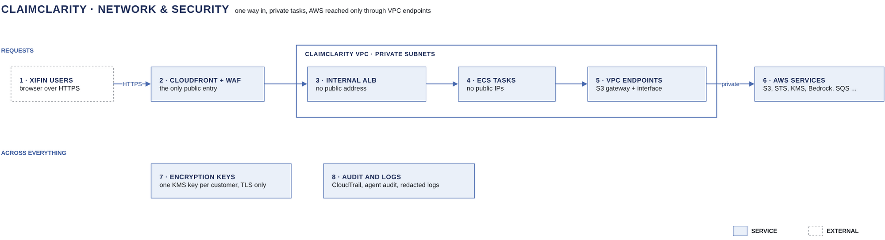

# Network & security

[Overview](00-overview.md) › Network & security

ClaimClarity has one public entry point, CloudFront with AWS WAF, and every ECS task runs in private subnets that
reach AWS only through VPC endpoints. Every object is encrypted with the customer's keys, and every AWS call and
every analyzer SQL call is recorded.

## In this diagram

| Item | What it does | Details |
|---|---|---|
| XiFin user | Reaches ClaimClarity over HTTPS only. | |
| CloudFront + WAF | The only public entry. Serves the web app and sends `/api/*` to the load balancer. | [Network](51-network.md) |
| Load balancer | Internal ALB in the private subnets. Accepts CloudFront traffic only. | [Network](51-network.md) |
| ECS tasks | Chat API, run workers and parser on Fargate, with no public IPs. | [Network](51-network.md) |
| VPC endpoints | Private access to S3 and the other AWS services. | [Network](51-network.md) |
| S3 | The ClaimClarity bucket with all customer data. TLS only, SSE-KMS on every object. | [Encryption keys](52-encryption-keys.md) |
| KMS | The customer's keys (lake, transcripts) and the platform query-audit key. | [Encryption keys](52-encryption-keys.md) |
| Bedrock | Claude Haiku on Amazon Bedrock, reached through its endpoint. | [Model calls](45-model-calls.md) |
| CloudTrail | Records every AWS call, allowed or denied. | [Audit logging](53-audit-logging.md) |

## How it works

1. The browser connects to CloudFront over HTTPS. WAF rules and rate limits run first.
2. CloudFront sends `/api/*` to the internal load balancer through a VPC origin.
3. The load balancer forwards to the chat API. Run workers and the parser accept no inbound traffic.
4. Tasks call S3, STS, KMS, Bedrock and the other services through VPC endpoints. The only internet path is the chat
   API's filtered egress to Amazon Cognito.
5. S3 encrypts every object with the writer's customer key. The bucket refuses requests without TLS.
6. CloudTrail, the agent audit and PHI-redacted application logs record what happened.

## Specification

| Control | Design |
|---|---|
| Public entry | CloudFront + WAF only. No public load balancer, no public IPs on tasks |
| Placement | All ECS tasks on Fargate in private subnets in two Availability Zones |
| AWS access | S3 gateway endpoint; interface endpoints for STS, KMS, Bedrock runtime, ECR api and dkr, CloudWatch Logs, SQS, Secrets Manager |
| Internet egress | Chat API only, through NAT + Network Firewall, to the Cognito hosts only |
| Buckets | One bucket holds all customer data. The web app and the access logs have their own buckets |
| In transit | TLS 1.2 or later on every hop. The bucket denies non-TLS requests |
| At rest | SSE-KMS on every object with the customer's keys; KMS on logs, queues and secrets |
| Audit | CloudTrail management and S3 data events; one agent-audit record per SQL call; redacted application logs |
| Retention | Raw 7 years · query audit 6 years · CloudTrail 6 years · network and app logs 1 year · transcripts 90 days |

## Pages in this area

- [Network](51-network.md): subnets, security groups, VPC endpoints and the single egress
- [Encryption keys](52-encryption-keys.md): the customer's keys, key policies and who may decrypt what
- [Audit logging](53-audit-logging.md): CloudTrail, the agent audit, redacted logs and retention

## Related

Up: [Overview](00-overview.md) · See also: [Identity & access](20-identity.md) · [Edge](31-edge.md) ·
[IAM and KMS matrix](91-iam-kms-matrix.md)
