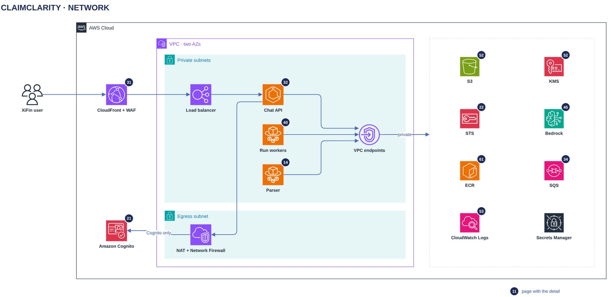

# Network

[Overview](00-overview.md) › [Network & security](50-network-security.md) › Network

The ClaimClarity VPC has no internet-facing resources: users enter through CloudFront and WAF, and tasks reach AWS
through VPC endpoints. One filtered egress path lets the chat API reach Amazon Cognito and nothing else.

## In this diagram

| Item | What it does | Details |
|---|---|---|
| XiFin user | Connects over HTTPS only. | |
| CloudFront + WAF | Public entry. Sends `/api/*` to the load balancer through a VPC origin. | [Edge](31-edge.md) |
| Load balancer | Internal ALB. Its security group admits CloudFront's origin-facing addresses only. | |
| Chat API | Receives API calls from the load balancer. | [Chat turn](32-chat-turn.md) |
| Run workers | Pull runs from SQS. No inbound traffic. | [Analyzer](40-analyzer.md) |
| Parser | Started by EventBridge. No inbound traffic. | [Parser task](14-parser-task.md) |
| VPC endpoints | S3 gateway endpoint and eight interface endpoints, private DNS on. | |
| NAT + Network Firewall | The only egress. Allows HTTPS to the Cognito hosts only. | |
| Amazon Cognito | Signing keys and the sign-in token endpoint. | [Sign-in](21-sign-in.md) |
| S3, KMS, STS, Bedrock, ECR, SQS, CloudWatch Logs, Secrets Manager | AWS services reached through the endpoints. | [Encryption keys](52-encryption-keys.md) |

## How it works

1. CloudFront forwards `/api/*` to the internal load balancer through a CloudFront VPC origin.
2. The load balancer forwards HTTPS to the chat API.
3. All three task tiers call AWS through the VPC endpoints. S3 traffic, including ECR image layers, uses the
   gateway endpoint.
4. The chat API fetches the Cognito signing keys through NAT + Network Firewall at start, caches them for 24 hours,
   and refetches only for an unknown key id (at most every 5 minutes). The sign-in callback reaches the Cognito
   token endpoint the same way.
5. STS verifies tokens on the AWS side and needs no egress from the VPC.

## Specification

### Subnets

| Subnet | Holds | Routes |
|---|---|---|
| Private (one per AZ, two AZs) | Load balancer, chat API, run workers, parser, interface endpoints | Default route to the NAT; S3 prefix list to the gateway endpoint |
| Egress (one per AZ) | NAT gateway, Network Firewall endpoint | Internet gateway |

No task subnet routes to the internet gateway. Every ECS service and task definition sets `assignPublicIp = DISABLED`.

### Security groups

| Group | Inbound | Outbound |
|---|---|---|
| Load balancer | 443 from the CloudFront origin-facing prefix list | App port to the chat API group |
| Chat API | App port from the load balancer group | 443 to the endpoint group and the S3 prefix list; 443 to the internet, filtered to the Cognito hosts |
| Run workers | none | 443 to the endpoint group and the S3 prefix list |
| Parser | none | 443 to the endpoint group and the S3 prefix list |
| Endpoints | 443 from the chat API, run worker and parser groups | none |

### VPC endpoints

| Endpoint | Type | Endpoint policy |
|---|---|---|
| S3 | Gateway | The ClaimClarity bucket and the ECR layer bucket |
| STS | Interface | AssumeRoleWithWebIdentity and AssumeRole for ClaimClarity roles |
| KMS | Interface | ClaimClarity keys |
| Bedrock runtime | Interface | InvokeModel on Claude Haiku only |
| ECR api, ECR dkr | Interface | ClaimClarity repositories |
| CloudWatch Logs | Interface | ClaimClarity log groups |
| SQS | Interface | The run queue |
| Secrets Manager | Interface | ClaimClarity secrets |

### Egress filter

| Allowed host | Used for |
|---|---|
| The Cognito user pool's issuer host | Signing keys (`/.well-known/jwks.json`) |
| The Cognito sign-in domain | Token endpoint at sign-in |

Everything else is dropped and logged. If egress fails, signed-in users keep working on the cached keys and new
sign-ins fail until it is back.

### Logging

VPC flow logs, Network Firewall logs, load balancer access logs and WAF logs are kept 1 year, encrypted with KMS.

## Related

Up: [Network & security](50-network-security.md) · See also: [Edge](31-edge.md) ·
[Encryption keys](52-encryption-keys.md) · [VPC card](90-service-catalog.md)
