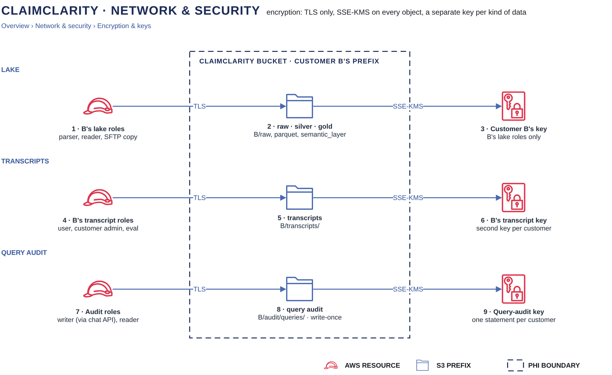

# Encryption keys

[Overview](00-overview.md) › [Network & security](50-network-security.md) › Encryption keys

Every object in the ClaimClarity bucket is encrypted with SSE-KMS under a key chosen by whose data it is and what kind
it is: each customer has a lake key and a transcript key, and the query audit has one platform key with one
statement per customer. Key policies are authoritative, so not even an IAM administrator can decrypt a customer's
objects or rewrite the policies that protect them.

## In this diagram

| Item | What it does | Details |
|---|---|---|
| Customer B's lake roles | Parser, reader and SFTP copy roles, tagged with Customer B and B's lake key. | [IAM and KMS matrix](91-iam-kms-matrix.md) |
| S3 · B's raw, silver, gold | `B/raw/`, `B/parquet/`, `B/semantic_layer/`, plus staging and quarantine. | [S3 layout](12-s3-layout.md) |
| Customer B's lake key | Decrypts only for B's lake roles, only through S3, only under `B/`. | |
| Customer B's transcript roles | Transcript user, customer admin and eval roles. | [State](33-state.md) |
| S3 · B's transcripts | `B/transcripts/`: chats, metadata and de-identified exports. | [State](33-state.md) |
| Customer B's transcript key | A second key for B, for transcripts only. Lake roles cannot use it. | |
| Customer B's audit roles | Audit writer (assumed by the run worker) and audit reader (customer admins). | [Audit logging](53-audit-logging.md) |
| S3 · B's query audit | `B/audit/queries/`: write-once records, kept 6 years. | [Audit logging](53-audit-logging.md) |
| Query-audit key | One platform key with one statement per customer. | |

## How it works

1. Every request to the bucket must use TLS: the bucket policy denies `aws:SecureTransport = false`.
2. Every writing role carries a `kms_key_arn` tag. The bucket policy denies a PUT whose SSE-KMS key is not that
   key, or that names no key. The bucket default key is never used for customer objects.
3. S3 Bucket Keys are off, so each object's encryption context is its own ARN, which the key policy checks on every
   read and write.
4. Transcript message bodies are also encrypted by the chat API with a per-user data key from the transcript key,
   before they reach S3.
5. Disabling a customer's keys makes all of that customer's objects unreadable at once. Disabling only the
   transcript key removes the chats and leaves the lake and the query audit.

## Specification

### Keys

| Key | Scope | Encrypts | Rotation |
|---|---|---|---|
| Lake key | Per customer | Raw, silver, gold, staging, quarantine | Automatic yearly; on demand by key admins |
| Transcript key | Per customer | `transcripts/` objects and per-user data keys | Automatic yearly |
| Query-audit key | Platform, one statement per customer | `<customer>/audit/queries/` | Automatic yearly |
| Platform default key | Platform | Bucket default only, never valid for customer objects | Automatic yearly |
| Logs key | Platform | CloudWatch log groups and the log bucket (access logs) | Automatic yearly |
| Trail key | Platform | CloudTrail log files | Automatic yearly |
| Queue and secrets keys | Platform | The run queue and its dead-letter queue; Secrets Manager secrets | Automatic yearly |

### Who may use each key

| Role | Key | Operations | Condition |
|---|---|---|---|
| Parser, reader, SFTP copy | Their customer's lake key | Decrypt, GenerateDataKey | Through S3, objects under `<customer>/` |
| Transfer Family role | Their customer's lake key | GenerateDataKey | Through S3, `landing/` only |
| Transcript user | Their customer's transcript key | Decrypt, GenerateDataKey | Own folder through S3; own data key only |
| Customer admin | Their customer's transcript key | Decrypt, GenerateDataKey | All users' folders, exports and admin objects; any user data key of the customer |
| Eval | Their customer's transcript key | Decrypt | Through S3, `transcripts/exports/` only |
| Support break-glass | The ticket's customer transcript key | Decrypt | Users' folders and data keys, read only |
| Audit writer | Query-audit key | Decrypt, GenerateDataKey | Through S3, own customer's `audit/queries/` |
| Audit reader | Query-audit key | Decrypt | Through S3, own customer's `audit/queries/` |
| Deploy role (Terraform) | All | Key policy and lifecycle | No data use |
| Key admin | All | Enable, disable, rotate, schedule deletion | No decrypt, no grants, no policy changes |

Key policies do not delegate to the account, so IAM policies cannot widen them. Per role: [IAM and KMS
matrix](91-iam-kms-matrix.md).

### Failure behaviour

| Case | Result |
|---|---|
| Key disabled | Every read and write under it fails until it is re-enabled |
| Key scheduled for deletion | Unusable during the 7–30 day waiting period, which can be cancelled; afterwards the data is gone |
| Wrong key on a PUT | Denied by the bucket policy |
| Wrong encryption context | KMS refuses |

### Logging

Every Decrypt and GenerateDataKey is a CloudTrail event with the role and the object ARN. Key policy changes,
disables and deletion schedules raise alarms.

## Related

Up: [Network & security](50-network-security.md) · See also: [Customer isolation](23-customer-isolation.md) ·
[S3 layout](12-s3-layout.md) · [IAM and KMS matrix](91-iam-kms-matrix.md)
