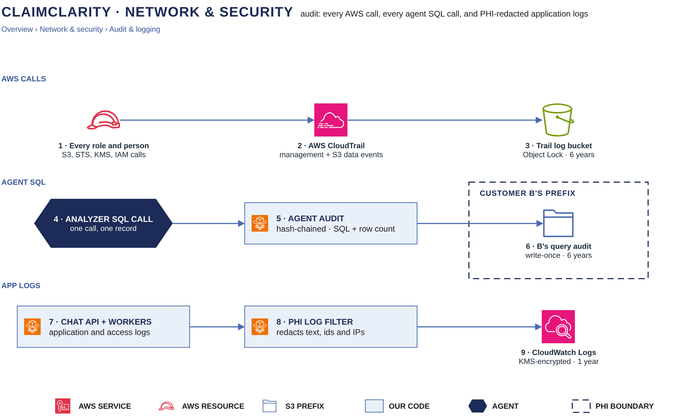

# Audit & logging

[Overview](00-overview.md) › [Network & security](50-network-security.md) › Audit & logging

ClaimClarity keeps three records, each for a different question. CloudTrail answers "which AWS identity touched which
object or key, and was it allowed?". The agent audit answers "which SQL did the analyzer run for which user, and how
many rows came back?". The application logs answer "what did the service do?", and they are redacted so that they
carry no PHI.

## In this diagram

| # | Box | What it does | Details |
|---|---|---|---|
| 1 | Every role and person | Every AWS call by any task role, the deploy pipeline, IT's SFTP copy or a person, allowed or denied | |
| 2 | AWS CloudTrail | Records management events and S3 data events for the ClaimClarity bucket, including KMS Decrypt | [CloudTrail card](90-service-catalog.md) |
| 3 | Trail log bucket | A separate bucket with Object Lock, its own KMS key and log file validation. Kept 6 years | |
| 4 | Analyzer SQL call | Each SQL statement the analyzer runs, on the standard KPI path or the custom analysis path | [SQL guard & escalation](44-sql-guard-escalation.md) |
| 5 | Agent audit | One hash-chained record per SQL call: SQL, outcome and row count, never result cells | |
| 6 | B's query audit | `B/audit/queries/<date>/<request id>.json`. Write-once, Object Lock COMPLIANCE, 6 years | [Encryption & keys](52-encryption-keys.md) |
| 7 | Chat API + workers | Application logs and HTTP access logs | |
| 8 | PHI log filter | Redacts every log record before it is written | |
| 9 | CloudWatch Logs | KMS-encrypted log groups, kept 1 year | [Monitoring](62-monitoring.md) |

## How it works

### AWS calls (1–3)

1. CloudTrail (2) records every management event in the account: IAM, STS, KMS (including every Decrypt and
   GenerateDataKey), ECS, EventBridge, Cognito.
2. Data events are on for the ClaimClarity bucket, for both reads and writes: every GetObject, PutObject,
   DeleteObject and list call, with the role, the session name and the object key.
3. Denied calls are recorded too, with `errorCode = AccessDenied`. A cross-customer attempt therefore always leaves
   a record.
4. CloudTrail delivers to the trail log bucket (3), with log file validation on. That bucket is in its own account
   or behind its own bucket policy. It has Object Lock (COMPLIANCE, 6 years) and its own KMS key, and only the
   security team's audit role may read it.
5. CloudTrail also streams to a CloudWatch Logs group that carries the security alarms below.

### Agent SQL (4–6)

1. Every SQL statement the analyzer runs (4) goes through one entry point. That entry point checks the credentials,
   runs the guard, executes the statement and writes one audit record (5), whatever the outcome.
2. Opening a reader session also writes a record: customer, user, gold version, the escalation flag and a short
   hash of the id token (never the token).
3. Each record is sealed into a hash chain. It carries a sequence number, the previous record's hash and its own
   SHA-256 hash over the record and the previous hash. Editing, reordering or inserting a record, even a blank line,
   breaks verification.
4. At the end of a request, the chat API assumes Customer B's audit writer role and writes the request's records as
   one object (6). The bucket policy requires `If-None-Match` (no overwrite), Object Lock COMPLIANCE and at least
   6 years of retention, and denies deletes. The writer role can only put objects: it cannot read, list or delete.
   So a writer cannot shorten a chain once it is stored.
5. Customer administrators read their own customer's query audit through the audit reader role.

### Application logs (7–9)

1. The chat API and run workers (7) log through one filter (8), which runs on every logger and handler:
   - quoted strings, emails, SSNs, phone numbers, dates, long numbers and id-like strings are masked;
   - tracebacks keep the file, line and function, and drop the exception message;
   - access logs record the route shape (`/api/conversations/:id`), never the real path or query string;
   - client IPs are cut to /24 (IPv4) or /48 (IPv6);
   - outbound request logs keep the host and route shape only.
2. The primary rule comes before the filter: code never logs user text, SQL, row values or tokens. The filter is the
   last line of defence.
3. Logs go to CloudWatch Logs (9) through the Logs VPC endpoint. Log groups are encrypted with KMS and kept 1 year.

## Specification

### Agent audit record

| Field | Content |
|---|---|
| `kind` | `session_open`, `agent_query`, or an escalation grant |
| `outcome` | `ok`, `blocked` (guard refused), `error` (execution failed) or `expired` (credentials too old) |
| `customer`, `user` | From the verified token (customer, and the user's email or `sub`) |
| `request_id` | The run's request id. It also appears in the STS session name, so CloudTrail and the audit join on it |
| `version` | The gold version the session read |
| `escalate` | Whether `lossless.*` was mounted. Escalation grants carry the stated reason, masked, at most 300 characters |
| `sql`, `sql_sha256` | The SQL text (first 4,000 characters) and its SHA-256 |
| `row_count`, `column_count` | Size of the result. Result cells are never stored |
| `error` | Error type and first line, at most 300 characters |
| `seq`, `prev_hash`, `hash`, `eventTime` | The hash chain |

The SQL text can contain literal values that the user typed, so the query audit is treated as PHI. It lives under
the customer's prefix, inside the PHI boundary.

### CloudTrail

| Setting | Value |
|---|---|
| Events | Management events (read and write); S3 data events for the ClaimClarity bucket (read and write) |
| Integrity | Log file validation (signed digest files) |
| Storage | Trail log bucket: Object Lock COMPLIANCE, own KMS key, access for the audit role only |
| Streaming | CloudWatch Logs group for alarms |

### Security alarms (CloudWatch metric filters on the trail)

| Alarm | Fires on |
|---|---|
| Cross-customer denial | `AccessDenied` on S3 or KMS for any reader, parser or transcript role |
| Trust refusal | Denied AssumeRoleWithWebIdentity, above a small threshold |
| Key change | PutKeyPolicy, DisableKey, ScheduleKeyDeletion on any ClaimClarity key |
| Bucket change | PutBucketPolicy, lifecycle, versioning, Object Lock or encryption changes |
| Break-glass | Any AssumeRole of the support break-glass role |
| Root use | Any sign-in or call by the root user |

### Retention

| Record | Retention | Enforced by |
|---|---|---|
| Raw EDI files | 7 years | Object Lock COMPLIANCE; deletes denied |
| Query audit | 6 years | Object Lock COMPLIANCE; deletes denied |
| CloudTrail logs | 6 years | Object Lock COMPLIANCE on the trail log bucket |
| Application, access, ALB, WAF, VPC flow and firewall logs | 1 year | CloudWatch Logs retention setting |
| Chat transcripts | 90 days | S3 lifecycle on `transcripts/`. Users can delete sooner |
| Entra sign-in logs | Per the company's Entra settings | Entra ID |

### Failure behaviour

| Case | Result |
|---|---|
| Agent audit write fails | The SQL result is not returned. The run fails rather than run unaudited SQL |
| Query-audit object already exists | The write is refused (`If-None-Match`). Records are never replaced |
| CloudTrail delivery delayed | AWS buffers and retries. No data is lost |
| Log filter error on a record | The record keeps its template only. No argument text is written |

### Verification

The security team checks CloudTrail digests with the CloudTrail validation tool, and recomputes the query audit's
hash chains with the verification job (sequence, previous hash and hash per record). Both checks run monthly and on
demand during an investigation.

## Related

Up: [Network & security](50-network-security.md) · See also: [Encryption & keys](52-encryption-keys.md) ·
[Monitoring](62-monitoring.md) · [SQL guard & escalation](44-sql-guard-escalation.md) · [CloudTrail card](90-service-catalog.md)
