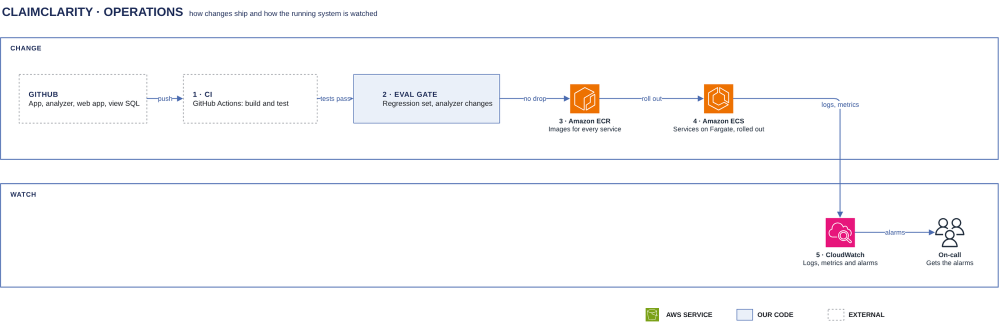

# Operations

[Overview](00-overview.md) › Operations

Operations covers how a change reaches production and how the running system is watched. Every change goes
through a pull request and CI. Every image is built once and stored in ECR. An analyzer change must also pass
the regression set before it ships. In production, CloudWatch collects logs and metrics from every service
and pages on-call when an alarm fires. No log carries PHI.

## In this diagram

| # | Box | What it does | Details |
|---|---|---|---|
| – | GitHub | One repository: chat API, run worker, analyzer, parser, web app and view SQL | [Deploy](61-deploy.md) |
| 1 | CI | GitHub Actions: lint, type checks, unit and contract tests, builds | [Deploy](61-deploy.md) |
| 2 | Eval gate | Runs the regression set on every analyzer change and blocks it if accuracy drops | [Eval regression](63-eval-regression.md) |
| 3 | Amazon ECR | Holds the chat API, run worker and parser images | [ECR card](../cards/ecr.md) |
| 4 | Amazon ECS | Runs the chat API and run worker services and the parser task on Fargate | [ECS card](../cards/ecs-fargate.md) |
| 5 | CloudWatch | Logs, metrics and alarms | [Monitoring](62-monitoring.md) |
| – | On-call | Receives alarm notifications | [Monitoring](62-monitoring.md) |

## How it works

1. A developer opens a pull request. CI runs every check (see [Deploy](61-deploy.md)).
2. If the change touches the analyzer, CI also runs the regression set. The change ships only if accuracy
   does not drop.
3. CI builds the images once, tags them with the commit, and pushes them to ECR. It builds the web app and
   publishes it to the web app bucket.
4. The deploy step rolls the ECS services to the new task definitions. New tasks must pass their health checks
   before old ones stop.
5. Every task writes structured, redacted logs to CloudWatch Logs. Metric filters and embedded metrics turn
   them into CloudWatch metrics. Alarms on those metrics notify on-call.

## Specification

| Item | Value |
|---|---|
| Deploy identity | CI assumes the deploy role through GitHub's OIDC provider. There are no long-lived AWS keys. |
| Environments | One production environment per account. Real PHI only in production. |
| Images | One image per service, immutable tags (commit SHA), scanned on push |
| Logs | No row data, question text or SQL in any service log. The audit log holds ids, counts and timings only. |
| Paid model calls | Only the production run workers and the eval gate call Claude Haiku on Amazon Bedrock |

## Pages in this area

- [Deploy](61-deploy.md): images, ECS rolling deploys, the web app and view SQL
- [Monitoring](62-monitoring.md): logs, metrics, alarms and their thresholds
- [Eval regression](63-eval-regression.md): the regression set and the ship rule

## Related

Up: [Overview](00-overview.md) · See also: [Chat backend](30-chat-backend.md),
[Agent analyzer](40-analyzer.md), [Audit & logging](53-audit-logging.md)
