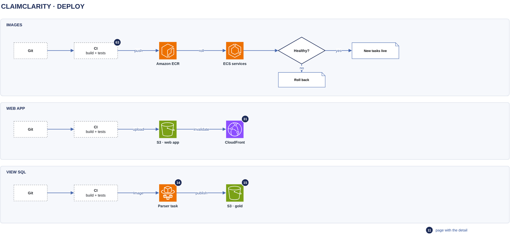

# Deploy

[Overview](00-overview.md) › [Operations](60-operations.md) › Deploy

Three things ship from one repository: container images, the web app and the gold view SQL. Each goes through
CI from a reviewed pull request and is deployed by a pipeline role, not by a person.

## In this diagram

| Item | What it does | Details |
|---|---|---|
| Git | The protected main branch | |
| CI | Lint, type checks, unit, contract and security tests, and the eval gate for analyzer changes | [Eval regression](63-eval-regression.md) |
| Amazon ECR | One repository per image: chat API, run worker, parser | [Service catalog](90-service-catalog.md) |
| ECS services | Rolling deploy of the chat API and run workers | [Service catalog](90-service-catalog.md) |
| Healthy? | New tasks must pass their health checks | |
| New tasks live / Roll back | Old tasks stop, or the circuit breaker rolls back | |
| S3 · web app | The web app bucket. New assets go in first, then the HTML template. | [Edge](31-edge.md) |
| CloudFront | Invalidates the HTML paths only | [Edge](31-edge.md) |
| Parser task | Its image carries the view SQL | [Parser task](14-parser-task.md) |
| S3 · gold | The next parser run publishes the views with a new version | [Gold publish](15-gold-publish.md) |

## How it works

1. CI runs every check. A critical image scan finding, or a failed eval gate, stops the pipeline.
2. CI pushes images tagged with the commit SHA. Task definitions pin the digest.
3. The chat API rolls at 100–200 % with the `GET /api/health` check. Old tasks drain open streams for up to 120 s,
   and clients reconnect and replay.
4. Run workers stop taking new runs and finish the current one. The 110 s run deadline fits the 120 s stop timeout.
5. The web app's new hashed assets are uploaded without overwriting old ones, then the HTML template, then a
   CloudFront invalidation. The SRI, header and CSP checks then run against the live site.
6. A view SQL change ships in the parser image. CI checks every gold answer against its answer key first.

## Specification

| Item | Value |
|---|---|
| Deploy role can | Push to the three ECR repositories, register task definitions, update the ECS services, pass only the task and execution roles, write the web app bucket, invalidate CloudFront |
| Deploy role cannot | Read the ClaimClarity bucket, use the customer's keys, or change bucket and key policies (the infrastructure pipeline does that) |
| Images | Immutable tags. Scanned on push. The last 50 are kept for rollback. |
| Rollback | ECS circuit breaker, or redeploy the previous revision. Web app: restore the previous HTML template. |
| Production settings | Cookie sign-in; SQL literal masking `phi` or `all`; Bedrock model calls switched on in production only |

## Related

Up: [Operations](60-operations.md) · See also: [Monitoring](62-monitoring.md)
