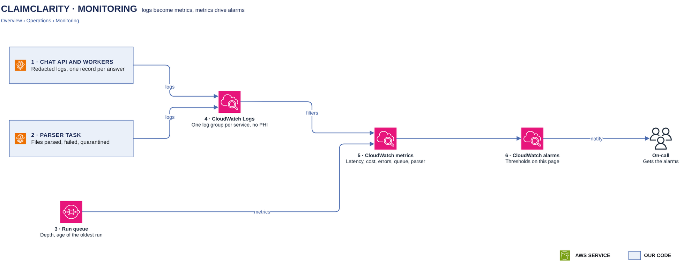

# Monitoring

[Overview](00-overview.md) › [Operations](60-operations.md) › Monitoring

Every task logs to CloudWatch, and the logs never hold question text, SQL or row values. Metrics from the logs and
from AWS services drive alarms that notify on-call.

## In this diagram

| Item | What it does | Details |
|---|---|---|
| ECS tasks | Chat API, run workers and parser. They write redacted logs, plus one metric record per answer and per batch. | |
| CloudWatch Logs | One encrypted log group per service | [Service catalog](90-service-catalog.md) |
| CloudWatch metrics | Metrics from metric filters, embedded metric records and AWS services | |
| Run queue · Load balancer · Amazon Bedrock | Publish their own metrics | |
| CloudWatch alarms | Compare the metrics with the thresholds below | |
| Over threshold? | Fires the alarm | |
| Notify on-call | An SNS topic for e-mail and chat | |

## How it works

1. A redaction filter masks identifiers in log text. Exceptions are logged as type and line only.
2. Access logs record route shapes (`/api/conversations/:id`) and client addresses cut to /24 or /48.
3. Each answer writes one record with ids, counts and timings: outcome, tokens, estimated cost, time to first
   token, model time, SQL time.
4. Metric filters count rate-limit refusals, chunk write failures, write conflicts and data escalations.
5. Alarms notify on-call through SNS.

## Specification

| Alarm | Starting threshold | Action |
|---|---|---|
| API 5xx | Above 1 % of requests for 5 minutes | Page |
| Healthy chat API tasks | Below 2 for 2 minutes | Page |
| Answer errors | Above 5 % of answers for 15 minutes | Page |
| Time to first token | p95 above 15 s for 15 minutes | Notify |
| Bedrock | p95 latency above 10 s, or any throttles | Notify |
| Daily tokens | A customer above 80 % of its budget | Notify |
| Run queue | Oldest message older than 30 s for 5 minutes | Page |
| Dead-letter queue | Any message | Notify |
| Parser | Any failed batch | Page |
| Quarantine | Any file quarantined | Notify the data team |

| Item | Value |
|---|---|
| Log groups | `/claimclarity/chat-api`, `/claimclarity/run-worker`, `/claimclarity/parser`: 1 year, KMS-encrypted with the logs key |
| Permissions | Each task writes only its own log group, and metrics only in the `ClaimClarity` namespace. The operations team reads them without any customer access. |
| Never logged | Question and answer text, SQL, row values, titles, feedback comments, tokens, cookies |

## Related

Up: [Operations](60-operations.md) · See also: [Limits](34-limits.md), [Audit & logging](53-audit-logging.md)
