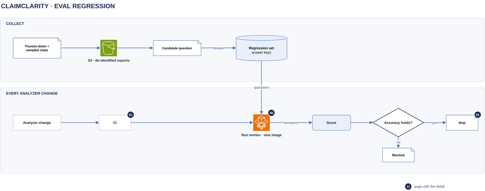

# Eval regression

[Overview](00-overview.md) › [Operations](60-operations.md) › Eval regression

Real questions, and especially the thumbs-down ones, become test questions with independent answer keys. Every
analyzer change is re-run on this set, and it ships only if accuracy does not drop.

## In this diagram

| Item | What it does | Details |
|---|---|---|
| Thumbs-down + sampled chats | Answers users marked wrong, plus a small sample of the rest | |
| S3 · de-identified exports | Under the customer's `transcripts/exports/` prefix, with patient-level values removed | [State](33-state.md) |
| Candidate question | Written by a reviewer, with gold SQL | |
| Regression set | Questions, answer keys and reworded variants, in train, validation and sealed test splits | |
| Analyzer change | A pull request to the analyzer | |
| CI | Starts the eval run | [Deploy](61-deploy.md) |
| Run worker · new image | The changed analyzer answers every question on the synthetic test data set | [Analyzer](40-analyzer.md) |
| Score | Each answer is matched against its answer key | |
| Accuracy holds? | Compares the new version with the current one, question by question | |
| Ship / Blocked | Merge and deploy, or block | [Deploy](61-deploy.md) |

## How it works

1. Thumbs-down answers and a small sample of other answers are exported with patient-level values removed. The eval
   role can read only these exports.
2. A reviewer turns an export into a question with gold SQL. Its answer key is computed a second, independent way,
   and the two must agree.
3. Rewordings of a question share one answer key and always sit in the same split.
4. A change to the analyzer starts the run worker image from that change on the validation split, with at least
   two repeats.
5. The scorer matches columns by value and rows within tolerance. Safety questions pass only if the analyzer refuses.
6. The change ships only if accuracy and answered-and-wrong are no worse, every safety question is still refused,
   and the rewordings of each question still agree.

## Specification

| Item | Value |
|---|---|
| Data | The synthetic test data set only. The eval run never reads customer data. |
| Model | Claude Haiku on Amazon Bedrock, the same as production |
| Reported | Accuracy, right-in-both-repeats, answered-and-wrong, cost per correct answer |
| Comparison | Paired by question, with a 95 % bootstrap interval |
| Permissions | The eval role reads only `transcripts/exports/`. CI's eval role may call Bedrock and nothing else. |
| PHI | None in the regression set or in the CI results |
| Blocking | A failed gate blocks the merge. An override needs a written reason in the pull request. |

## Related

Up: [Operations](60-operations.md) · See also: [Analyzer](40-analyzer.md), [Deploy](61-deploy.md)
